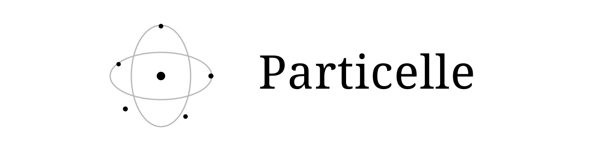
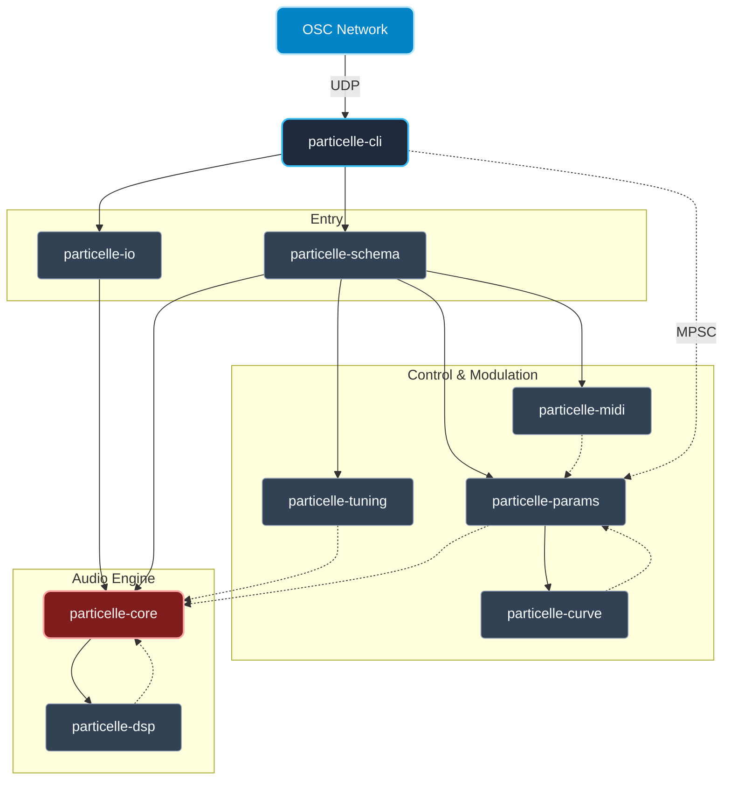
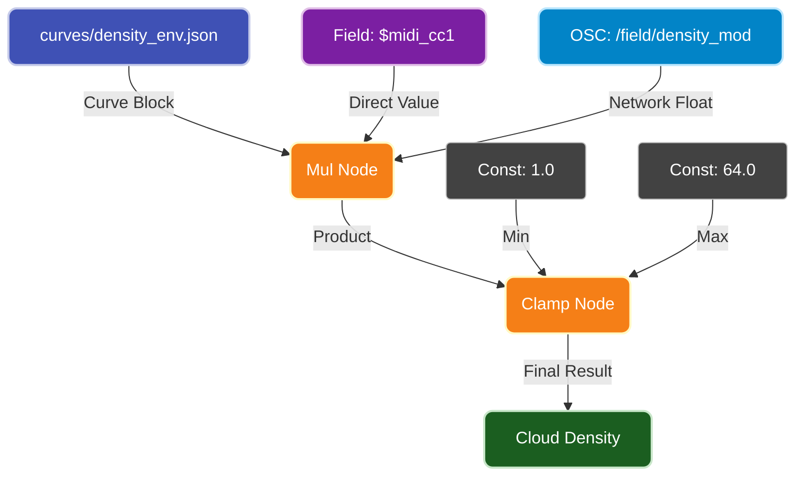

# Particelle User Guide



Granular sound design, spatial composition, and expressive control

Expanded book edition for the 0.3.1 CLI release. Prepared October 17, 2026. Obelisk M0 host archives and the browser study remain previews, not qualified VST3/AU or physical-controller releases.

## Preface

A recorded sound contains more than its original performance. A single note contains an attack, a changing spectrum, a steady region, and a decay. A field recording contains events at many different scales. Granular synthesis makes those regions available as material: extract short pieces, shape their edges, repeat them, overlap them, and distribute them in space.

Particelle describes that process in a text file. A patch is a recipe that can be read, revised, archived, and rendered again. This book teaches a working method for that instrument, from the first audible file to layered drones, automated studies, multichannel delivery, and MIDI or network control.

The book follows the teaching approach of the VerbX user guide: practical chapters first, illustrated explanations alongside the work, listening exercises, and a reference section for returning users. Read Chapters 1 through 4 in sequence. After that, choose a route: Chapter 5 for drones, Chapters 6 and 7 for automation, Chapters 8 and 9 for spatial work and tuning, or Chapters 10 and 11 for performance and Obelisk M0.

Chapters 19-22 form a deeper field reference; Chapter 23 is a complete source-tree patch atlas. Use the first eighteen chapters to learn, then use the later material to compare full designs and find exact examples. The cover displays the repository logo from `assets/logo.svg`, which is also used on GitHub.

This edition was checked against the repository source, rather than treating every historical example or CLI help sentence as a guarantee. Particelle is alpha software. The capability table in Chapter 1 and the notes beside affected workflows distinguish implemented behavior from host and hardware qualification.

All listening tasks assume modest monitoring levels. Begin with short previews, examine the rendered level, and only then commit to a long render. A dense cloud can sum to a much larger level than its individual grains suggest.

## How to use this book

Commands in `sh` blocks belong in a terminal. YAML and JSON blocks belong in files. Never paste a bare YAML patch into zsh or bash. The shell interprets braces, colons, and quotes as shell syntax; it does not become a patch editor because a block looks like configuration.

Full teaching patches and their curve are supplied in `examples/userguide/`. Work from the repository root so their relative paths resolve. The PDF and this Markdown source contain the same teaching text; the build script copies the named example blocks into the accompanying files.

Commands use `particelle` after installation. When working from source without installing, replace it with `./target/debug/particelle` after `cargo build -p particelle-cli`. Output examples use a directory named `renders`; create it first with `mkdir -p renders`.

The unit conventions are worth learning before touching a parameter: `duration` and `position` are seconds, `density` is grains per second, oscillator rates are hertz, and angles ending in `_deg` or used for orientation are degrees. A position of `0.5` means approximately half a second into a matching-rate source; it does not mean the middle of the file.

# 1. Meet the instrument

## A patch is a score for small sounds

The granular engine reads a WAV file into memory and emits windowed excerpts called grains. A cloud is a family of grains sharing a source and a collection of parameter signals. Several clouds can run together: one may hold a stable tone, another scan a noisy edge, and a third create intermittent detail.

The layout declares the output channels and their directions. The engine distributes each grain according to the cloud's spatial settings. The render command writes those channels to a WAV file. The run command sends them to an audio device.

A useful working sequence is source, patch, validation, preview, revision, delivery. Validation catches some structural errors; a preview proves that the complete audio path can load the assets and produce the intended result. Neither step replaces listening.

[Figure: signal-flow]

## Choose the right entry point

| Task | Entry point | Result |
| --- | --- | --- |
| Make a first granular texture | `particelle init` | Editable two-cloud YAML patch |
| Turn a WAV into a drone | `particelle preset dronoify` | Three-cloud YAML patch |
| Produce an audio asset | `particelle render` | Multichannel WAV |
| Perform a granular patch | `particelle run` | Hardware output with live controls |
| Play an MPE synthesizer | `obelisk-m0-live` | Separate wavetable/modal instrument |
| Embed the M0 instrument | Rust API or C ABI | Host-controlled synthesis instance |

Obelisk M0 belongs to the repository but is a separate instrument. It synthesizes voices from wavetable excitation and a resonant body. It does not consume a Particelle granular YAML patch, and its JSON controls are not interchangeable with the Dronoify generator.

## What this edition supports

| Area | Current user-facing behavior |
| --- | --- |
| Granular source | WAV file loaded into memory; source channels averaged inside each grain |
| Output format | 32-bit float by default; PCM24 and PCM16 available |
| Patch generation | 1 through 256 channels; counts above two generate a horizontal ring |
| Spatial rendering | Default CLI uses amplitude panning; channel names do not create an Atmos deliverable |
| Granular tuning | Cloud `pitch` and `playback_rate` control source read speed; source-rate conversion is applied |
| M0 tuning | Scala/KBM and host-supplied frequency tables reach the synthesizer |
| Realtime | Device-dependent; qualify the actual interface and patch |
| Native plug-ins | M0 adapter, C API, and VST3/AU wrapper source; named-host qualification and signing remain separate |

These distinctions matter musically. An eight-channel ring is a useful compositional space, but it is not automatically a cinema bed. A tuning declaration only changes granular pitch when a cloud selects a degree and source reference frequency. A successful offline render does not demonstrate that a laptop can sustain the same patch in realtime.

## Listening exercise

Choose one source you know well. Write down three qualities you want to preserve and three you want to transform. Examples include the consonants of a voice, a bowed attack, a periodic pulse, a noisy tail, or the location of an event. Keep this list beside your first patch; it is a more useful target than simply making the texture denser.

# 2. Installation and a reliable workspace

## The source-tree route used in this book

The examples use repository assets, so a source checkout provides the most reproducible starting point. Use an existing checkout if you already have one; otherwise clone the repository and build the CLI.

```sh
git clone https://github.com/TheColby/Particelle.git
cd Particelle
cargo build -p particelle-cli
./target/debug/particelle --version
mkdir -p renders
```

Use a current stable Rust toolchain and the platform's native compiler tools. Hardware audio builds may also require operating-system audio development libraries. If your immediate goal is offline rendering, the CLI can be built without realtime features:

```sh
cargo build -p particelle-cli --no-default-features
```

That build supports offline commands. Build with the default features when you need hardware output. The application version alone does not identify every development change; record `git rev-parse HEAD` when comparing results from source builds.

## Installed and packaged builds

The repository provides `install.sh` with stable, nightly, and source channels. From a checkout, the stable installation command is:

```sh
./install.sh --channel stable
particelle --version
```

Stable selects a tagged release, nightly selects a development build, and source builds from source. A release may lag behind this book's source-tree features. Consult `docs/RELEASE_CHANNELS.md` for version pinning and signature verification. The Homebrew formula is maintained at `Formula/particelle.rb`; use the repository installation instructions appropriate to the Homebrew version you have installed.

Keep the executable and the assets conceptually separate. Installing a binary does not mean that the shell's current directory contains the source WAV requested by a starter patch. If `audio/music_example.wav` is missing, work from the checkout and prepare the canonical samples, or edit the patch to point to your own WAV.

```sh
./scripts/generate_sample_pack.sh
```

That script requires SoX. The checked-in source tree may already contain the required material; avoid regenerating it merely to resolve a wrong working directory.

## Paths that remain understandable

The CLI first resolves source WAVs, analysis WAVs, and curve files relative to the patch file. For older repository examples it also accepts an existing path relative to the current working directory, with a warning. Stdin patches have no file location, so their assets resolve from the working directory.

For a personal project, keep one project root containing `patches/`, `audio/`, `curves/`, and `renders/`. Launch commands from that root. Use absolute paths only when you deliberately want to refer outside the project. Quote shell paths containing spaces.

The granular read-head step compensates for the source and engine sample-rate ratio, so importing a WAV at another rate need not change its pitch. `engine.sample_rate` still changes output resolution, timing budgets, and the rendered file format; record it alongside a reproducible patch.

## Exercise: make a portable project

Create a new folder with a short WAV, a patch, and a one-line text note recording the command used to render it. Move the entire folder, change into its new root, and render again. If it fails, inspect relative paths before changing synthesis settings. Portability is a compositional convenience as well as a reproducibility tool.

# 3. Your first finished render

## Start with the designed demonstration

The starter generator creates two animated clouds. Generate the patch, validate it, and render a ten-second PCM24 preview. The commands below contain no shell prompt or illustrative output lines, so they can be entered directly.

```sh
particelle init > first.yaml
particelle validate first.yaml
particelle render first.yaml -o renders/first.wav \
  --duration 10 --format pcm24
```

On macOS, `afplay renders/first.wav` plays a stereo file. On systems with SoX, `play renders/first.wav` is another option. You can also import the WAV into a DAW. Start with stereo even if your eventual destination has many speakers; the first task is to establish that the source, patch, and render command work together.

Listen for two overlapping textures rather than a dry replay of the source. Their positions and timing differ, so the material should change over time. If it is silent, check that the referenced source is audible before raising amplitude.

## Inspect a small patch

The following complete patch is supplied as `examples/userguide/basic.yaml`. It is deliberately simpler than the generated demonstration. One cloud gives each control a clear audible role.

```yaml file=examples/userguide/basic.yaml
schema_version: 2
engine:
  sample_rate: 48000
  block_size: 256
layout:
  channels:
    - { name: L, azimuth_deg: -30.0 }
    - { name: R, azimuth_deg: 30.0 }
clouds:
  - id: study
    source: audio/music_example.wav
    density: 12.0
    duration: 0.08
    position: 0.5
    amplitude: 0.12
    width: 0.5
    listener_pos: { x: 0.0, y: 1.0, z: 0.0 }
    window: { type: hann }
```

```sh
particelle validate examples/userguide/basic.yaml
particelle render examples/userguide/basic.yaml \
  -o renders/basic.wav --duration 5 --format pcm24
```

The engine rate is 48,000 frames per second. A block contains 256 frames. The layout contains two output channels in the order L, R. The cloud emits roughly twelve grains per second; each grain lasts 80 milliseconds and begins near half a second into the source. The Hann window softens the grain's beginning and end.

## Know what success means

At 48 kHz, a ten-second render contains 480,000 frames. Stereo contains two samples per frame, so it contains 960,000 scalar samples. Frame count and sample count are different quantities. A report of 480,000 frames for ten seconds of stereo is correct.

A non-empty WAV is not sufficient evidence of a successful musical result. Confirm that it has the intended rate, channel count, duration, and nonzero audio. Listen at the beginning, middle, and end. For a reusable sound, also listen through the loop seam or edit boundary you intend to use.

## Pipes and stdin

A dash in the patch argument means read YAML from standard input. This lets a generator feed a renderer without an intermediate file:

```sh
particelle init | particelle render - \
  -o renders/piped.wav --duration 5 --format pcm24
```

Save the patch for any result you want to keep. A pipe is convenient for a quick demonstration, but a named file is easier to revise and archive. Avoid editing a generated multi-line signal expression with a simple line-oriented substitution; it can leave the old expression body behind.

## Exercise: three versions, one change

Copy the basic patch three times. Change only density to 6, 12, and 24 grains per second. Render each for five seconds and compare them at matched playback level. Describe the transition from identifiable fragments to a more continuous texture. Keep duration unchanged so the comparison has one independent variable.

# 4. How grains become texture

## Density and duration work together

Density controls how often grains begin. Duration controls how long they remain active. Their product is a useful estimate of simultaneous overlap: a cloud at 40 grains per second with 0.2-second grains has an average overlap near eight. This estimate is a design aid, not an exact promise about every block of the current scheduler.

[Figure: overlap]

Low overlap exposes individual grains and the gaps between them. High overlap blends details into a sustained texture. The source itself still matters: a voiced vowel may remain pitched, a cymbal may become a bright wash, and a drum transient may turn into a series of little impacts.

Increasing density and duration simultaneously changes the texture, level, and processing load. If you want only a smoother texture, start by increasing one of them and reducing amplitude. Compare renders after loudness matching so the louder version does not automatically seem better.

## Source position is a reading location

A cloud's `position` selects where each new grain begins reading. A constant position revisits the same region. A slowly moving position scans the source and preserves more of its long-term development. A fast scan can pass across attacks and silences before enough grains have sampled them.

Source read heads wrap by default. Set `loop_source: false` on a cloud to stop grains at the source boundary rather than wrap through it. For a deliberate final gesture, also shape the cloud amplitude or apply a final fade in an editor.

Use nonnegative positions in the working range of your file. The current implementation is designed around a simple source-index mapping, not a full transport with documented reverse and boundary modes.

## Amplitude belongs to the cloud

Amplitude scales the gains of each emitted grain. It is not a final master limiter. Overlapping grains and multiple clouds add at the output. Similar grains can add coherently, so doubling grain count does not imply a fixed three-decibel change.

A useful beginner range is 0.05 to 0.2 for a modest cloud, followed by a short level check. These are starting values, not guaranteed output peaks. Reduce amplitude before increasing density into the hundreds. Float output retains values beyond nominal full scale, but a player or later conversion may clip them.

## Capacity and scheduling

Each cloud uses a particle pool. The current CLI uses `cloud.max_particles` when provided and otherwise constructs a pool of 1,024 grains. The root `engine.max_particles_per_cloud` declaration is not currently propagated as the default pool size by this CLI path. Set a per-cloud limit when capacity matters.

If every particle is active, a new grain cannot be acquired. The result can sound thinner or less predictable than a calculation based only on density suggests. Leave headroom above density multiplied by duration, then test the actual patch.

The granular engine places grain onsets at their scheduled sample within a block. Block-size changes should preserve onset timing, but always compare the actual rendered audio when qualifying a performance or revising a deterministic baseline.

## Exercise: separate three causes of roughness

Make three rough textures: one with sparse grains, one with very short grains, and one with abrupt window edges. Listen for gaps, spectral broadening, and clicks respectively. Write down which parameter caused each behavior. This distinction makes later troubleshooting much faster.

# 5. Dronoify: a source becomes an atmosphere

## Generate an editable instrument

Dronoify is a patch generator. It takes a WAV path and writes three cooperating clouds: foundation, halo, and sparkle. It does not overwrite or process the source file when generating YAML. Render the generated patch in a second step.

```sh
particelle preset dronoify audio/music_example.wav \
  --amplitude 0.06 > drone.yaml
particelle validate drone.yaml
particelle render drone.yaml -o renders/drone.wav \
  --duration 30 --format pcm24
```

The reduced amplitude in this example leaves more room for long overlapping grains. It is intentional. The generator's default is 0.32, and the result still depends on the source and the other parameters. Render a short preview before making a long bed.

## Understand the three layers

The foundation receives your primary density, duration, amplitude, position, and width. The halo uses 55 percent of the density, 1.75 times the duration, and 55 percent of the amplitude. It starts from a source region offset by 0.22 seconds. The sparkle layer uses 28 percent of the density, 55 percent of the duration, and 32 percent of the amplitude, with a 0.51-second offset.

The layers also differ in scan and orientation rates. These differences let a steady source generate slow internal movement. The supplied oscillators are unipolar, so the source drift expressions add a positive excursion to their base positions. They do not alternate equally above and below the stated position.

| Option | Default | What to listen for |
| --- | --- | --- |
| `--density` | 32 | Density of the main layer |
| `--grain-duration` | 0.85 s | Sustain, overlap, and source recognizability |
| `--amplitude` | 0.32 | Per-grain level before summing |
| `--position` | 0.5 s | Which source region establishes the drone |
| `--width` | 0.92 | Spread in the default panner |
| `--movement-hz` | 0.012 | Slow orientation/directivity variation |
| `--drift-hz` | 0.021 | Slow movement through source material |
| `--window` | blackman_harris | Grain-edge shape |
| `--channels` | 2 | Output layout size, from 1 to 256 |

## Three useful source choices

For a vocal atmosphere, select a sustained vowel with little room noise. Start just after the consonant, use long grains, and let the halo carry slow change. If every grain repeats the consonant, move position later rather than trying to smooth it away with more overlap.

For a metallic drone, choose a struck resonant object and scan the decay. The early region produces more attack and brightness; the later region emphasizes a few persistent resonances. A very short source may reveal obvious wraparound repetition. Prepare a longer source when that repetition conflicts with the musical goal.

For an environmental bed, choose a recording with stable background activity. Gusts, passing engines, or isolated calls can become recurring motifs. Decide whether those motifs are welcome before increasing grain length: longer grains may preserve the events more clearly.

## Multichannel Dronoify

```sh
particelle preset dronoify audio/music_example.wav \
  --channels 8 --density 24 --grain-duration 1.2 \
  --amplitude 0.04 > drone-eight.yaml
particelle render drone-eight.yaml -o renders/drone-eight.wav \
  --duration 20 --format pcm24
```

This creates eight channels in a horizontal ring. The current amplitude panner only excites speakers in the source-facing hemisphere. A large width does not guarantee energy in every channel of a ring. Review Chapter 8 before promising an all-speaker installation or a height-channel delivery.

## Exercise: preserve a trace

Render three thirty-second drones from the same source. In the first, make the source unmistakable. In the second, retain only one recognizable clue. In the third, aim for an abstract sustained texture. Record the source position, duration, and density for each, then explain which changes did the most work.

# 6. Signals, curves, and controlled movement

## A parameter can be a small expression

A signal-valued field accepts a number, a named reference, or an expression with `op` and `args`. A number stays constant. A file path refers to a JSON curve. A string beginning with `$` reads a named control field, except for recognized `$analysis.` references.

The simplest useful animated density is a baseline plus a scaled oscillator. The following complete patch varies density between 8 and 32 grains per second, while the source position scans through the first second every eight seconds.

```yaml file=examples/userguide/moving.yaml
schema_version: 2
engine: { sample_rate: 48000, block_size: 256 }
layout:
  channels:
    - { name: L, azimuth_deg: -30.0 }
    - { name: R, azimuth_deg: 30.0 }
clouds:
  - id: moving
    source: audio/music_example.wav
    density:
      op: sum
      args: [8.0, { op: mul, args: [24.0,
        { op: osc, args: [sine, 0.2] }] }]
    duration: 0.12
    position: { op: osc, args: [phasor, 0.125] }
    amplitude: 0.06
    width: 0.6
    listener_pos: { x: 0.0, y: 1.0, z: 0.0 }
    window: { type: hann }
```

A frequency of 0.2 Hz gives a five-second cycle. Sine, triangle, saw, square, and phasor oscillators produce values between zero and one at ordinary positive rates. To obtain a range from minimum to maximum, multiply by the range and add the minimum. For a bipolar range from -1 to 1, multiply by 2 and add -1.

| Operator | Arguments | Use |
| --- | --- | --- |
| `sum` or `add` | two signals | Add a baseline or combine modulation |
| `mul` or `multiply` | two signals | Set depth or gate a signal |
| `clamp` | signal, constant min, constant max | Restrict an input range |
| `map` | signal, function name | Apply a conversion such as `db_to_linear` |
| `osc` | shape, frequency, optional phase | Repeating motion; phase is in cycles |

Use constant oscillator frequency for a predictable cycle. The current oscillator computes phase from absolute time multiplied by the current rate; changing rate is not the same as integrating a continuously varying frequency. Abrupt rate changes may produce discontinuities.

## Draw a phrase with a curve

A curve specifies time/value endpoints and an interpolation shape. In this example, source position travels from zero to two seconds over eight seconds of output. Save the supplied JSON as `examples/userguide/scan.json`.

```json file=examples/userguide/scan.json
{
  "segments": [
    { "x": 0.0, "y": 0.0,
      "x_end": 8.0, "y_end": 2.0,
      "shape": "linear" }
  ],
  "extrapolation": { "left": "clamp", "right": "clamp" }
}
```

Use it in a complete patch:

```yaml file=examples/userguide/scan.yaml
schema_version: 2
engine: { sample_rate: 48000, block_size: 256 }
layout:
  channels:
    - { name: L, azimuth_deg: -30.0 }
    - { name: R, azimuth_deg: 30.0 }
clouds:
  - id: scan
    source: audio/music_example.wav
    density: 24.0
    duration: 0.10
    position: examples/userguide/scan.json
    amplitude: 0.08
    width: 0.6
    listener_pos: { x: 0.0, y: 1.0, z: 0.0 }
    window: { type: hann }
```

```sh
particelle curve examples/userguide/scan.json \
  --resolution 17 > renders/scan.tsv
particelle render examples/userguide/scan.yaml \
  -o renders/scan.wav --duration 8 --format pcm24
```

The phrase samples source positions at a quarter of normal forward progression. It is a granular time-expansion technique, not a promise of phase-coherent time stretching. Individual grains still read forward, and overlaps create their own coloration.

[Figure: scan]

## Extrapolation defines the ending

Clamp holds the boundary value; repeat returns to the start; mirror travels back through the curve; zero returns zero outside the domain; linear extends the boundary trend. Select these deliberately. A source-position curve that clamps will keep revisiting the endpoint. An amplitude curve that clamps at a nonzero value will sustain, even if you imagined the phrase was over.

Linear is easy to inspect. Smoothstep and smootherstep soften transitions. More elaborate interpolation shapes belong after you can predict the result of a linear segment. Check the TSV output when the shape does not match your expectation.

## Exercise: design a beginning and an ending

Make a sixteen-second study with three stages: sparse opening, dense middle, and a fading end. Use separate curves for density and amplitude. Explain why setting density to zero stops new grains but does not instantly remove already active grains. Render beyond the nominal ending to inspect the tail.

# 7. Let the audio control the patch

## Analysis is a prepared control signal

An analysis block reads a source file, extracts a feature, and gives the result a name. A cloud can refer to it through `$analysis.name`. The current CLI prepares these vectors offline before synthesis; this is not live microphone analysis.

The analysis path reads the first source channel. If your meaningful signal is only on the right, prepare a mono analysis file or reorganize the source. Tracking is interpreted at approximately 100 values per second, then interpolated while the engine runs.

A feature is measured in its own units. RMS is an amplitude measure, a spectral centroid is a frequency-like measure, and loudness in dBFS is logarithmic. Connect them through a scale and a bound that makes sense for the destination. Raw centroid values make poor grain densities without conversion.

## A level-following density patch

```yaml file=examples/userguide/follower.yaml
schema_version: 2
engine: { sample_rate: 48000, block_size: 256 }
layout:
  channels:
    - { name: L, azimuth_deg: -30.0 }
    - { name: R, azimuth_deg: 30.0 }
analysis:
  - id: level
    source: audio/music_example.wav
    extractor: rms
clouds:
  - id: follower
    source: audio/music_example.wav
    density:
      op: clamp
      args:
        - op: sum
          args: [8.0, { op: mul,
            args: [80.0, "$analysis.level"] }]
        - 8.0
        - 48.0
    duration: 0.1
    position: { op: osc, args: [phasor, 0.1] }
    amplitude: 0.05
    width: 0.6
    listener_pos: { x: 0.0, y: 1.0, z: 0.0 }
    window: { type: hann }
```

The baseline of eight grains per second keeps the cloud alive in quieter passages. The scale of eighty makes the source level influential, while the clamp limits the operating range. Render this beside a constant-density version. The meaningful question is whether the extracted contour makes the gesture more readable, not whether a complex expression exists.

## Select a feature for a musical reason

| Feature family | Examples accepted by the CLI | Possible mapping |
| --- | --- | --- |
| Level | `rms`, `peak_amplitude`, `loudness_dbfs` | Density or amplitude |
| Brightness | `spectral_centroid`, `spectral_rolloff` | Grain duration or source position |
| Change | `spectral_flux` | Accent density or motion depth |
| Noise/tonality | `spectral_flatness`, `harmonic_ratio` | Width or texture balance |
| Pitch | `f0_yin`, `chroma_strength`, `chroma_C` | Control contours; see tuning limits |

Treat noisy or unreliable feature values as an expected design issue. A pitch tracker can become unstable on percussion; a low-level recording can produce an almost flat envelope. Inspect the source and use a baseline, range limit, or prepared control curve when necessary.

When a render outlasts the analysis vector, the current parameter evaluator holds its final value. It does not loop the analysis simply because the audio read heads wrap. Long-form textures need an explicit plan for that sustained control value.

## Exercise: one source conducts another

Use a rhythmic source for analysis and a sustained source for the cloud. Map the rhythmic source's RMS to density, then to amplitude in a second version. The first changes the arrival of material; the second changes its level. Compare the residual tail after each accent and explain why the two versions differ.

# 8. Compose beyond stereo

## A layout is an ordered list

Output channel order follows `layout.channels`. Speaker names are useful documentation, but they do not guarantee how a DAW or player assigns a multichannel WAV. Write down your channel map and test it on the receiving system.

Spherical positions use azimuth and elevation in degrees. Zero azimuth points forward; positive azimuth turns toward the right; positive elevation points upward. Cartesian coordinates use positive x to the right, positive y forward, and positive z upward. The panner normalizes direction, so these coordinates should not be interpreted as a complete distance/acoustics model.

[Figure: layout]

## A four-channel teaching patch

The following patch uses opposing front and rear clouds so the default panner has material in both hemispheres. A single forward-facing cloud with a large width would not necessarily energize the rear pair.

```yaml file=examples/userguide/quad.yaml
schema_version: 2
engine: { sample_rate: 48000, block_size: 256 }
layout:
  channels:
    - { name: FL, azimuth_deg: -45.0 }
    - { name: FR, azimuth_deg: 45.0 }
    - { name: RL, azimuth_deg: -135.0 }
    - { name: RR, azimuth_deg: 135.0 }
clouds:
  - id: front
    source: audio/music_example.wav
    density: 16.0
    duration: 0.15
    position: 0.5
    amplitude: 0.06
    width: 0.8
    listener_pos: { x: 0.0, y: 1.0, z: 0.0 }
    window: { type: hann }
  - id: rear
    source: audio/music_example.wav
    density: 11.0
    duration: 0.22
    position: 1.0
    amplitude: 0.04
    width: 0.8
    listener_pos: { x: 0.0, y: -1.0, z: 0.0 }
    window: { type: hann }
```

```sh
particelle render examples/userguide/quad.yaml \
  -o renders/quad.wav --duration 8 --format pcm24
```

Import it into a four-channel track or route its four channels explicitly. A stereo player may downmix, ignore channels, or refuse the file. That behavior says little about whether the file was rendered correctly.

## Width, direction, and radiation

The default amplitude panner favors speakers whose direction has a positive dot product with the source direction. Width changes how concentrated the gains are within that hemisphere. Width near one flattens that distribution, but it does not turn rear-facing speakers into front-facing ones.

`orientation_azimuth`, `orientation_elevation`, and `directivity` alter the source's radiation gain relative to the listener. Rotating orientation can therefore change level without moving a point around the loudspeaker ring. To design a clear front/rear gesture, begin with separate clouds at different `listener_pos` values, then shape their amplitudes.

Use the channel count generated by `init -n` as a starting layout only. Above two channels the generator creates a ring at zero elevation. If you need height speakers, explicitly edit their elevation. A channel called LFE receives ordinary synthesized audio unless you build a separate bass-management process; its name does not create a low-pass filter.

## Delivery is another stage

Particelle produces channel-based WAVs. It does not author Dolby Atmos objects, ADM metadata, or a finished immersive distribution package. Prepare such delivery in an appropriate downstream authoring workflow, using a verified channel map.

The M0 adapter's multichannel method is different again: stereo is preserved at two channels, while larger buses carry a power-normalized spatial voice field. It is an instrument output, not an Atmos authoring or speaker-calibration system. Do not interchange those two spatial behaviors in a production specification.

## Exercise: verify the room before composing it

Render the front cloud alone and confirm that it reaches FL and FR. Render the rear cloud alone and confirm RL and RR. Then combine them. Write the routing map beside the patch so the study can be reconstructed on another interface.

# 9. Tuning and pitch: use the connected path

## Three different meanings of pitch control

Pitch can mean a source recording's original note, a grain's playback speed, or the note assigned to a synthesizer voice. These are related but distinct. Slowing sample playback changes duration and spectrum together. Moving a grain's start position changes which source material is selected, but does not itself transpose that material.

The repository contains tuning libraries for twelve-tone equal temperament, arbitrary equal divisions of the octave, just-intonation ratios, and Scala scales. In a granular cloud, `pitch` selects a tuning degree and a source reference frequency. Its frequency ratio multiplies `playback_rate`; source and output sample rates are accounted for in the final read-head step.

Adding `tuning: { mode: edo, steps: 31 }` alone does not transpose every cloud: set each intended cloud's `pitch` degree and `source_hz`. Use a short audible test to check the selected interval and distinguish pitch movement from source-position movement.

## What an interval calculation tells you

In an N-division equal temperament, k steps represent a frequency ratio of 2 raised to k/N. Twelve steps in 12-EDO give a ratio of two. A just-intonation fifth represented as 3/2 gives a ratio of 1.5. These calculations describe desired frequencies; an audio path still has to apply them.

For granular work today, prepare source files at the intended pitches or use the Rust engine API where playback-rate signals can be assigned programmatically. Keep source rate and output rate consistent when judging pitch.

## Scala and keyboard maps in M0

Obelisk M0's render and live binaries load Scala tuning through `--scl` and optional `--kbm`. A scale describes interval structure; a keyboard map describes how MIDI keys correspond to it, including reference pitch and unmapped notes. An unmapped note should not consume an audible voice.

The following command is a template: replace the two filenames with your own scale and map.

```sh
cargo run --release -p obelisk-m0 --bin obelisk-m0-render -- \
  --scl my-scale.scl --kbm my-map.kbm \
  --output renders/tuned-m0.wav --duration 10
```

Test the reference note, an octave-related note, and at least one unmapped key before a performance. Check that the controller and the instrument agree on pitch-bend range. A correct static tuning can still sound wrong if per-note bend is scaled differently at the controller and synthesizer.

## Exercise: write a tuning verification plan

Choose a scale and list three exact target frequencies or ratios. Record which keys should play them and which keys should remain silent. Render or play those notes in M0, then compare against your expectations. Keep this verification separate from judging whether the scale makes a compelling musical phrase.

# 10. Realtime, MIDI, and OSC

## Establish the device path first

Begin with the basic stereo patch. Confirm offline playback, then run it for a bounded duration and save diagnostics.

```sh
particelle run examples/userguide/basic.yaml \
  --duration 20 --telemetry-file renders/realtime.json
```

The audio device must support the configured sample rate and output-channel count. `hardware.device_name` can select a device; absent a name, the default output is used. A patch that renders to twelve channels offline may fail on a two-channel device.

A 256-frame block at 48 kHz lasts about 5.33 milliseconds. That is a processing deadline, not a complete round-trip latency measurement. Device buffers, operating-system scheduling, and the rest of a performance rig add latency of their own.

The granular DSP engine has sample-accurate onset and allocation regression coverage. The hardware callback also performs control-thread synchronization and device conversion; the M0 zero-allocation audit does not qualify that separate path. Use the actual interface and workload when judging readiness.

## Route a control field into a sound

MIDI routing writes named fields. A patch must reference those fields to make them audible. The following patch maps modulation wheel CC1 to `energy`, then scales that field into density. A baseline keeps the cloud audible before the first controller message arrives.

```yaml file=examples/userguide/control.yaml
schema_version: 2
engine: { sample_rate: 48000, block_size: 256 }
layout:
  channels:
    - { name: L, azimuth_deg: -30.0 }
    - { name: R, azimuth_deg: 30.0 }
routing:
  midi_bindings:
    - { source: midi.cc.1, target: energy }
clouds:
  - id: control
    source: audio/music_example.wav
    density:
      op: sum
      args: [8.0, { op: mul, args: [32.0,
        { op: clamp, args: ["$energy", 0.0, 1.0] }] }]
    duration: 0.12
    position: 0.5
    amplitude: 0.06
    width: 0.6
    listener_pos: { x: 0.0, y: 1.0, z: 0.0 }
    window: { type: hann }
```

Select a MIDI port by its exact name using `--midi-port`. The patch's `hardware.midi_input` provides another configuration route. `--simulate-mpe` supplies a test stream; it is not evidence that a physical controller is connected.

The current CLI constructs direct routing rules and does not apply the optional binding `transform` expression. Put scaling and clamping in the destination signal graph, as the example does. Unbound fields evaluate to zero. The router's `midi.note` value is note velocity, not MIDI note number.

## Speak OSC

```sh
particelle run examples/userguide/control.yaml \
  --osc-port 9000 --osc-reply --duration 30
```

Use an OSC-capable sender to send `/field/energy` with a numeric argument between zero and one. This changes the same field that the MIDI mapping writes. The CLI understands binary OSC packets over UDP; sending a plain text string with a generic network utility is not equivalent.

| Request | Meaning | Reply when enabled |
| --- | --- | --- |
| `/ping` | Check the responder | `/pong` with string `particelle` |
| `/field/energy 0.75` | Set field `energy` | `/ack` with field name and numeric value |
| Unsupported address | No recognized operation | `/error` with explanatory text |
| Field without a numeric argument | Invalid update | `/error` with explanatory text |

Replies go back to the sender. An acknowledgement confirms handling of the control message, not that sound was heard or a target field was connected. OSC bundles are traversed in order; the current handler does not schedule them from their timetags. Several writes to one field in a control drain use the last value. OSC updates take precedence when MIDI and OSC target the same field in that drain cycle.

## Rehearse failure as well as success

A bounded normal exit produces the telemetry JSON. Do not rely on an interrupted process to produce the same final report. Inspect deadline misses and dropped callbacks alongside your listening notes. If the patch struggles, reduce density or duration, simplify the analysis/control workload, or test a larger block with the resulting musical tradeoff in mind.

The patch watcher can rebuild an engine after edits. Do not assume continuity of grain state or click-free changes during a performance. Rehearse the exact editing process if live patch changes are part of the work.

## Exercise: one gesture, two controllers

Control density first from a MIDI wheel and then from OSC. Keep the same field and output range. Confirm that the baseline produces sound with neither controller active, that both paths reach the same maximum, and that an OSC ping/reply works independently of the audio mapping.

# 11. Obelisk M0 for performers and host developers

## A different source of sound

M0 combines frequency-aware wavetable excitation with a sixteen-mode resonant body, per-note expression, filtering, and release behavior. Pressure influences brightness; timbre/CC74 influences coupling and morph behavior. Its audio samples are f32, with f64 used in tuning and other calculations. Do not apply the granular engine's f64 description indiscriminately to M0.

Render the built-in performance before connecting a controller:

```sh
cargo run --release -p obelisk-m0 --bin obelisk-m0-render -- \
  --output renders/m0.wav --duration 5
```

The renderer reports peak level, a sample-data hash, callback timing ratios, and audited audio-thread allocations. Its WAV output is 32-bit float. When a player has float-WAV compatibility trouble, convert it in an audio editor or SoX to PCM24.

## Play a controller

```sh
cargo run --release -p obelisk-m0 --bin obelisk-m0-live -- --list
cargo run --release -p obelisk-m0 --bin obelisk-m0-live
```

Select named devices with `--midi` and `--audio` when needed. The live path uses a bounded MIDI queue and has overflow handling intended to prevent a dropped note-off from leaving a permanent note. A useful physical test includes pressure before note-on, independent bends on held notes, channel reuse, release, and reconnection.

Start with a small voice count or a modest playing pattern while establishing device settings. The standalone stress renderer is a useful software check, but physical-controller and DAW qualification require the actual equipment.

## Preset state and host state

Factory presets live in `presets/obelisk-m0/`. They use a versioned JSON schema with `base_morph`, `modulation_hz`, `delay_mix`, and `reverb_mix`. The standalone render/live binaries accept a preset file; inspect each binary's `--help` for the exact flag and combine it with a short listening test.

The host adapter also has versioned session JSON for the four controls. A factory preset and a host session are separate formats. The host uses `save_state` and `restore_state` with exclusive access on the control thread. Parsing or validation failures leave controls unchanged. State operations allocate and must not run in an audio callback.

Session state intentionally excludes active voices, effect tails, bus configuration, and external tuning. The host configures these at their own lifecycle points. `all_notes_off` releases held voices at a block boundary; envelopes and tails continue to decay rather than disappearing instantly.

## Integration boundaries

`M0HostAdapter` accepts block-boundary control changes, sample-offset MIDI events, planar output, and host frequency tables. The C API provides opaque handles and stereo processing. The wrapper remains responsible for host lifecycle, UI, parameter identification, format-specific state exchange, and external tuning discovery.

The JUCE wrapper source in `native/obelisk-plugin/` builds VST3 and, on macOS, AU from the M0 C ABI. It exposes four automatable controls and saves their state. Its in-process smoke check is not a named-DAW test; do not describe a host as supported until its timing, automation, stop/reset, and restore paths have been exercised there. The wrapper is stereo and does not yet discover MTS-ESP tuning tables.

For a browser-only listening study, build the M0 WASM target with `./scripts/build_wasm.sh`, then serve `web/` over HTTP. The browser renders a short preset-like phrase locally, previews it, and exports PCM WAV. It is an offline playground, not a live MIDI instrument or a general Particelle YAML renderer.

The external tuning bridge accepts 128 positive frequencies. The current engine applies its cached base frequencies when voices start; do not assume that replacing the table retunes already sounding voices. Test that distinction if continuous retuning is central to a piece.

For more than two adapter output channels, M0 distributes voice energy across the bus rather than duplicating a mono field. The delay and diffusion controls make an atmospheric instrument texture, not a measured-room model or an encoded immersive master.

## Exercise: qualify one expressive phrase

Create a phrase with two held notes, independent pitch bends, different pressures, a timbre sweep, and overlapping releases. Save the setup and replay it. Listen specifically for expression leaking from one note to another or a release changing when a channel is reassigned. Attach your controller model and device settings to the results.

# 12. A practical sound-design cookbook

## Freeze a recognizable moment

Use `basic.yaml` as the starting point. Select an interesting source position, raise duration to 0.3 seconds, set density near 24, and lower amplitude to 0.04 for the first preview. The grains keep revisiting the chosen region, creating a stationary view of the source.

If the attack dominates, move the position later. If the sound becomes too periodic, introduce a small position scan with a low-rate oscillator. If it loses identity, shorten duration or reduce position movement before increasing level.

Listening target: the sound should remain related to the source while losing the source's original timeline. Compare a vowel, a bell, and a burst of noise to hear how strongly the material controls the result.

## Make a granular pulse

Begin with density 4 and duration 0.04 seconds, amplitude 0.1, and a Hann window. Use a short, clear source region. Increase density until pulses fuse into a buzz or texture, then return to the point where the rhythmic identity is useful.

For a changing pulse rate, use a curve so you can inspect the intended timing contour. This engine's block scheduling is not a sample-accurate drum sequencer; if precise synchronization is essential, render the texture and place the result on the DAW timeline.

Listening target: choose whether the listener should follow individual onsets or hear an aggregate texture. The transition is often more interesting than either extreme.

## Stretch a gesture

Use the supplied scan curve, which moves through two seconds of source positions during eight seconds of output. Increase density if holes become distracting, and adjust grain length to preserve or dissolve attacks. Keep source and output sample rates matched.

A slow scan and a long grain are not equivalent. Scan determines where new material enters; duration determines how long old material remains. With very long grains, later regions overlap earlier ones and the gesture can become a harmonic mixture instead of a prolonged phrase.

Listening target: preserve the overall contour while altering the apparent duration. Describe which attacks survive and which smear into the surrounding texture.

## Build a front/rear question and answer

Start with `quad.yaml`. Put an amplitude curve on the front cloud that rises during the first half of the phrase and falls during the second. Give the rear cloud the complementary contour. Keep total level moderate during the crossover.

Because the source regions and densities differ, the rear answer can sound like a transformation rather than a moved copy. For an unambiguous routing test, use one cloud at a time before auditioning the musical overlap.

Listening target: a listener should hear both a spatial exchange and a relationship between the two materials. If the relationship disappears, first reduce the differences in source position.

## Create a self-following atmosphere

Use `follower.yaml`, then lengthen the grains and lower their amplitude. The source's level contour changes density while the scan moves through its internal material. Compare the result against Dronoify to hear the difference between externally measured motion and periodic internal motion.

Try analyzing a different file while keeping the cloud source unchanged. This separates the gestural identity of one performance from the timbral identity of another. Preserve both files in the project archive because both determine the render.

## Finish a study as a deliverable

A useful small composition can have an opening, a sustained development, and an ending without needing a large number of clouds. Commit to a duration, render short sections during development, then render the complete file. Add the final edit and fade in your delivery workflow if the patch does not provide them.

For each study, save a brief listening note: what changed, what remained identifiable, and which parameter mattered most. Over several studies, this becomes a personal cookbook tied to audible evidence rather than a collection of impressive-looking patches.

# 13. Windows and the shape of a grain

## Smooth edges change the spectrum

A grain window multiplies the selected source excerpt. Abruptly turning a waveform on or off introduces sharp changes that can be heard as clicks or broadband energy. A smooth window reduces those edges and changes how overlapping grains add.

[Figure: windows]

Hann is a good starting point because it has smooth endpoints and a clear single-lobed shape. Rectangular keeps full level until the boundary, useful for demonstrating edge effects but often too abrupt for a smooth cloud. Blackman-Harris emphasizes a smoothly tapered center and is the Dronoify default.

The window is not a filter that simply removes a fixed frequency band. Window duration, source content, and grain overlap interact. Shortening a window broadens the spectral influence of the time-localized excerpt; increasing overlap can smooth the amplitude contour without recreating the original source exactly.

## Choose by listening, then refine

| Starting choice | Character to investigate | Good first comparison |
| --- | --- | --- |
| Hann | General smooth grain envelope | Basic patch at several durations |
| Rectangular | Abrupt boundaries | Same patch at low density |
| Blackman-Harris | Strongly tapered grain | Long-grain drone |
| Triangle/Bartlett | Linear rise and fall | Sparse rhythmic texture |
| Kaiser | Adjustable shape | Controlled comparison with explicit parameters |

The public window schema uses `bartlett` for the triangle family. Do not invent a `triangle` window token merely because the oscillator supports a triangle waveform; these are different namespaces. Additional windows and parameterized forms are defined in `particelle-dsp/src/window/schema.rs`.

The CLI builds a peak-normalized window lookup table. Peak normalization keeps the largest window value comparable; it does not equalize integrated energy across all windows. Loudness-match window comparisons before deciding which one is brighter or fuller.

## Exercise: hear a boundary

Use one sustained source region and a low grain density. Render Hann, rectangular, and Blackman-Harris versions with identical duration and amplitude. Listen for edge clicks, the apparent length of the grain, and changes in level. Then increase density and compare again; overlap can hide an edge that was obvious in isolation.

# 14. Rendering, quality control, and archiving

## Choose an encoding for the next stage

The default float format is convenient for further processing. PCM24 is a practical sharing format for players and audio tools that are less tolerant of float-WAV headers. PCM16 is useful when a specific destination requires it. The `--pcm24` flag is a shortcut and takes precedence over the ordinary format selection.

```sh
particelle render examples/userguide/basic.yaml \
  -o renders/archive.wav --duration 10 --format f32 --hash
particelle render examples/userguide/basic.yaml \
  -o renders/share.wav --duration 10 --format pcm24
```

The CLI does not expose a 64-bit-float WAV output option, even though the granular calculations use f64 internally. Internal precision and delivery encoding are separate choices. Do not describe an ordinary default render as a 64-bit WAV.

## Inspect level and channel activity

For a short render, confirm sample rate, frame count, channel count, and peak. If using SoX, `soxi renders/share.wav` reports format information and `sox renders/share.wav -n stats` reports level statistics. Listen to the result as well; measurements do not identify a musically unwanted loop or a badly chosen source segment.

A float peak above 1.0 exceeds nominal full scale. Lower patch amplitudes and rerender before producing an integer deliverable. The renderer is not a mastering chain with automatic loudness targeting or a guaranteed final limiter. Dense correlated grains can reach high peaks even if each amplitude number looks small.

For multichannel work, inspect each channel individually. Silence can be intentional under the hemisphere-based panner. If a delivery requires every channel active, demonstrate that requirement with the actual patch rather than inferring it from channel count.

## Reproduce the result you actually tested

Keep the executable version or commit, patch, source WAVs, curves, analysis files, duration, sample rate, block size, and output encoding. Repeat a render with exactly those inputs before claiming repeatability.

The granular CLI's `--hash` hashes the complete output file. M0 reports a hash of its rendered sample values. Those hashes are not interchangeable. Across architectures, library versions, or changed blocks, do not promise an identical digest without running the relevant comparison. The repository's render-parity scripts are the place to check its narrower tested policy.

The renderer holds source buffers in memory. Large files, many clouds, and large particle pools increase memory use. Estimate capacity and try a short render before asking for a long multichannel artifact.

## A handoff checklist

- Give the audio file a descriptive name and state its channel order.
- Include the patch and all assets required to recreate it.
- Record source and output rates and any conversion performed beforehand.
- Note whether final fades, normalization, or other edits happened afterward.
- Preserve one short preview that can be heard without a specialist playback rig.

## Exercise: a reproducibility exchange

Give a collaborator the project folder and one exact render command. Ask them to reproduce the WAV without editing the patch. Compare format information and hashes within the expected build environment, then compare listening impressions. Fix missing paths or ambiguous instructions before adding more features.

# 15. Troubleshooting by symptom

## The shell complains about a brace or a comment

A message such as `zsh: parse error near '}'` usually means YAML was pasted into the terminal. Put it in a `.yaml` file and give that filename to `validate` or `render`. A `zsh: command not found: #` message may come from copying explanatory comment lines into a shell that does not enable interactive comments. This book keeps explanation outside executable shell blocks.

## The source cannot be opened

Check the patch location and the source path first. The CLI prefers assets relative to the patch, then uses an existing working-directory path as a compatibility fallback. Moving only the YAML file may therefore break its source reference. A valid schema does not establish that the WAV can be decoded or that it contains sound.

If the source is MP3, AAC, or another unsupported format, convert it to WAV with a tool you trust. Keep the converted file and its original sample rate as explicit project assets.

## The render exists but is silent

Listen to the source. Then return to the basic patch's constant values: positive density, positive duration, moderate amplitude, a Hann window, and a forward listener position. Temporarily remove field references and analysis mappings. An uninitialized `$field` evaluates to zero and can mute amplitude or stop emission.

Check spatial geometry next. A source facing away from all speakers can produce zero gains. Directivity can also reduce radiation to zero. Compare with a stereo layout and `directivity: 1.0`, which avoids orientation attenuation in the current implementation.

## A control seems to do nothing

Confirm that the field name written by MIDI or OSC exactly matches the `$field` used in the cloud. The target is a field name, not an automatic path into the YAML tree. Sending a message to a cloud-like path does not alter density unless the density expression reads that field.

If the control concerns tuning, playback rate, loop behavior, or a binding transform, check the required companion fields and use a short audible render. Avoid diagnosing a missing source asset or malformed signal by repeatedly increasing a parameter value.

## A patch becomes invalid after using set

`set` traverses the YAML structure, so `clouds[1].density` selects one cloud even when the same key appears elsewhere. Write the result to a new filename, inspect it, and validate it. Never redirect `set patch.yaml ...` back onto `patch.yaml`; shell redirection can truncate the input before it is read.

## Playback reports a WAV header warning

Render PCM24 for a compatibility copy. The message `wave header missing extended part of fmt chunk` has appeared with some float-WAV playback paths. A successful PCM24 render is a useful way to distinguish player/container compatibility from synthesis failure.

## Realtime clicks or drops out

Render offline to determine whether the click is in the patch or the device path. If it is present offline, inspect windows, discontinuous curves, source boundaries, and clipping. If it appears only live, inspect telemetry and test a lower processing load on the same device.

A larger block changes the callback budget even though the core scheduler uses sample-position onsets. Treat it as a new performance configuration, and record it in the project notes. A device soak with the real patch is more useful than a generic statement that the engine is realtime capable.

# 16. Command and patch reference

## Command map

| Command | Essential input | Typical result |
| --- | --- | --- |
| `init` | Optional `--channels` / `-n` | Starter YAML on stdout |
| `preset dronoify` | Source WAV and options | Layered YAML on stdout |
| `validate` | Patch filename or `-` | Schema report |
| `render` | Patch, `-o`, optional duration/format | Offline WAV |
| `run` | Patch, optional devices/control flags | Realtime output |
| `curve` | JSON file, optional resolution | TSV time/value samples |
| `set` | Patch, parameter name, value | Text-modified YAML on stdout |

Use `particelle --help` and `particelle COMMAND --help` to inspect the installed binary. This book's behavior notes take precedence over examples in old help text when discussing the documented source snapshot. Validate and preview after any change.

## Root patch blocks

| Block | Purpose | Important detail |
| --- | --- | --- |
| `schema_version` | Compatibility version | Current generated patches use 2 |
| `engine` | Rate and processing block | Keep rate matched to source |
| `layout` | Ordered output channels | Generator counts are 1 through 256 |
| `clouds` | One or more sound layers | Each loads its own source path |
| `analysis` | Offline feature vectors | Named by `id` and referenced with `$analysis.` |
| `routing` | MIDI field assignments | Scaling belongs in the signal expression |
| `hardware` | Device and MIDI selection | Realtime path only |
| `tuning` | Tuning declaration | Used by clouds that declare `pitch` |

## Cloud controls to reach for first

| Field | Meaning | Practical constraint |
| --- | --- | --- |
| `id` | Layer name | Use stable, readable names |
| `source` | WAV path | Resolve from working directory |
| `density` | Grains per second | Positive for continuing emission |
| `duration` | Grain length in seconds | Positive; affects overlap |
| `position` | Source read start in seconds | Use matching source/output rates |
| `amplitude` | Per-grain scale | Summed output can exceed full scale |
| `window` | Grain envelope | Start with `{ type: hann }` |
| `width` | Panner spread control | Use 0 through 1 as the working range |
| `listener_pos` | Direction vector for panning | x right, y forward, z up |
| `max_particles` | Pool capacity | CLI fallback is 1,024 per cloud |

## What validation does and does not establish

The schema validator checks selected properties, including positive sample rate, nonzero block size, nonempty layout, known window names, and basic tuning constraints. Unknown fields are rejected; the validator is not a complete static analyzer for every expression.

Expression arity and curve decoding are checked later while building the engine. Asset loading can fail after validation. A complete acceptance sequence therefore includes schema validation, a short render, format/level inspection, and listening.

For programmatic patch generation, use canonical schema version 2, emit only documented fields, and validate your output. AI-generated patches are proposals to inspect, not an alternate implementation of the engine. Preserve the prompt only as supplementary context; the actual YAML and assets determine the render.

# 17. A short course in granular composition

## Session one: one source, one cloud

Work only with the basic patch and a single source. Make a five-second study for each of three densities and each of three durations. Avoid changing both at once. Label the results by parameter values and sort them from most fragmentary to most continuous.

Your written response should identify at least one case where source content mattered more than a numerical setting. A silent source region, a sharp transient, or a nearly periodic vowel can dominate the apparent behavior of the same cloud recipe.

## Session two: a phrase instead of a loop

Use curves to write a beginning, development, and ending. Keep the phrase under twenty seconds. Make one version where density shapes the form and another where amplitude shapes it. Explain which version feels more articulated and which feels more continuous.

Your deliverable is the patch, curve files, source, rendered WAV, and a short paragraph describing the intended listening path. A collection of curve points without an audible formal intention is not yet a composition.

## Session three: space as structure

Use the four-channel patch. Assign a distinct role to front and rear: statement/answer, stable/unstable, near/far impression, or recognizable/abstract. Use level and material contrast thoughtfully; the current panner does not simulate complete room acoustics or distance cues.

Prepare a channel map and a stereo reference for a listener who lacks the playback array. Explain what the stereo reference preserves and what it loses. Verify channel activity before a rehearsal so routing problems do not consume the compositional session.

## Session four: a performed parameter

Map one MIDI or OSC field to a bounded destination. Learn its response well enough to perform a repeatable gesture. Record a version with a controller and a version with a predetermined curve. Compare timing, overshoot, and expressive intent.

If using M0, make the gesture per-note and test overlapping voices. If using the granular CLI, explain that a shared field affects the cloud rather than creating a separate expressive synthesizer voice for every MIDI note.

## Final project: a one-minute work

Make a one-minute composition from no more than two source recordings and four clouds. Include one static region, one evolving scan, one contrast in density, and an explicit ending. A multichannel version is optional, but a reproducible render and a documented channel map are required.

Assess the work by the clarity of its form, the relationship between source and result, control of level and silence, and the quality of its project archive. Complexity is not an assessment criterion. A small patch whose behavior you understand is a stronger foundation than a large patch whose most important fields are unconnected.

# 18. Glossary and further reading

## Working vocabulary

**Amplitude.** A scale applied to a signal. In a granular cloud it acts on emitted grains; output level also depends on overlap and source correlation.

**Block.** A group of audio frames processed together. Its duration is block size divided by sample rate.

**Cloud.** A stream of grains sharing source material and parameter signals.

**Density.** The intended number of grain onsets per second.

**Directivity.** Orientation-dependent radiation behavior. In the default panner it can change gain without changing the cloud's position.

**EDO.** Equal divisions of the octave. An interval of k steps in N-EDO has ratio 2 raised to k/N.

**Field.** A named runtime control value that a `$name` reference reads.

**Frame.** One simultaneous sample from every output channel. A stereo frame contains two scalar samples.

**Grain.** A short, windowed excerpt of a source signal.

**KBM.** A Scala keyboard map that relates MIDI keys to a scale and reference pitch.

**MPE.** MIDI Polyphonic Expression: a way to give notes independent expressive control through channel assignments.

**OSC.** Open Sound Control, a typed message format commonly transported over UDP. It is unrelated to the YAML `osc` operator that generates an oscillator signal.

**Overlap.** The coexistence of several active grains. Density multiplied by duration gives a useful average estimate.

**PCM.** Pulse-code modulation. PCM16 and PCM24 identify integer sample encodings of different bit depths.

**Position.** The source location from which a new grain begins reading.

**Schema.** The structure and field definitions accepted when a patch or state document is parsed.

**SCL.** A Scala scale file that describes interval relationships.

**Signal graph.** A collection of constants, references, and operations evaluated to produce parameter values.

**Window.** An envelope multiplied with a grain to shape its temporal boundary.

## Repository reading map

The following sources underpin this edition. Paths are relative to the repository root and identify the implementation or maintained notes to inspect when behavior changes.

| Question | Source |
| --- | --- |
| Which CLI flags and expression operators exist? | `particelle-cli/src/main.rs` |
| Which YAML fields are parsed? | `particelle-schema/src/config.rs` |
| What does validation actually check? | `particelle-schema/src/validation.rs` |
| How are grains scheduled and mixed? | `particelle-core/src/engine.rs` and `grain.rs` |
| How does default panning work? | `particelle-core/src/spatializer.rs` |
| How are signals and curves evaluated? | `particelle-params/src/signal.rs` and `particelle-curve/` |
| What are OSC replies? | `particelle-cli/src/osc_control.rs` |
| How is hardware tested? | `docs/REALTIME_OPERATIONS.md` |
| What is published in releases? | `docs/RELEASE_ASSURANCE.md` |
| What does M0 expose to a host? | `docs/OBELISK_M0_API.md` and `obelisk-m0/src/host.rs` |
| Which host/device claims have evidence? | `docs/OBELISK_M0_QUALIFICATION.md` |

## Edition and verification notes

The first eighteen chapters are an authored guide to the current source tree; later chapters adapt maintained repository notes and reproduce canonical patches as a reference atlas. The example verification script renders the teaching patches, checks finite nonzero audio, checks expected frame/channel counts, and repeats one render to compare bytes. The PDF build includes a linked contents page, chapter bookmarks, original vector diagrams, and running page furniture. This PDF edition embeds TeX Gyre Schola, the available New Century Schoolbook-compatible family; the exact proprietary face can be used when its licensed font files are supplied to the builder.

Hardware playback, physical MPE response, and DAW hosting still require equipment-specific testing. These activities are identified as listening or performance exercises rather than claimed as completed by a documentation build.

The project is maintained at https://github.com/TheColby/Particelle. Consult the repository's LICENSE for distribution terms. All diagrams in this book are generated specifically for the guide.

# 19. Extended listening and synthesis concepts
The first eighteen chapters are a guided route through the instrument. The remainder of this volume is a field reference: fuller background, repository workflows, and an example atlas. The material below adapts the source-tree README and specialist notes. Some reference patches are intentionally extreme; use a short offline preview and a low monitoring level before committing to a long render. When a historical description conflicts with the CLI or the earlier capability table, test the actual checkout and treat the executable as authoritative.

Use these chapters selectively. A beginning reader can return to them when a question arises; an experienced reader can compare approaches and locate complete patch files. The example atlas is not a substitute for the named teaching exercises in Chapters 1-17, which are the best learning route.

## Hold Up! What Is Granular Synthesis?

Granular synthesis is a method of sound generation that operates on a fundamentally different principle than traditional synthesis or sampling. Instead of playing back audio as a continuous stream, granular synthesis **breaks sound into hundreds or thousands or more of tiny fragments** — called *grains* — and reassembles them in new configurations.

## The Grain

A grain is a short snippet of audio, typically between **1 and 200 milliseconds** long. Mathematically, the output grain is a source segment beginning at read position `tau`, multiplied by a window over duration `D`:

```text
grain(t) = source(t + tau) * window(t / D), for 0 <= t <= D
```

This windowing fades the grain smoothly in and out, preventing harsh clicks at the boundaries. A single grain sounds like almost nothing — a brief click or a wisp of tone. But when hundreds of grains are layered together per second, something remarkable happens: a continuous, evolving texture emerges from the aggregate. This is the central insight of granular synthesis.


*Each colored envelope is one grain — a short Hann-windowed segment. The grains hop forward by the **hop size** and overlap each other, producing a continuous output through overlap-add reconstruction.*


## How It Works: The Cloud

A *cloud* (nothing to do with The Cloud, involving the interwebs) is a stream of grains emitted over time. A cloud has parameters that control:

- Parameter: What it does
- **Density**: How many grains per second are emitted (1–10000+)
- **Duration**: How long each grain lasts (1ms–500ms or whatever you fancy)
- **Position**: Where in the source audio each grain reads from
- **Amplitude**: How loud each grain is
- **Pitch/Rate**: The playback speed of each grain (affects pitch)
- **Window**: The fade-in/fade-out envelope shape applied to each grain
- **Spatial position**: Where the grain is placed in 3D space (for surround)

## The Hop Size and Overlap Factor

The **hop size** is the time interval between successive grain onsets - essentially, how far the window "slides" between one grain and the next. In Particelle, hop size is the inverse of **density** (grains per second):

```text
hop_seconds = 1 / density_grains_per_second
```

The **overlap factor** is grain duration divided by hop size. It estimates the average number of grains playing simultaneously:

```text
overlap = duration_seconds / hop_seconds
        = duration_seconds * density_grains_per_second
```

At an overlap factor of 2, adjacent grains cross-fade. This is the regime shown in the earlier window diagrams; the resulting texture is often continuous, though source correlation and window choice still matter.

- Overlap Factor: Hop Size (for 50ms grain): Sonic Character
- **0.1×**: 500ms: Sparse, isolated events — pointillist, stochastic
- **0.25×**: 200ms: Scattered droplets — grains separated by silence
- **0.5×**: 100ms: Rhythmic pulse — grains with gaps, percussive feel
- **1×** (no overlap): 50ms: Back-to-back grains, choppy, percussive
- **2×** (50% overlap): 25ms: Smooth, continuous texture, minimal artifacts
- **4×** (75% overlap): 12.5ms: Dense, lush, blurred — spectral smearing
- **8×** (87.5% overlap): 6.25ms: Extremely dense, chorus-like, washy
- **16×+**: <3ms: Approaching resynthesis; timbre transforms

**Sub-unity overlap (<1×)** produces silence between grains. The lower the factor, the sparser the texture. At very low values (0.1×–0.25×), each grain is an isolated sonic event — you hear individual “droplets” or “particles” with audible gaps between them. This regime is ideal for pointillist composition, stochastic textures, and rhythmic granulation where the silence *between* grains is as important as the grains themselves.

**Low overlap (1×–2×)** preserves transients and rhythmic detail. Each grain is distinct; the source material’s attack characteristics survive. Useful for percussive textures, rhythmic granulation, and time-domain effects.

**High overlap (4×–16×)** blurs the source into a cloud where individual grains are no longer perceptible. The output becomes a spectral average of the source region. This is the classic “granular pad” sound — shimmering, suspended, and evolving. At very high overlap, the effect resembles spectral freezing.

In Particelle, hop size is derived from the **density** parameter (grains per second) and the grain **duration**. Both are full signals, meaning the overlap factor can evolve continuously over time under curve or MIDI control.

When density is high and duration is long enough for grains to overlap, the output sounds like a sustained, shimmering texture. When density is low, individual grains become audible as discrete sonic events — like raindrops on glass.

## Creating Stutter Effects

Stutter and glitch effects in Particelle are created by manipulating **overlap** and **position**:

1.  **Freeze Position**: Set `position` to a constant value (e.g., `0.5` for the middle of a file).
2.  **Low Overlap**: Set `density` and `duration` so the overlap factor is **≤ 1.0**. Back-to-back grains (1.0×) create a rhythmic repeat. Gappy grains (<1.0×) create a choppy, isolated stutter.
3.  **Short Duration**: Keep durations between 10ms and 50ms for that classic "glitch" sound rather than a recognizable loop.

```yaml
clouds:
  - id: stutter_glitch
    source: "audio/vocal.wav"
    density: 20.0        # 20 grains/sec
    duration: 0.02       # 20ms grains
    # overlap = 20 * 0.02 = 0.4 (gappy stutter)
    position: 0.25       # frozen at 25% through the file
    amplitude: 0.8
    window:
      type: "rectangular" # sharp edges for clicky stutters
```

## Why Is It Powerful?

Granular synthesis decouples properties that are normally locked together in recorded audio:

**Time and pitch become independent.** In normal playback, slowing down audio lowers its pitch. In granular synthesis, you can move through the source file at any speed (timestretching) while each grain plays back at the original pitch — or any other pitch you choose. A 4-second recording can become a 40-minute ambient piece without any change in timbre.

**Position becomes a parameter.** Instead of playing a file from start to finish, the read position can jump, freeze, reverse, scatter, or drift under curve or signal control. You can "freeze" on a single moment of a recording indefinitely, or scan through it in non-linear patterns.

**Space becomes a compositional dimension.** Each grain can be placed independently in a 3D listener space. A single source file can be scattered across a 12-channel speaker array, with each grain arriving from a different direction. Sound becomes sculptural.

## ️ A Simple Analogy

Think of a photograph. Granular synthesis is like cutting the photograph into thousands of tiny tiles, then reassembling them — but now you can:

-   Rearrange the tiles in any order
-   Repeat certain tiles thousands of times
-   Change the color of each tile independently
-   Spread them across the walls of a room
-   Control how fast you scan across them

The source material is still recognizable, but you have total control over its micro-structure.

## The Role of the Window Function

Every grain is multiplied by a *window function* — a bell-shaped curve that smoothly fades the grain in and out. Without windowing, each grain would start and stop abruptly, producing harsh clicks at the boundaries.


Different window shapes produce different timbral qualities. A Hann window gives a soft, warm overlap. A Kaiser window with a high beta produces a tighter, more focused grain. Particelle includes **35+ window types** precisely because the window is one of the most expressive parameters in granular synthesis.

## Where Granular Synthesis Is Used

-   **Ambient and electroacoustic music** — timestretching, texture generation, spectral freezing
-   **Film and game audio** — creating evolving atmospheric soundscapes from short recordings
-   **Sound design** — transforming mundane recordings into otherworldly textures
-   **Scientific research** — auditory perception studies, acoustic ecology, spatial audio experiments
-   **Live performance** — real-time granular processing of live instruments or voice
-   **Installation art** — long-duration generative pieces running unattended for hours or days

## Granular Synthesis in Particelle

Particelle takes these ideas and builds them into a **production-grade, multichannel, microtonal, deterministic engine**. Every parameter listed above — density, duration, position, amplitude, pitch, window, spatial position — is a full signal in Particelle. That means each parameter can be a constant, a time-varying curve, a MIDI controller, an MPE expression, or an arithmetic combination of all of the above. There are no fixed parameters and no special cases.

---

## What Makes Particelle Different

## Surround-Native from the First Buffer

Particelle does not retrofit stereo to surround. The internal audio model is multichannel-native at the type level. Channels carry metadata — name, azimuth, elevation — and the engine operates over arbitrary discrete layouts including 2ch, 5.1, 7.1.4, and custom configurations up to any channel count. Grain positioning is computed in 3D listener space and distributed across channels via a `Spatializer` trait. There is no stereo assumption anywhere in the codebase.

## Microtonal-First

The tuning subsystem is not an add-on. It is a load-bearing part of the signal chain. Supported tuning models include arbitrary EDO systems, fixed Just Intonation via rational ratios, and Scala format (`.scl` and `.kbm`). The complete pitch pipeline — from scale degree through pitchbend, curve offsets, and modulation — operates in `f64` at every step. There is no rounding in the frequency domain.

MPE (MIDI Polyphonic Expression) integrates natively: per-note pitchbend, pressure, and timbre are first-class signals routed directly into the parameter graph.

## Full Parameter Signal Graph

In Particelle, parameters are not values. They are signals. `ParamSignal` is a composable expression graph: constants, curves, control inputs, sums, products, maps, and clamps all compose into a unified signal that resolves to `f64` at render time. There are no special-cased parameters. No parameter bypasses the graph.

YAML declares every parameter. JSON control-point curves express temporal behavior. Control-rate values are upsampled to audio rate through configurable reconstruction methods including ZOH, linear, cubic, monotone cubic, sinc interpolation, one-pole and two-pole filters, slew limiters, and MinBLEP step reconstruction.

## Determinism Guarantee

Any patch that runs in real time can run offline with byte-identical output given equal inputs. Randomness is seeded and deterministic. Offline renders are batchable and scriptable. Hash-based regression testing is a first-class part of the test suite.

## 35+ Window Types

The windowing system covers standard research windows (Hann, Hamming, Blackman-Harris, Kaiser, DPSS, Dolph-Chebyshev) and specialized variants (Planck taper, KBD, asymmetric Tukey, Rife-Vincent, user-defined cosine sum). All windows are generated in `f64`, cached by spec and length, and normalized by peak, RMS, or sum as specified. No window is computed more than once per session.

## Lock-Free Execution

Particelle is written entirely in Rust. The real-time audio callback performs zero heap allocation. Lock-free queues separate the audio thread from all I/O. Internal precision is `f64` throughout. The hardware boundary converts to `f32` only at the device interface, if required by the driver. Thread safety is guaranteed by the type system.

---

## Who Particelle Is For

Particelle is designed for:

-   Microtonal composers working in EDO, JI, or Scala tuning systems
-   Immersive audio composers and installation artists working in surround and spatial formats
-   Spatial audio researchers building reproducible experimental workflows
-   Algorithmic composition researchers who require deterministic, batchable rendering
-   Developers building sound systems that require formal architectural boundaries

Particelle is not designed for:

-   Casual preset-driven production
-   GUI-centric workflows
-   Users who need a DAW plugin

If you are looking for a visual instrument, Particelle is not the right tool. If you are building infrastructure for a complex compositional system, it may be exactly right.

---

## Core Concepts

- Concept: Description
- **Matter**: The source audio material a cloud reads grains from. May be a file on disk or a real-time input stream.
- **Cloud**: A grain emitter. Owns an `EmitterParams` struct specifying density, duration, position, rate, amplitude, spread, and spatial position. Multiple clouds may run simultaneously over the same or different Matter sources.
- **Particle**: A single active grain. Has a read position, playback rate, elapsed duration, window phase, 3D position, and pre-computed per-channel gains. Particles are pooled; no allocation occurs during grain scheduling.
- **Field**: A named scalar value in the signal routing layer. Fields are populated by MIDI, MPE, or external control, and are readable by `ParamSignal::Control` nodes.
- **ParamSignal**: A composable signal expression. Variants: `Const`, `Curve`, `Control`, `Sum`, `Mul`, `Map`, `Clamp`, `ScaleOffset`. All variants resolve to `f64`. Signal graphs are constructed from YAML and evaluated per-block at render time.
- **Curve**: A JSON-defined control-point curve. Segments carry an explicit shape per interval. Curves are compiled before rendering. Evaluation inside the audio loop is a direct function call with no parsing and no allocation.
- **Tuning**: An implementation of the `Tuning` trait. Converts scale degrees to frequencies in `f64`. The broader pitch pipeline applies MPE pitchbend, curve offsets, and modulation on top of the tuning frequency before computing playback ratio.
- **Spatializer**: A trait defining how a grain's 3D position and width are distributed as per-channel gain values. The default implementation uses amplitude panning. The interface is open for VBAP, HRTF, and other methods.

---

## ️ Architecture Overview



All internal audio data is `f64`. Multichannel buffers are planar: one `Vec<f64>` per channel. The block size and sample rate are fixed at engine initialization. Frame time is tracked as a monotonic `u64`.

Curves are compiled from JSON into efficient evaluators before the first block is processed. Windows are computed once, cached by `(WindowSpec, length, normalization)`, and returned as shared `Arc<[f64]>` slices. No window is recomputed during rendering.

The engine runs identically in offline mode (writing to file) and real-time mode (driving a hardware device). The audio callback in real-time mode performs no heap allocation. Control and I/O ingress are handled off the audio thread and transferred through non-blocking queues.

---

# 20. Worked patch and workflow reference
This chapter retains longer repository examples so you can inspect complete designs, not only the small teaching patches. Each patch is also available as a real file in the checkout. Read a printed patch as a score: identify the source, output layout, cloud count, and the parameters that move over time. Then run the checked-in file, not a fragment copied from a PDF page.

## Example 1 — Stereo Shimmer

```yaml
engine:
  sample_rate: 48000
  block_size: 256

layout:
  channels:
    - { name: "L", azimuth_deg: -30.0, elevation_deg: 0.0 }
    - { name: "R", azimuth_deg:  30.0, elevation_deg: 0.0 }

clouds:
  - id: shimmer
    source: audio/music_example.wav
    density: 20.0
    duration: 0.12
    amplitude: 0.6
    position: 0.5
    window: { type: hann }
    listener_pos: { x: 0.0, y: 1.0, z: 0.0 }
    width: 0.3
```

```sh
cat > shimmer.yaml <<'YAML'
engine:
  sample_rate: 48000
  block_size: 256

layout:
  channels:
    - { name: "L", azimuth_deg: -30.0, elevation_deg: 0.0 }
    - { name: "R", azimuth_deg:  30.0, elevation_deg: 0.0 }

clouds:
  - id: shimmer
    source: audio/music_example.wav
    density: 20.0
    duration: 0.12
    amplitude: 0.6
    position: 0.5
    window: { type: hann }
    listener_pos: { x: 0.0, y: 1.0, z: 0.0 }
    width: 0.3
YAML

particelle render shimmer.yaml -o shimmer.wav --duration 8.0
```

## Example 2 — 4 Timestretch

Slow down a 4-second file to 16 seconds without changing pitch. The grain read position is driven by a linear curve that advances 4× slower than real time:

```yaml
clouds:
  - id: stretch
    source: audio/music_example.wav
    density: 24.0
    duration: 0.08
    amplitude: 0.5
    window: { type: hann }
    listener_pos: { x: 0.0, y: 1.0, z: 0.0 }
    width: 0.8
    position:
      op: curve
      ref: "curves/stretch_pos.json"
```

The curve `curves/stretch_pos.json` maps 16s of clock time to 4s of file position:

## Example 3 — Steve Reich Phase Effect

Granulate a mono sound file and pan two duplicate clouds hard left and right. Use programmatic `phasor` oscillators running at *slightly* different rates (0.100 Hz vs 0.101 Hz) to control the `position` parameter. The left and right channels will drift out of phase exactly like early Steve Reich tape experiments. No JSON curves required. Bonus: no analog tape required.

```yaml
engine:
  sample_rate: 48000
  block_size: 256

layout:
  channels:
    - { name: "L", type: spherical, azimuth_deg: -30.0, elevation_deg: 0.0 }
    - { name: "R", type: spherical, azimuth_deg:  30.0, elevation_deg: 0.0 }

clouds:
  - id: "left_phase"
    source: "audio/music_example.wav"
    density: 20.0
    duration: 0.2
    position:
      op: osc
      args: ["phasor", 0.100] # 10-second loop
    amplitude: 0.8
    window: { type: hann }
    listener_pos: { x: -1.0, y: 1.0, z: 0.0 } # Hard Left

  - id: "right_phase"
    source: "audio/music_example.wav"
    density: 20.0
    duration: 0.2
    position:
      op: osc
      args: ["phasor", 0.101] # Slightly faster loop
    amplitude: 0.8
    window: { type: hann }
    listener_pos: { x: 1.0, y: 1.0, z: 0.0 } # Hard Right
```

```sh
particelle render steve_reich_phase.yaml -o phased.wav --duration 60.0
```

```json
{
  "segments": [
    { "x": 0.0, "y": 0.0, "x_end": 16.0, "y_end": 4.0, "shape": "linear" }
  ],
  "extrapolation": { "left": "clamp", "right": "clamp" }
}
```

```sh
particelle render examples/stretch_4x.yaml -o stretched.wav --duration 16.0
```

## Example 3 — 31-EDO Microtonal Drone

A dense grain cloud tuned to 31 equal divisions of the octave:

```yaml
engine:
  sample_rate: 96000
  block_size: 512

tuning:
  mode: edo
  steps: 31

layout:
  channels:
    - { name: "L", azimuth_deg: -30.0 }
    - { name: "R", azimuth_deg:  30.0 }

clouds:
  - id: drone
    source: samples/cello_sustain.wav
    density: 8.0
    duration: 0.5
    amplitude: 0.4
    position: 0.0
    window: { type: kaiser, beta: 8.6 }
    listener_pos: { x: 0.0, y: 1.5, z: 0.0 }
    width: 0.6
```

```sh
particelle render drone_31edo.yaml -o drone.wav --duration 30.0
```

## Example 4 — 7.1.4 Immersive Spatialization

12-channel Atmos-compatible layout with grains drifting through 3D space:

```yaml
engine:
  sample_rate: 96000
  block_size: 256

layout:
  channels:
    - { name: "FL",  azimuth_deg: -30.0,  elevation_deg:  0.0 }
    - { name: "FR",  azimuth_deg:  30.0,  elevation_deg:  0.0 }
    - { name: "C",   azimuth_deg:   0.0,  elevation_deg:  0.0 }
    - { name: "LFE", azimuth_deg:   0.0,  elevation_deg:  0.0 }
    - { name: "BL",  azimuth_deg: -150.0, elevation_deg:  0.0 }
    - { name: "BR",  azimuth_deg:  150.0, elevation_deg:  0.0 }
    - { name: "SL",  azimuth_deg: -90.0,  elevation_deg:  0.0 }
    - { name: "SR",  azimuth_deg:  90.0,  elevation_deg:  0.0 }
    - { name: "TFL", azimuth_deg: -45.0,  elevation_deg: 45.0 }
    - { name: "TFR", azimuth_deg:  45.0,  elevation_deg: 45.0 }
    - { name: "TBL", azimuth_deg: -135.0, elevation_deg: 45.0 }
    - { name: "TBR", azimuth_deg:  135.0, elevation_deg: 45.0 }

clouds:
  - id: orbit
    source: samples/glass_textures.wav
    density: 16.0
    duration: 0.2
    amplitude: 0.5
    window: { type: tukey, alpha: 0.3 }
    listener_pos: { x: 0.0, y: 0.0, z: 0.0 }
    width: 0.5
    position:
      op: curve
      ref: "curves/spatial_orbit.json"
```

```sh
particelle render immersive.yaml -o atmos_orbit.wav --duration 60.0
```

## ️ Example 5 — 384kHz DXD 64-Channel Stress Test

Enough playing around; lets get serious. To test multicore hardware limits (like Apple M-Series chips), Particelle scales effortlessly to massive spatial arrays and extreme sample rates. This patch generates 250 grains per second per channel, calculating all mixing in 64-bit float across 64 discrete outputs at 384,000 Hz:

```yaml
engine:
  sample_rate: 384000.0   # 384 kHz DXD limit
  block_size: 1024
  max_particles_per_cloud: 16384

layout:
  channels:
    - { name: "CH01", azimuth_deg: 0.0, elevation_deg: 0.0 }
    - { name: "CH02", azimuth_deg: 5.6, elevation_deg: 0.0 }
    # ... 62 more channels spanning a 360-degree sphere ...

tuning:
  mode: twelve_tet

analysis:
  - id: source_bursts
    source: samples/drums.wav
    extractor: peak_amplitude

clouds:
  - id: dxd_orchestra
    source: samples/drums.wav
    density: 250.0   # 250 grains per second
    duration: 0.200  # 50x overlap per channel
    position: { op: osc, args: [phasor, 0.5] }
    amplitude:
      op: clamp
      args:
        - { op: mul, args: ["$analysis.source_bursts", 0.05] }
        - 0.0
        - 0.1
    window: { type: kaiser, beta: 10.0 }
    listener_pos: { x: 0.0, y: 1.0, z: 0.0 }
    width: 3.5  # Wide 64-channel dispersion
```

## ️ Example Use Cases

# 21. Analysis, tuning, spatial, and control workflows
The following workflow material expands the quick introductions earlier in this book. It includes examples intended for particular source files, layouts, interfaces, or external controllers. Validate each file, render a short preview, and document the hardware and source media used. A higher channel count is not a guarantee that every channel has equal activity or that a deliverable conforms to a named distribution format.

## Offline Audio Feature Analysis

The `analysis` block extracts time-varying acoustic feature vectors from source files offline (before rendering begins). These vectors are then interpolated at audio rate and exposed as `$analysis.<id>` references anywhere in the parameter graph. The source file in `analysis` blocks is independent of — and can be completely different from — the cloud's granular source.
*Feature extraction runs once at patch load time. The resulting `Vec<f64>` is then interpolated at audio rate during rendering/real-time performance.*

Because the analysis source is **independent of the granulation source**, you can cross-couple any file to any cloud:


**Supported extractors (30+):**

*Pitch & Tonality*

- Extractor: Output: Description
- `f0_yin`: Hz: Fundamental frequency via [YIN algorithm](https://audition.ens.fr/adc/pdf/2002_JASA_YIN.pdf)
- `f0_hps`: Hz: Fundamental frequency via [Harmonic Product Spectrum](https://en.wikipedia.org/wiki/Harmonic_product_spectrum)
- `harmonic_ratio`: 0–1: Autocorrelation-based harmonics-to-noise ratio (HNR)
- `inharmonicity`: 0–1: Average partial deviation from ideal harmonic series
- `tristimulus1`: 0–1: Ratio of fundamental energy to total spectral energy

*Spectral Magnitude*

- Extractor: Output: Description
- `spectral_centroid`: Hz: Spectral center of mass ("brightness")
- `spectral_spread`: Hz: Standard deviation of energy around centroid
- `spectral_skewness`: —: Asymmetry of spectral distribution (3rd moment)
- `spectral_kurtosis`: —: "Tailedness" of spectral distribution (4th moment)
- `spectral_rolloff`: Hz: Frequency below which 85% of energy lies
- `spectral_crest`: ratio: Peak power / mean power
- `spectral_flatness`: 0–1: 0 = tonal, 1 = white noise (Wiener Entropy)
- `spectral_entropy`: 0–1: Information entropy of the normalised spectrum
- `spectral_flux`: ≥0: Half-wave rectified L2 norm of successive spectra
- `spectral_contrast`: —: Peak-valley sub-band contrast (6 octave bands)

*Perceptual (MFCCs)*

- Extractor: Output: Description
- `mfcc1`–`mfcc12`: —: Mel-Frequency Cepstral Coefficients 1–12 via 26-band Mel filterbank + DCT-II

*Dynamics*

- Extractor: Output: Description
- `rms`: 0–1: Root-Mean-Square amplitude envelope
- `peak_amplitude`: 0–1: Per-window absolute peak
- `loudness_dbfs`: –96–0 dBFS: RMS-based loudness in decibels
- `crest_factor`: ratio: Peak / RMS (impulsiveness)
- `log_attack_time`: log(sec): Log10 of the onset-to-peak attack time (global)

*Temporal*

- Extractor: Output: Description
- `zero_crossing_rate`: 0–1: Normalized sign changes per window (noisiness proxy)

*Chroma / Pitch Class*

- Extractor: Output: Description
- `chroma_active_class`: 0–11: Most energetically active pitch class (0=C, 11=B)
- `chroma_strength`: ≥0: Standard deviation across chroma bins (tonality dominance)
- `chroma_C` … `chroma_B`: 0–1: Normalized energy for a specific pitch class (also `chroma_Cs`, `chroma_Ds`, `chroma_Fs`, `chroma_Gs`, `chroma_As`)


**Example — use `A.wav`'s spectral flatness to shape grains on `B.wav`:**

```yaml
analysis:
  - id: texture_flatness
    source: samples/A.wav
    extractor: spectral_flatness

clouds:
  - id: melodic_granulated
    source: samples/B.wav
    duration:
      op: add
      args:
        - 0.04                          # 40ms minimum
        - op: mul
          args:
            - "$analysis.texture_flatness"
            - 0.46                      # scale to 460ms at max flatness
```

See more examples in `examples/analysis/`.

---

## YAML-Centric Workflow

All engine behavior is declared in YAML. There are no hidden parameters. No behavior is configured through code paths that bypass the schema. The YAML file is the complete, reproducible description of a patch.

```yaml
engine:
  sample_rate: 96000
  block_size: 256

layout:
  channels:
    - { name: "L",   azimuth_deg: -30.0, elevation_deg: 0.0 }
    - { name: "R",   azimuth_deg:  30.0, elevation_deg: 0.0 }
    - { name: "C",   azimuth_deg:   0.0, elevation_deg: 0.0 }
    - { name: "LFE", azimuth_deg:   0.0, elevation_deg: 0.0 }
    - { name: "Ls",  azimuth_deg: -110.0, elevation_deg: 0.0 }
    - { name: "Rs",  azimuth_deg:  110.0, elevation_deg: 0.0 }

tuning:
  mode: edo
  steps: 31

clouds:
  - id: shimmer
    source: samples/strings.wav
    density: { op: mul, args: [16.0, "$density_mod"] }
    duration: 0.18
    amplitude: 0.6
    window:
      type: hann
    listener_pos: { x: 0.0, y: 1.5, z: 0.0 }
    width: 0.4
```

Curves are defined in separate JSON files and referenced by name:

```json
{
  "segments": [
    { "x": 0.0, "y": 0.0, "x_end": 4.0, "y_end": 1.0, "shape": "smootherstep" },
    { "x": 4.0, "y": 1.0, "x_end": 8.0, "y_end": 0.2, "shape": { "exp": { "k": 3.0 } } }
  ],
  "extrapolation": { "left": "clamp", "right": "clamp" }
}
```

CLI usage:

```sh
# Validate a patch
particelle validate patch.yaml

# Render to file
particelle render patch.yaml -o output.wav --duration 120.0

# Run in realtime
particelle run patch.yaml

# Run in realtime with a specific MIDI input port
particelle run patch.yaml --midi-port "Your MIDI Device"

# Run in realtime with deterministic synthetic MPE pressure (demo/testing)
particelle run patch.yaml --simulate-mpe

# Generate a default patch
particelle init > patch.yaml

# Preview a curve
particelle curve curves/density.json --resolution 1000
```

---

## Microtonal Workflow

Particelle treats tuning as a structural element, not a parameter. The scale is declared in YAML and applies globally to all clouds that reference degrees rather than raw frequencies.

**31-EDO drone:**

```yaml
tuning:
  mode: edo
  steps: 31
```

**Just Intonation:**

```yaml
tuning:
  mode: ji
  ratios:
    - { degree: 0, num: 1,  den: 1  }
    - { degree: 1, num: 9,  den: 8  }
    - { degree: 2, num: 5,  den: 4  }
    - { degree: 3, num: 4,  den: 3  }
    - { degree: 4, num: 3,  den: 2  }
    - { degree: 5, num: 5,  den: 3  }
    - { degree: 6, num: 15, den: 8  }
```

**Scala format:**

```yaml
tuning:
  mode: scala
  scl_path: scales/partch_43.scl
  kbm_path: scales/partch_43.kbm
```

The full pitch pipeline for a grain:


For an equal division of the octave with `E` steps, the base frequency for a fractional scale degree `n` relative to a reference frequency is:

```text
frequency(n) = reference_hz * 2 ** (n / E)
```

Modulation in cents from MIDI pitchbend or parameter curves is applied exponentially:

```text
final_hz = frequency(n) * 2 ** (cents / 1200)
```

All arithmetic is `f64`. No conversion to `f32` occurs before the hardware boundary.

MPE pitchbend range is configurable per voice. Per-note pressure and timbre are routed into the ParamSignal graph as named Fields.

---

## Surround and Spatial Workflow

Layouts are declared declaratively. Any number of channels with any position may be specified. The engine supports both Spherical (Azimuth/Elevation) and Cartesian (X/Y/Z) coordinates.

**Spherical / Dolby Atmos style (degrees):**
```yaml
layout:
  channels:
    - { name: "FL",  azimuth_deg: -30.0,  elevation_deg:  0.0 }
    - { name: "FR",  azimuth_deg:  30.0,  elevation_deg:  0.0 }
    - { name: "C",   azimuth_deg:   0.0,  elevation_deg:  0.0 }
    - { name: "LFE", azimuth_deg:   0.0,  elevation_deg:  0.0 }
    - { name: "BL",  azimuth_deg: -150.0, elevation_deg:  0.0 }
    - { name: "BR",  azimuth_deg:  150.0, elevation_deg:  0.0 }
    - { name: "TFL", azimuth_deg:  -45.0, elevation_deg: 45.0 }
    - { name: "TFR", azimuth_deg:   45.0, elevation_deg: 45.0 }
    - { name: "TBL", azimuth_deg: -135.0, elevation_deg: 45.0 }
    - { name: "TBR", azimuth_deg:  135.0, elevation_deg: 45.0 }
    - { name: "TC",  azimuth_deg:   0.0,  elevation_deg: 90.0 }
    - { name: "BC",  azimuth_deg:   0.0,  elevation_deg: -45.0 }
```

**Cartesian style (meters):**
```yaml
layout:
  channels:
    - { name: "FL", x: -1.0, y:  1.0, z: 0.0 }
    - { name: "FR", x:  1.0, y:  1.0, z: 0.0 }
    - { name: "BL", x: -1.0, y: -1.0, z: 0.0 }
    - { name: "BR", x:  1.0, y: -1.0, z: 0.0 }
```

Each grain carries a position in 3D listener space (`x`, `y`, `z`). The `Spatializer` trait computes per-channel gains from that position and the channel layout. Position can be signal-driven: a curve can move a grain cluster through space over time.

Hardware output is multichannel-native. The CPAL backend is configured to request the full channel count declared in the layout. No downmixing is applied by the engine.

---

## ️ Automation System

The automation system in Particelle is not a modulation matrix. It is a signal composition graph. Any parameter can be expressed as a function of time, control input, or other parameters, without limit. This forms a recursive [Abstract Syntax Tree (AST)](https://en.wikipedia.org/wiki/Abstract_syntax_tree) that is evaluated deterministically.

Supported segment shapes in JSON curves:

- Family: Shapes
- Basic: `hold`, `linear`
- Smooth: `smoothstep`, `smootherstep`, `sine`, `cosine`, `raised_cosine`
- Ease: `ease_quad`, `ease_cubic`, `ease_quart`, `ease_quint` (each with `in`, `out`, `in_out`)
- Exponential: `exp(k)`, `log(k)`, `power(p)`
- Spline: `catmull_rom`, `cubic_hermite`, `monotone_cubic`

For exponential-family segments, `exp(k)` accepts any finite curvature,
`log(k)` requires finite `k > -1`, and `power(p)` requires finite `p > 0`.
Both `exp(0)` and `log(0)` reduce exactly to linear interpolation.

Supported control-rate to audio-rate reconstruction:

`zoh` · `linear` · `cubic` · `monotone_cubic` · `sinc(taps)` · `one_pole` · `two_pole` · `slew_limiter` · `minblep_step`

The Rust API exposes `create_reconstructor_with_interval` for the actual
control interval; `create_reconstructor` retains the original 64-sample
default. Reconstruction allocates its kernels and state only at construction,
not while processing samples.

Signal expressions compose. Here is a visual representation of how a density parameter might be routed:





```yaml
density:
  op: clamp
  args:
    - op: mul
      args: [{ op: curve, ref: "curves/density_env.json" }, "$midi_cc1"]
    - 1.0
    - 64.0
```

The curve is evaluated at control rate. The result is multiplied by a MIDI CC field. The product is clamped. This expression is compiled before rendering and evaluated without allocation per block.

---

## ️ Real-Time Hardware Support

```yaml
hardware:
  device_name: "Focusrite USB Audio"
  midi_input: "Your MIDI Device"
  latency_ms: 5.0
  duplex: false
```

The real-time mode selects a device by name, configures the sample rate and block size from the engine config, and opens a multichannel output stream. Duplex mode enables audio input, which becomes available as Matter for clouds. MIDI input can be chosen in patch config (`hardware.midi_input`) or overridden at runtime with `--midi-port`.

MIDI and MPE are ingested off the audio thread and pushed into a channel-backed queue. The audio thread drains queued events without blocking. No MIDI parsing or event dispatch occurs on the audio thread.

For automated coverage, `particelle-midi` now provides a deterministic looping event harness and an offline MIDI timeline that both operate in sample frames. Synthetic MPE pressure injection is now explicit opt-in (`--simulate-mpe`) and uses that same block-accurate harness, so demo modulation is deterministic and transparent.

The internal f64 buffers are converted to f32 only at the hardware output boundary, if the driver requires it. The engine never operates in f32 internally.

Offline and realtime modes share the same engine core. A deterministic offline render of a given patch is byte-identical across runs with equal inputs.

## Verification

The workspace ships dedicated regression entry points:

```sh
# Full example regression with audibility + DSP metrics
./scripts/check_examples.sh

# Throughput and realtime block-latency budgets
./scripts/check_performance.sh
```

`check_examples.sh`:

1. regenerates the canonical sample pack,
2. validates every YAML example,
3. renders a 1-second offline WAV for every example,
4. computes deterministic per-example PCM16 SHA-256 fingerprints,
5. fails on silence, out-of-range dynamics, or fingerprint drift, and
6. writes per-example metrics and summary reports under [`target/example-metrics/`](/Users/cleider/dev/Particelle/target/example-metrics).

The metrics files record peak amplitude, RMS amplitude, crest factor, active channel count, per-channel RMS values, and the deterministic PCM16 hash so DSP regressions are visible even when a render is technically non-silent.

Golden fingerprint baseline file: [`examples/golden_fingerprints.tsv`](/Users/cleider/dev/Particelle/examples/golden_fingerprints.tsv). Update it with:

```sh
./scripts/update_golden_fingerprints.sh
```

For CI throughput, example checks support sharding:

```sh
EXAMPLE_SHARD_TOTAL=4 EXAMPLE_SHARD_INDEX=0 ./scripts/check_examples.sh
```

`check_performance.sh` runs representative render-throughput scenarios plus two deterministic realtime benchmarks:

- block-latency benchmark: [`particelle-core/examples/realtime_block_benchmark.rs`](/Users/cleider/dev/Particelle/particelle-core/examples/realtime_block_benchmark.rs)
- soak/XRUN stability benchmark: [`particelle-core/examples/realtime_soak_benchmark.rs`](/Users/cleider/dev/Particelle/particelle-core/examples/realtime_soak_benchmark.rs)

It fails if configured throughput, latency, or XRUN-equivalent budgets are exceeded.

External control-path behavior is covered by deterministic tests in [`particelle-cli/tests/external_control_io.rs`](/Users/cleider/dev/Particelle/particelle-cli/tests/external_control_io.rs), including OSC queue timing semantics and OSC/MIDI same-field ordering.

For launch preparation, run the full announcement gate:

```sh
./scripts/announcement_readiness.sh
```

This gate runs sample-pack verification, fmt/clippy/tests, performance budgets, and full example regression in one command.

# 22. Operations, compatibility, and integration notes
## Presets
The current source note is `docs/PRESETS.md`. The excerpt below is included for offline reading; consult that file for later revisions.
## Presets

## Obelisk M0 Factory Presets

`presets/obelisk-m0/` contains versioned JSON state for the MPE instrument:

- `glass-pressure.json`: bright wavetable/body morph with pressure-friendly motion.
- `low-embers.json`: lower, slower modal texture with more diffuse reverb.

Each preset uses schema version 1 and contains `base_morph`, `modulation_hz`,
`delay_mix`, and `reverb_mix`. Parsing and validation occur on the control
thread. See [`OBELISK_M0_API.md`](OBELISK_M0_API.md) for the Rust API.

Particelle presets are source-controlled generators, not opaque binary state. A preset emits a normal editable YAML patch; every parameter can be inspected, versioned, and rendered deterministically.

## Dronoify 1.0.0

`dronoify` transforms any WAV file into an atmospheric drone using three complementary grain clouds: a stable foundation, a diffuse halo, and a shorter moving highlight layer.

```sh
particelle preset dronoify field-recording.wav > dronoify.yaml
particelle render dronoify.yaml -o dronoify.wav --duration 60 --format pcm24
```

The `--channels` switch generates layouts for every count from 1 to 256. Controls are `--density`, `--grain-duration`, `--amplitude`, `--position`, `--width`, `--movement-hz`, `--drift-hz`, and `--window`.

The versioned catalog manifest is [`presets/dronoify/manifest.json`](../presets/dronoify/manifest.json). Package it for distribution with:

```sh
./scripts/package_presets.sh
```

## Schema Migrations
The current source note is `docs/SCHEMA_MIGRATIONS.md`. The excerpt below is included for offline reading; consult that file for later revisions.
## Schema Versioning and Migration Metadata

Particelle patches now carry an explicit `schema_version` field.

- Current schema version: `2`
- Legacy patches without `schema_version` are treated as version `0` and normalized forward.
- Future versions (`schema_version > 2`) are parsed but rejected by validation until support is added.

## Patch Header

```yaml
schema_version: 2
engine:
  sample_rate: 48000
  block_size: 256
```

## Migration Notes

The compatibility layer emits migration notes with stable IDs so migrations are auditable across releases.

- Migration ID: Description
- `schema.version.introduced`: Inserted `schema_version` for legacy patches without an explicit version.
- `schema.version.bumped`: Upgraded older declared schema versions to the current canonical version.
- `tuning.mode.just_intonation_to_ji`: Renamed `tuning.mode: just_intonation` to `tuning.mode: ji`.
- `tuning.edo.divisions_to_steps`: Renamed `tuning.divisions` to `tuning.steps`.
- `tuning.ji.ratio_list_to_structs`: Converted legacy JI ratio list entries into structured `degree/num/den`.
- `signal.op.strip_dollar_prefix`: Normalized signal operator aliases from `$name` to `name`.
- `signal.curve.ref_to_string`: Normalized `op: curve` + `ref` nodes into canonical string signal refs.
- `window.defaults.tukey_alpha`: Added `alpha=0.5` when legacy `tukey` nodes omit it.
- `window.defaults.planck_epsilon`: Added `epsilon=0.1` when legacy `planck_taper` nodes omit it.
- `window.defaults.dpss_half_bandwidth`: Added `half_bandwidth=4.0` when legacy `dpss` nodes omit it.
- `layout.channel.legacy_type`: Accepted a matching legacy `type: spherical` or `type: cartesian` channel tag. Conflicting tags remain errors.
- `cloud.pitch_ratio_to_playback_rate`: Renamed a numeric legacy `pitch_ratio` to `playback_rate` when the latter is absent.

Unknown keys are rejected after these narrowly defined normalizations. This prevents a misspelled control from silently producing the wrong sound.

## CLI Audit Path

`particelle validate patch.yaml` prints the applied migration notes (if any), plus the final schema version used for validation.

## Release Channels
The current source note is `docs/RELEASE_CHANNELS.md`. The excerpt below is included for offline reading; consult that file for later revisions.
## Release Artifacts and Install Channels

Particelle ships signed release artifacts for macOS and Linux plus channel-aware install paths.

## Channels

- `stable`: latest promoted, non-prerelease release (not an RC)
- `nightly`: rolling prerelease on tag `nightly`
- `source`: build locally from the checked-out repository

## Installer

Use the root installer script:

```sh
./install.sh --channel stable
./install.sh --channel nightly
./install.sh --channel source
./install.sh --channel stable --version v0.2.3
./install.sh --channel stable --verify-signatures
```

For prebuilt channels, the installer verifies SHA-256 checksums by default. Sigstore verification modes:

- `auto` (default): verify signatures when `cosign` is installed; otherwise continue with checksum verification.
- `--verify-signatures`: require signature verification and fail if `cosign` or signature assets are unavailable.
- `--skip-signature-verify`: disable signature verification and use checksum verification only.

## Homebrew

Particelle ships a first-party formula at [`Formula/particelle.rb`](/Users/cleider/dev/Particelle/Formula/particelle.rb).

Install:

```sh
brew install --formula https://raw.githubusercontent.com/TheColby/Particelle/main/Formula/particelle.rb
```

Formula maintenance:

```sh
./scripts/update_homebrew_formula.sh --tag v0.2.3
```

This script refreshes release URLs and SHA-256 checksums in the formula from GitHub release metadata.
Without `--tag`, it selects the latest non-prerelease release; RC testing always passes an explicit tag.

## Release Assets

Each release publishes target-specific tarballs:

- `particelle_<version>_x86_64-unknown-linux-gnu.tar.gz`
- `particelle_<version>_x86_64-apple-darwin.tar.gz`
- `particelle_<version>_aarch64-apple-darwin.tar.gz`

Alongside:

- `*.sha256` per artifact
- consolidated `SHA256SUMS`
- Sigstore keyless signatures/certificates (`*.sig`, `*.pem`)
- Versioned PDF guide, listening demos, presets, and preview-labeled Obelisk M0 C API/host archives
- Cargo metadata SBOM and provenance, included in the checksum manifest and signed

RCs and GA candidates stay prereleases until the release gates, pinned installer check, Homebrew test, and formula update succeed. `stable` does not move on failure. Browser and native plug-in qualification are not asserted by these portable checks.

When signatures are verified, the installer validates keyless certificates against:

- OIDC issuer: `https://token.actions.githubusercontent.com`
- Workflow identity regex:
  - release tags: `.../.github/workflows/release.yml@...`
  - nightly channel: `.../.github/workflows/nightly.yml@...`

## CI/Automation

- Tagged releases are gated, published as prereleases, and promoted only after installer and formula tests by [`.github/workflows/release.yml`](/Users/cleider/dev/Particelle/.github/workflows/release.yml).
- Nightly channel is built/published by [`.github/workflows/nightly.yml`](/Users/cleider/dev/Particelle/.github/workflows/nightly.yml).
- Packaging logic is centralized in [`scripts/package_release.sh`](/Users/cleider/dev/Particelle/scripts/package_release.sh).

## Realtime Operations
The current source note is `docs/REALTIME_OPERATIONS.md`. The excerpt below is included for offline reading; consult that file for later revisions.
## Realtime Operations

## Diagnostics

Use a bounded run when collecting a reproducible bug report or validating a device:

```sh
particelle run patch.yaml --duration 60 --telemetry-file telemetry.json
```

The JSON report includes callback count, average and maximum callback time, callback deadline, deadline misses, lock-contention drops, MIDI/OSC control event counts, and maximum pending control batch depth. Deadline misses are the portable underrun-risk signal exposed by the CPAL callback contract. The report is emitted only after a bounded run exits normally.

The core granular engine schedules grain onsets at sample positions and its post-setup `GranularEngine::process` allocation test is part of the portable suite. That test does not cover the full hardware callback, device conversion, mutex contention, or the operating-system audio stack. Continue to use the bounded soak below for the actual device and patch.

## Hardware Soak Gate

Hardware output cannot be meaningfully exercised by hosted CI. Run the gate on the target interface:

```sh
./scripts/realtime_soak.sh examples/texture_cloud.yaml --duration 600
```

The default budget permits zero callback deadline misses and zero dropped callbacks. Use explicit `--max-deadline-misses` and `--max-dropped` values only when documenting a known device limitation. The gate writes `target/realtime-soak.json` for attachment to an issue or release qualification record.

The command opens the patch-selected device, or the system default output device. Ensure the patch layout, sample rate, and channel count are supported by that device before starting a soak.

## Obelisk M0 Api
The current source note is `docs/OBELISK_M0_API.md`. The excerpt below is included for offline reading; consult that file for later revisions.
## Obelisk M0 Host API

`obelisk-m0` is a fixed-topology MPE instrument. It ships a C ABI and a portable Rust API. Native VST3/AU wrapper source is built separately from the Rust engine; building a wrapper is not named-host qualification or code signing.

Build a dynamic or static library:

```sh
cargo build --release -p obelisk-m0
```

The C header is [`obelisk-m0/include/obelisk_m0.h`](../obelisk-m0/include/obelisk_m0.h).

## Realtime Contract

- Create one handle with `obelisk_m0_create(sample_rate, max_voices)`.
- Send complete short MIDI messages with `obelisk_m0_send_midi3` at a block boundary.
- Call `obelisk_m0_process_stereo` with an interleaved `float` buffer of exactly `frames * 2` samples.
- Apply validated morph, modulation, delay, and reverb controls with `obelisk_m0_set_controls` at a processing boundary. Invalid values leave controls unchanged.
- Call `obelisk_m0_reset` when the host requires an immediate, allocation-free voice/tail clear. It preserves controls and tuning; unlike `all_notes_off`, it does not let releases ring out.
- For MTS-ESP-aware wrappers, fetch the host's 128-note table at a block boundary and call `obelisk_m0_set_tuning_table`. Call `obelisk_m0_clear_tuning_table` to resume the configured Scala/KBM tuning. The core intentionally does not discover MTS-ESP or link its SDK.
- Serialize MIDI dispatch and rendering externally. The API does not take locks or allocate while processing audio.
- Call `obelisk_m0_all_notes_off` during transport stop, then `obelisk_m0_destroy` once no audio callback can access the handle.

The M0 wavetable source selects a harmonic band below 45% of Nyquist before interpolation, avoiding bright-source harmonic foldback at high notes. Its sixteen-mode body and tuning calculations remain deterministic.

## Presets, Effects, and Output

`presets/obelisk-m0/*.json` uses the versioned schema in `obelisk_m0::M0Preset`. Parameters cover wavetable/body morph, slow macro modulation, feedback delay, and diffuse reverb. Preset parsing and graph compilation run on the control thread; the audio thread is allocation-free.

`M0Engine::process_block_diffuse` supports one or more equally-sized output channels. Mono is downmixed, stereo preserves the normal render, and layouts above two channels receive independently routed voices plus decorrelated effects on a circular channel ring. It does not encode Atmos objects, ADM metadata, or a host-specific speaker map.

`render_interleaved_stereo` has no filesystem, device, or thread dependency and is suitable for a WASM wrapper. Build the core without realtime hardware dependencies with:

```sh
cargo build -p obelisk-m0 --no-default-features
```

Standalone `obelisk-m0-render` and `obelisk-m0-live` accept `--preset <file>` using the versioned factory preset schema. Preset parsing is outside the audio callback.

## Native Wrapper Contract

`M0HostAdapter` is the framework-neutral layer for VST3/AU wrappers. Create one adapter per plug-in instance with its negotiated channel count. Before each callback, submit automation with `set_parameter`, MTS-derived frequencies with `set_tuning_table`, and timestamped MPE events. Call `process_planar` with the host's planar output slices.

The adapter validates all parameters before accepting them, applies controls at the block boundary, rejects a bus whose channel count differs from the negotiated layout, and delegates rendering to the allocation-free engine path. Host lifecycle integration, UI, code signing, and MTS-ESP discovery belong to the VST3/AU wrapper and its host-specific qualification.

Use `save_state` and `restore_state` on the control thread with exclusive access to the instance. The version 1 JSON state stores all four automatable controls. Unsupported schema versions, missing or unknown fields, malformed JSON, and invalid parameter values are rejected without changing controls. Saving and restoring allocate memory and must never run in the audio callback. MIDI voices, effect tails, output bus configuration, and externally supplied tuning are transient; hosts must configure the bus and resubmit tuning separately.

Call `all_notes_off` at a block boundary when transport stops. Continue rendering to let release envelopes and effect tails decay. This releases held notes without resetting or recreating the instance.

## Qualification

Run the portable gate locally:

```sh
./scripts/qualify_obelisk_m0.sh
```

It renders an audible WAV and asserts zero audio-thread allocations under stress. Hardware-controller and DAW evidence are tracked separately in [`OBELISK_M0_QUALIFICATION.md`](OBELISK_M0_QUALIFICATION.md); they are not implied by the portable gate.

## Obelisk M0 Qualification
The current source note is `docs/OBELISK_M0_QUALIFICATION.md`. The excerpt below is included for offline reading; consult that file for later revisions.
## Obelisk M0 Qualification Matrix

This matrix prevents a portable engine test from being mistaken for DAW or hardware certification.

## Automated Gate

`scripts/qualify_obelisk_m0.sh` is required in GitHub Actions. It runs M0 unit tests, renders a one-second stress WAV, verifies the artifact is non-empty, and asserts that the audio path made zero heap allocations. On macOS, `scripts/build_plugin.sh` builds VST3/AU with local JUCE and `ctest --test-dir native/obelisk-plugin/build --output-on-failure` exercises in-process MIDI/audio and state round-trip. This smoke check is not a DAW test.

## Evidence Required Before Host Release

- Area: Required evidence: Current status
- MPE controller: Per-note pitch, pressure, timbre, note release, and reconnect tested on a named physical controller: Pending physical-device run
- VST3 host: Note/event timing, transport stop, reset, block sizes, automation, and state restore in a named host/version: Wrapper builds and in-process smoke passes on macOS; named-host run pending
- AU host: Same coverage in a named AU host/version, including sandbox and state restore: Wrapper builds and in-process smoke passes on macOS; named-host run pending
- MTS-ESP: Wrapper obtains a host table and passes all 128 values through `obelisk_m0_set_tuning_table`: Core bridge implemented; wrapper discovery/integration not wired
- Multichannel: Named host accepts 1, 2, and >2 outputs without channel reordering: Core spatial bus implemented; shipped JUCE wrapper is stereo only

Add dated, reproducible test notes and host/controller versions here before describing any row as qualified in release notes.

## Release Assurance
The current source note is `docs/RELEASE_ASSURANCE.md`. The excerpt below is included for offline reading; consult that file for later revisions.
## Release Assurance

## Listening Bundle

`scripts/package_listening_demos.sh` renders the curated PCM24 demo catalog, rejects silent output, writes metrics and a playlist, and packages the result as `particelle-listening-demos.tar.gz`. Release and nightly workflows publish this bundle beside binaries so listeners can evaluate the engine without local setup.

## Provenance and SBOM

Release workflows generate two machine-readable files:

- `particelle.sbom.cargo-metadata.json`: Cargo package graph metadata.
- `particelle.provenance.json`: revision, generation timestamp, and SHA-256 digests for release/demo artifacts.

Binary archives and checksum manifests remain Sigstore-signed. Verify both the archive signature and its digest before installation.

## Cross-Platform Render Policy

`scripts/check_render_parity.sh` runs deterministic PCM16 renders twice for each canonical scenario and rejects any same-platform byte mismatch. CI runs this policy on Linux and macOS and uploads a report from each platform. Cross-platform reports are retained for release review; an unexplained PCM16 hash divergence blocks release promotion until the numerical/output-format cause is recorded.

## First-Run Gate

`scripts/check_first_run.sh` validates the shell-safe path used in the README: generate a patch, validate it both as a file and from stdin, render PCM24 audio, and reject an empty output. CI runs this gate on every change.

## New Audio Delivery Checks

The example gate validates and renders every shipped YAML patch, rejects silent output, and compares PCM16 hashes against `examples/golden_fingerprints.tsv`. The baseline was regenerated only after two complete 229-example runs produced identical hashes following the sample-position scheduler change.

The M0 portable gate checks audible output and zero audio-thread allocations. The browser CI job tests the Rust renderer and WAV encoder and builds the `wasm32-unknown-unknown` artifact. The local Homebrew Rust installation used for this change lacks `rust-lld`; its native renderer and JavaScript tests passed, but local WASM playback was not verified. A CI build and browser playback check are still required before publishing a hosted playground.

The JUCE VST3/AU wrapper builds and passes an in-process MIDI/audio/state smoke test on macOS with a local JUCE CMake package. These checks do not qualify a named DAW, physical MPE controller, MTS-ESP bridge, code signing, or notarization. Record those separately in [`OBELISK_M0_QUALIFICATION.md`](OBELISK_M0_QUALIFICATION.md).

## Announcement Faq
The current source note is `docs/ANNOUNCEMENT_FAQ.md`. The excerpt below is included for offline reading; consult that file for later revisions.
## Announcement FAQ: Top 5 Expected Complaints

This document captures the five objections most likely to appear immediately after public announcement, and the concrete mitigations now in place.

## 1) "Realtime modulation is fake or misleading."

**Complaint:** Realtime `run` mode should not silently inject synthetic MPE behavior.

**Mitigation:**

- Synthetic MPE injection is now explicit opt-in via `particelle run ... --simulate-mpe`.
- Default realtime behavior no longer injects synthetic events unless requested.
- A runtime note is printed when MIDI bindings exist and synthetic injection is not enabled, so control expectations are explicit.

**Code:** `particelle-cli/src/main.rs` (`Run` command args and `cmd_run` behavior).

## 2) "CI is too slow if every PR renders every example serially."

**Complaint:** Full example rendering on every PR can bottleneck contribution flow, and performance claims need explicit budgets.

**Mitigation:**

- Example regression checks now support deterministic sharding with:
  - `EXAMPLE_SHARD_TOTAL`
  - `EXAMPLE_SHARD_INDEX`
- CI now runs example regression in a 4-way matrix after core checks.
- Added `check_performance.sh` with representative render-throughput scenarios.
- Added deterministic realtime block-latency benchmark (`particelle-core/examples/realtime_block_benchmark.rs`).
- CI now fails when throughput or latency budgets are exceeded.

**Code:** `scripts/check_performance.sh`, `.github/workflows/ci.yml`, `particelle-core/examples/realtime_block_benchmark.rs`.

## 3) "Audio gate says pass/fail, but not enough DSP signal detail."

**Complaint:** "Non-silent" alone is too weak for release confidence.

**Mitigation:**

- Regression gate records:
  - peak amplitude
  - RMS amplitude
  - crest factor
  - active channel count
  - per-channel RMS
- Per-shard summary reports now include clip-suspect and low-RMS counts with configurable thresholds.

**Code:** `scripts/check_examples.sh` output in `target/example-metrics/`.

## 4) "Canonical sample-pack claims are hard to trust."

**Complaint:** Generated fixtures need deterministic verification and coverage checks.

**Mitigation:**

- Added deterministic sample-pack verifier that:
  - regenerates the pack twice and checks manifest stability
  - validates that every `samples/*.wav` reference in docs/examples exists
- CI now runs sample-pack verification before fmt/lint/test.

**Code:** `scripts/verify_sample_pack.sh`, `.github/workflows/ci.yml`.

## 5) "Launch readiness is scattered across multiple manual commands."

**Complaint:** Announcing confidently requires one reproducible launch check.

**Mitigation:**

- Added one-command launch gate:
  - `./scripts/announcement_readiness.sh`
- The script runs sample-pack verification, fmt, clippy (`-D warnings`), workspace tests, the performance gate, and full example regression.
- It emits a timestamped report in `target/announcement-readiness/report.md`.

**Code:** `scripts/announcement_readiness.sh`.

## 6) "Sound-quality claims need curated listening demos."

**Complaint:** Metrics and correctness checks are good, but listeners still want clear audio proof points.

**Mitigation:**

- Added a curated listening catalog: `examples/listening_demos.tsv`.
- Added one-command demo rendering: `./scripts/render_listening_demos.sh`.
- Script renders five representative demos to `target/listening-demos/` as PCM24 WAV for broad playback compatibility.
- Script emits:
  - `playlist.m3u`
  - `metrics.tsv`
  - `README.md` manifest with patch + intent per demo
- Added dedicated usage docs: `docs/LISTENING_DEMOS.md`.

**Code:** `scripts/render_listening_demos.sh`, `examples/listening_demos.tsv`, `docs/LISTENING_DEMOS.md`, `README.md`.

# 23. Complete source-tree patch atlas
This atlas reproduces the repository YAML patches outside `examples/userguide/`. Its purpose is to make the tested patch vocabulary browsable in one book, including source names, channel layouts, analysis routes, cloud parameters, and window choices. The canonical editable versions remain the files under `examples/`. The regression gate in `scripts/check_examples.sh` validates every example, renders one second, checks positive amplitude and RMS, and records channel metrics and fingerprints. That gate is a short audibility check, not a subjective listening endorsement for every full-length composition.

Prepare the canonical samples before running the atlas if the asset paths do not resolve. Execute commands from the repository root. For a representative file, use `particelle validate examples/granular_delay.yaml` and `particelle render examples/granular_delay.yaml -o renders/granular-delay.wav --duration 5.0`. The catalog below is grouped by directory, then filename. Each listing matches the repository YAML content at the time this book was built, apart from insignificant trailing whitespace. Start with `examples/` top-level recipes, then move to the mono, stereo, multichannel, analysis, and generated-prompt studies. The complex group is for stress and edge-case exploration, not a recommended first session.

## Ai2Yaml studies
These are the `ai2yaml` entries in the source-tree atlas. Compare neighboring patches by changing one audible parameter at a time; keep the file path in the render notes so the exact design remains traceable.

### `examples/ai2yaml/01_31edo_drone.yaml`
Source file: `examples/ai2yaml/01_31edo_drone.yaml`. The YAML below is a complete patch; run the file from the checkout root.

```yaml
# ai2yaml prompt:
# "Create a 60-second dense granular drone using a cello sample in 31-TET (31 tones per octave).
#  The drone should slowly pan in a complete circle around the listener at 0.02 Hz.
#  Make the density chaotic with a slow triangle LFO modulating between 40 and 120 grains/sec."

engine:
  sample_rate: 48000
  block_size: 256

layout:
  channels:
    - { name: "L",   azimuth_deg: -30.0,  elevation_deg: 0.0 }
    - { name: "R",   azimuth_deg:  30.0,  elevation_deg: 0.0 }
    - { name: "SL",  azimuth_deg: -110.0, elevation_deg: 0.0 }
    - { name: "SR",  azimuth_deg:  110.0, elevation_deg: 0.0 }

tuning:
  mode: edo
  steps: 31

clouds:
  - id: cello_drone
    source: samples/cello_sustain.wav

    # 80 ± 40 grains/sec via a triangle LFO
    density:
      op: add
      args:
        - 80.0
        - op: mul
          args:
            - { op: osc, args: [triangle, 0.17] }  # LFO at 0.17 Hz
            - 40.0

    # Long, sustaining grains
    duration: 0.35
    amplitude: 0.55

    # Circle pan: phasor at 0.02 Hz drives azimuth via listener_pos
    position: { op: osc, args: [phasor, 0.03] }

    window:
      type: hann

    listener_pos: { x: 0.0, y: 1.0, z: 0.0 }
    width: 2.8
```

### `examples/ai2yaml/02_pitch_follower.yaml`
Source file: `examples/ai2yaml/02_pitch_follower.yaml`. The YAML below is a complete patch; run the file from the checkout root.

```yaml
# ai2yaml prompt:
# "Take a mono vocal recording vocal.wav and extract its fundamental frequency.
#  Use that F0 contour to control the grain duration when granulating the same file —
#  shorter grains at high pitches (high F0), longer grains at low pitches (low F0).
#  Map the inverse (reciprocal) of the pitch in Hz to the duration.
#  Keep grain density constant at 60, amplitude at 0.7."

engine:
  sample_rate: 48000
  block_size: 256

layout:
  channels:
    - { name: "L", azimuth_deg: -30.0, elevation_deg: 0.0 }
    - { name: "R", azimuth_deg:  30.0, elevation_deg: 0.0 }

tuning:
  mode: twelve_tet

analysis:
  - id: vocal_f0
    source: samples/vocal.wav
    extractor: f0_yin           # Outputs Hz. Typical range: 80–1200 Hz

clouds:
  - id: pitch_follower
    source: samples/vocal.wav

    density: 60.0

    # duration = 1.0 / F0 (one cycle period).
    # Clamp to [0.001, 0.5] so silence/unvoiced frames don't blow up.
    duration:
      op: clamp
      args:
        - { op: map, args: ["$analysis.vocal_f0", recip] }
        - 0.001
        - 0.5

    amplitude: 0.70
    position: { op: osc, args: [phasor, 0.025] }

    window:
      type: hann

    listener_pos: { x: 0.0, y: 1.0, z: 0.0 }
    width: 1.0
```

### `examples/ai2yaml/03_spectral_shimmer.yaml`
Source file: `examples/ai2yaml/03_spectral_shimmer.yaml`. The YAML below is a complete patch; run the file from the checkout root.

```yaml
# ai2yaml prompt:
# "Use the spectral flatness contour of noise_texture.wav to drive the grain window size
#  of a completely different orchestral sample orchestra.wav.
#  When the texture file is noisy (flatness → 1), use large grains (0.5s).
#  When it is tonal (flatness → 0), use very short grains (0.02s).
#  Density at 90 grains/sec, stereo output."

engine:
  sample_rate: 48000
  block_size: 256

layout:
  channels:
    - { name: "L", azimuth_deg: -30.0, elevation_deg: 0.0 }
    - { name: "R", azimuth_deg:  30.0, elevation_deg: 0.0 }

tuning:
  mode: twelve_tet

analysis:
  - id: noise_flatness
    source: samples/noise_texture.wav
    extractor: spectral_flatness   # Range: 0 (tonal) → 1 (noise)

clouds:
  - id: orchestral_shimmer
    source: samples/orchestra.wav

    density: 90.0

    # duration = 0.02 + flatness × 0.48 → range [0.02, 0.5]
    duration:
      op: add
      args:
        - 0.02
        - op: mul
          args:
            - "$analysis.noise_flatness"
            - 0.48

    amplitude: 0.65
    position: { op: osc, args: [phasor, 0.015] }

    window:
      type: hann

    listener_pos: { x: 0.0, y: 1.0, z: 0.0 }
    width: 1.2
```

### `examples/ai2yaml/04_percussive_freeze.yaml`
Source file: `examples/ai2yaml/04_percussive_freeze.yaml`. The YAML below is a complete patch; run the file from the checkout root.

```yaml
# ai2yaml prompt:
# "Freeze and dramatically time-stretch a percussive rimshot sample rim.wav.
#  Hold position fixed at the attack transient (position = 0.05).
#  Use very high density (200 grains/sec) and very short grains (8ms).
#  Slowly open the grain duration from 0.008 to 0.8 over the course of the render
#  using a rising curve-shaped ramp (phasor at very low rate) to simulate a freeze-bloom.
#  Output stereo."

engine:
  sample_rate: 48000
  block_size: 256

layout:
  channels:
    - { name: "L", azimuth_deg: -30.0, elevation_deg: 0.0 }
    - { name: "R", azimuth_deg:  30.0, elevation_deg: 0.0 }

tuning:
  mode: twelve_tet

clouds:
  - id: percussive_freeze
    source: samples/rim.wav

    # Dense, stuttering grain spray
    density: 200.0

    # Duration blooms from 8ms → 800ms over ~60 seconds (phasor at 0.017 Hz)
    duration:
      op: add
      args:
        - 0.008
        - op: mul
          args:
            - { op: osc, args: [phasor, 0.017] }
            - 0.792

    amplitude: 0.80

    # Fixed scrub position at attack transient
    position: 0.05

    window:
      type: planck_taper
      epsilon: 0.1

    listener_pos: { x: 0.0, y: 1.0, z: 0.0 }
    width: 1.8
```

### `examples/ai2yaml/05_atmos_rain.yaml`
Source file: `examples/ai2yaml/05_atmos_rain.yaml`. The YAML below is a complete patch; run the file from the checkout root.

```yaml
# ai2yaml prompt:
# "Create a 12-channel Dolby Atmos spatial rain cloud using rain.wav.
#  Spread the grains randomly across all 12 channels including overhead speakers.
#  Use high density (150 grains/sec), short grains (30–80ms), low amplitude (0.4).
#  Position slowly drifts. Output in 7.1.4 layout (12 channels)."

engine:
  sample_rate: 48000
  block_size: 256

layout:
  channels:
    # Floor ring — ITU-R BS.2051 7.1.4 layout
    - { name: "L",    azimuth_deg: -30.0,  elevation_deg:  0.0 }
    - { name: "R",    azimuth_deg:  30.0,  elevation_deg:  0.0 }
    - { name: "C",    azimuth_deg:   0.0,  elevation_deg:  0.0 }
    - { name: "LFE",  azimuth_deg:  45.0,  elevation_deg: -30.0 }
    - { name: "LsS",  azimuth_deg: -110.0, elevation_deg:  0.0 }
    - { name: "RsS",  azimuth_deg:  110.0, elevation_deg:  0.0 }
    - { name: "LbS",  azimuth_deg: -145.0, elevation_deg:  0.0 }
    - { name: "RbS",  azimuth_deg:  145.0, elevation_deg:  0.0 }
    # Overhead ring (elevation ~45°)
    - { name: "TFL",  azimuth_deg: -45.0,  elevation_deg: 45.0 }
    - { name: "TFR",  azimuth_deg:  45.0,  elevation_deg: 45.0 }
    - { name: "TBL",  azimuth_deg: -135.0, elevation_deg: 45.0 }
    - { name: "TBR",  azimuth_deg:  135.0, elevation_deg: 45.0 }

tuning:
  mode: twelve_tet

clouds:
  - id: atmos_rain
    source: samples/rain.wav

    density: 150.0

    # Duration randomized 30–80ms
    duration:
      op: add
      args:
        - 0.030
        - op: mul
          args:
            - { op: osc, args: [phasor, 5.3] }   # 5 Hz randomizes duration bin
            - 0.050

    amplitude: 0.40
    position: { op: osc, args: [phasor, 0.004] }  # very slow scrub

    window:
      type: hann

    listener_pos: { x: 0.0, y: 1.0, z: 0.0 }
    width: 6.28   # Full sphere spread
```

### `examples/ai2yaml/06_sidechain_gate.yaml`
Source file: `examples/ai2yaml/06_sidechain_gate.yaml`. The YAML below is a complete patch; run the file from the checkout root.

```yaml
# ai2yaml prompt:
# "Take two audio sources: kick.wav and pad.wav.
#  Extract the RMS envelope of kick.wav.
#  Use that sidechain signal to gate the amplitude of the granulated pad.
#  When kick RMS is high (near 1.0), pad grains should be near-silent.
#  When kick RMS is low (decay), pad grains open up at full amplitude 0.8.
#  This is a 'ducking sidechain' effect. Stereo output."

engine:
  sample_rate: 48000
  block_size: 256

layout:
  channels:
    - { name: "L", azimuth_deg: -30.0, elevation_deg: 0.0 }
    - { name: "R", azimuth_deg:  30.0, elevation_deg: 0.0 }

tuning:
  mode: twelve_tet

analysis:
  - id: kick_rms
    source: samples/kick.wav
    extractor: rms             # Range 0–1 (silence → full amplitude)

clouds:
  - id: sidechain_pad
    source: samples/pad.wav

    density: 80.0

    # Invert kick RMS: amplitude = 0.8 × (1 - kick_rms)
    amplitude:
      op: mul
      args:
        - 0.80
        - op: add
          args:
            - 1.0
            - op: mul
              args:
                - "$analysis.kick_rms"
                - -1.0   # negate (1 - kick_rms)

    duration: 0.28
    position: { op: osc, args: [phasor, 0.02] }

    window:
      type: hann

    listener_pos: { x: 0.0, y: 1.0, z: 0.0 }
    width: 1.0
```

### `examples/ai2yaml/07_chaotic_lfo_swarm.yaml`
Source file: `examples/ai2yaml/07_chaotic_lfo_swarm.yaml`. The YAML below is a complete patch; run the file from the checkout root.

```yaml
# ai2yaml prompt:
# "Create a chaotic granular swarm using three interlocking phasor LFOs
#  running at prime ratios (2 Hz, 3 Hz, 5 Hz) controlling grain density.
#  Each LFO should modulate a different cloud of the same source pad.wav.
#  Total density hovers around 40–120 grains/sec. Stereo output."

engine:
  sample_rate: 48000
  block_size: 256

layout:
  channels:
    - { name: "L", azimuth_deg: -30.0, elevation_deg: 0.0 }
    - { name: "R", azimuth_deg:  30.0, elevation_deg: 0.0 }

tuning:
  mode: twelve_tet

clouds:
  - id: swarm_2hz
    source: samples/pad.wav
    # density: 40 + 40 × phasor(2 Hz) → beats at 2 Hz
    density:
      op: add
      args:
        - 40.0
        - op: mul
          args:
            - { op: osc, args: [phasor, 2.0] }
            - 40.0
    duration: 0.12
    amplitude: 0.30
    position: { op: osc, args: [phasor, 0.03] }
    window: { type: hann }
    listener_pos: { x: -0.5, y: 1.0, z: 0.0 }
    width: 0.9

  - id: swarm_3hz
    source: samples/pad.wav
    # beats at 3 Hz
    density:
      op: add
      args:
        - 40.0
        - op: mul
          args:
            - { op: osc, args: [phasor, 3.0] }
            - 40.0
    duration: 0.09
    amplitude: 0.25
    position: { op: osc, args: [phasor, 0.05] }
    window: { type: hann }
    listener_pos: { x: 0.0, y: 1.0, z: 0.0 }
    width: 1.1

  - id: swarm_5hz
    source: samples/pad.wav
    # beats at 5 Hz
    density:
      op: add
      args:
        - 40.0
        - op: mul
          args:
            - { op: osc, args: [phasor, 5.0] }
            - 40.0
    duration: 0.07
    amplitude: 0.20
    position: { op: osc, args: [phasor, 0.08] }
    window: { type: hann }
    listener_pos: { x: 0.5, y: 1.0, z: 0.0 }
    width: 0.8
```

### `examples/ai2yaml/08_chroma_driven_pan.yaml`
Source file: `examples/ai2yaml/08_chroma_driven_pan.yaml`. The YAML below is a complete patch; run the file from the checkout root.

```yaml
# ai2yaml prompt:
# "Analyze violin.wav for its dominant chroma pitch class (0=C, 11=B).
#  Map that 0–11 chroma index, normalized to [0, 1], to the spatial width
#  parameter so the grains spread widely when C is dominant and narrowly when B is.
#  Also use chroma_strength to gate amplitude — when one pitch class is clearly
#  dominant, the grain is louder; when ambiguous, quieter. Stereo output."

engine:
  sample_rate: 48000
  block_size: 256

layout:
  channels:
    - { name: "L", azimuth_deg: -30.0, elevation_deg: 0.0 }
    - { name: "R", azimuth_deg:  30.0, elevation_deg: 0.0 }

tuning:
  mode: twelve_tet

analysis:
  - id: dominant_pitch_class
    source: samples/violin.wav
    extractor: chroma_active_class   # Range 0–11

  - id: pitch_certainty
    source: samples/violin.wav
    extractor: chroma_strength       # Higher = one pitch class clearly dominant

clouds:
  - id: chroma_driven
    source: samples/violin.wav

    density: 70.0
    duration: 0.18

    # Width: map dominant pitch class (0–11) to (0.3–2.2)
    width:
      op: add
      args:
        - 0.30
        - op: mul
          args:
            - op: mul
              args:
                - "$analysis.dominant_pitch_class"
                - 0.0909             # 1/11 to normalize 0–11 → 0–1
            - 1.90

    # Amplitude: clamp chroma_strength to [0, 1] scaled to [0.3, 0.85]
    amplitude:
      op: add
      args:
        - 0.30
        - op: mul
          args:
            - op: clamp
              args:
                - "$analysis.pitch_certainty"
                - 0.0
                - 1.0
            - 0.55

    position: { op: osc, args: [phasor, 0.02] }
    window: { type: hann }
    listener_pos: { x: 0.0, y: 1.0, z: 0.0 }
```

### `examples/ai2yaml/09_mfcc_texture.yaml`
Source file: `examples/ai2yaml/09_mfcc_texture.yaml`. The YAML below is a complete patch; run the file from the checkout root.

```yaml
# ai2yaml prompt:
# "Extract MFCC coefficient 3 from piano.wav (a perceptual timbral shape descriptor).
#  Use it to modulate grain width — MFCC3 is the upper spectral slope, so higher
#  values = brighter attack, wider spread. Normalize to get a useful [0.2, 2.0] range
#  assuming MFCC3 typically ranges from -20 to +20.
#  Keep density at 55, duration at 0.15. Stereo output."

engine:
  sample_rate: 48000
  block_size: 256

layout:
  channels:
    - { name: "L", azimuth_deg: -30.0, elevation_deg: 0.0 }
    - { name: "R", azimuth_deg:  30.0, elevation_deg: 0.0 }

tuning:
  mode: twelve_tet

analysis:
  - id: timbral_shape
    source: samples/piano.wav
    extractor: mfcc3          # Raw range typically -30 to +30

clouds:
  - id: mfcc_texture
    source: samples/piano.wav

    density: 55.0
    duration: 0.15

    # Normalize MFCC3 from [-20, +20] → [0, 1], then scale width [0.2, 2.0]
    width:
      op: add
      args:
        - 0.20
        - op: mul
          args:
            - op: clamp
              args:
                - op: mul
                  args:
                    - op: add
                      args:
                        - "$analysis.timbral_shape"
                        - 20.0         # shift from [-20,+20] → [0,40]
                    - 0.025            # scale [0,40] → [0,1]
                - 0.0
                - 1.0
            - 1.80                     # scale [0,1] → [0,1.8]

    amplitude: 0.65
    position: { op: osc, args: [phasor, 0.025] }
    window: { type: hann }
    listener_pos: { x: 0.0, y: 1.0, z: 0.0 }
```

### `examples/ai2yaml/10_polyrhythmic_bursts.yaml`
Source file: `examples/ai2yaml/10_polyrhythmic_bursts.yaml`. The YAML below is a complete patch; run the file from the checkout root.

```yaml
# ai2yaml prompt:
# "Create three simultaneous granular clouds from the same source strings.wav,
#  each running at a different prime density ratio: 2, 3, and 5 grains per second
#  times a shared base of 20. They should spatially diverge — cloud 1 at -60°,
#  cloud 2 at 0° (center), cloud 3 at +60°. Use Just Intonation (rational) tuning.
#  Grain duration for each cloud should be its reciprocal density-multiple (so
#  'faster' clouds use shorter grains). Amplitude at 0.5 for each."

engine:
  sample_rate: 48000
  block_size: 256

layout:
  channels:
    - { name: "L",  azimuth_deg: -30.0, elevation_deg: 0.0 }
    - { name: "R",  azimuth_deg:  30.0, elevation_deg: 0.0 }
    - { name: "C",  azimuth_deg:   0.0, elevation_deg: 0.0 }

tuning:
  mode: ji
  ratios:
    - { degree: 0, num: 1, den: 1 }
    - { degree: 1, num: 9, den: 8 }
    - { degree: 2, num: 5, den: 4 }
    - { degree: 3, num: 4, den: 3 }
    - { degree: 4, num: 3, den: 2 }
    - { degree: 5, num: 5, den: 3 }
    - { degree: 6, num: 15, den: 8 }

clouds:
  # Cloud α — prime 2 × base 20 = 40 grains/sec, 1/40 = 25ms grains
  - id: poly_cloud_2
    source: samples/strings.wav
    density: 40.0
    duration: 0.025
    amplitude: 0.50
    position: { op: osc, args: [phasor, 0.009] }
    window: { type: hann }
    listener_pos: { x: -0.8, y: 1.0, z: 0.0 }
    width: 0.6

  # Cloud β — prime 3 × base 20 = 60 grains/sec, 1/60 ≈ 17ms grains
  - id: poly_cloud_3
    source: samples/strings.wav
    density: 60.0
    duration: 0.017
    amplitude: 0.50
    position: { op: osc, args: [phasor, 0.011] }
    window: { type: hann }
    listener_pos: { x: 0.0, y: 1.0, z: 0.0 }
    width: 0.6

  # Cloud γ — prime 5 × base 20 = 100 grains/sec, 1/100 = 10ms grains
  - id: poly_cloud_5
    source: samples/strings.wav
    density: 100.0
    duration: 0.010
    amplitude: 0.50
    position: { op: osc, args: [phasor, 0.013] }
    window: { type: hann }
    listener_pos: { x: 0.8, y: 1.0, z: 0.0 }
    width: 0.6
```

### `examples/ai2yaml/11_arabic_microtonal.yaml`
Source file: `examples/ai2yaml/11_arabic_microtonal.yaml`. The YAML below is a complete patch; run the file from the checkout root.

```yaml
# ai2yaml prompt:
# "Granulate a sustained violin note violin.wav using a Scala microtonal scale
#  loaded from a .scl file arabic_24.scl. Use 24-tone Arabic tuning.
#  Position scrubs very slowly. Amplitude breathes via a sine LFO at 0.08 Hz
#  between 0.35 and 0.75. Grain duration 200ms, density 50. Stereo output."

engine:
  sample_rate: 48000
  block_size: 256

layout:
  channels:
    - { name: "L", azimuth_deg: -30.0, elevation_deg: 0.0 }
    - { name: "R", azimuth_deg:  30.0, elevation_deg: 0.0 }

tuning:
  mode: scala
  scl_path: scales/arabic_24.scl

clouds:
  - id: arabic_microtonal
    source: samples/violin.wav

    density: 50.0
    duration: 0.200

    # Breathing amplitude: 0.55 centre ± 0.20
    amplitude:
      op: add
      args:
        - 0.55
        - op: mul
          args:
            - { op: osc, args: [sine, 0.08] }
            - 0.20

    position: { op: osc, args: [phasor, 0.006] }
    window: { type: hann }
    listener_pos: { x: 0.0, y: 1.0, z: 0.0 }
    width: 1.0
```

### `examples/ai2yaml/12_granular_reverb_tail.yaml`
Source file: `examples/ai2yaml/12_granular_reverb_tail.yaml`. The YAML below is a complete patch; run the file from the checkout root.

```yaml
# ai2yaml prompt:
# "Build a granular reverb tail from a piano note piano.wav.
#  Position is fixed at the sustain (0.3). Density increases exponentially
#  at the start then fades — simulate by summing two phasors at different rates.
#  Grain duration: 180ms. Amplitude: 0.45. Use Kaiser window for smooth tail."

engine:
  sample_rate: 48000
  block_size: 256

layout:
  channels:
    - { name: "L",  azimuth_deg: -30.0, elevation_deg: 0.0 }
    - { name: "R",  azimuth_deg:  30.0, elevation_deg: 0.0 }
    - { name: "SL", azimuth_deg: -90.0, elevation_deg: 0.0 }
    - { name: "SR", azimuth_deg:  90.0, elevation_deg: 0.0 }

tuning:
  mode: twelve_tet

clouds:
  - id: reverb_tail
    source: samples/piano.wav

    # Density: two interleaved rates simulate density envelope
    density:
      op: add
      args:
        - op: mul
          args: [{ op: osc, args: [phasor, 1.3] }, 40.0]
        - op: mul
          args: [{ op: osc, args: [phasor, 2.7] }, 30.0]

    duration: 0.180
    amplitude: 0.45

    # Fixed inside sustain body
    position: 0.30

    window: { type: kaiser, beta: 6.0 }
    listener_pos: { x: 0.0, y: 1.0, z: 0.0 }
    width: 2.5
```

### `examples/ai2yaml/13_reverse_scrub.yaml`
Source file: `examples/ai2yaml/13_reverse_scrub.yaml`. The YAML below is a complete patch; run the file from the checkout root.

```yaml
# ai2yaml prompt:
# "Slowly scrub backwards through ocean.wav by reversing a phasor position
#  (1.0 minus phasor output). Use very long grains 500ms at low density 20.
#  Amplitude breathes slowly. Output in 5.1 surround."

engine:
  sample_rate: 48000
  block_size: 256

layout:
  channels:
    - { name: "L",   azimuth_deg: -30.0,  elevation_deg: 0.0 }
    - { name: "R",   azimuth_deg:  30.0,  elevation_deg: 0.0 }
    - { name: "C",   azimuth_deg:   0.0,  elevation_deg: 0.0 }
    - { name: "LFE", azimuth_deg:  45.0,  elevation_deg: -30.0 }
    - { name: "Ls",  azimuth_deg: -110.0, elevation_deg: 0.0 }
    - { name: "Rs",  azimuth_deg:  110.0, elevation_deg: 0.0 }

tuning:
  mode: twelve_tet

clouds:
  - id: reverse_ocean
    source: samples/ocean.wav

    density: 20.0
    duration: 0.50

    # Reverse scrub: 1 - phasor(0.01 Hz)
    position:
      op: add
      args:
        - 1.0
        - op: mul
          args:
            - { op: osc, args: [phasor, 0.01] }
            - -1.0

    # Slow breath
    amplitude:
      op: add
      args:
        - 0.55
        - op: mul
          args: [{ op: osc, args: [sine, 0.05] }, 0.20]

    window: { type: hann }
    listener_pos: { x: 0.0, y: 1.0, z: 0.0 }
    width: 3.14
```

### `examples/ai2yaml/14_dual_source_layer.yaml`
Source file: `examples/ai2yaml/14_dual_source_layer.yaml`. The YAML below is a complete patch; run the file from the checkout root.

```yaml
# ai2yaml prompt:
# "Create a granular cloud that layers two different source files simultaneously:
#  bass.wav as dense short grains (10ms) and pad.wav as sparse long grains (600ms).
#  The bass cloud sweeps position left to right; the pad cloud is centered and static.
#  Balance the mix so bass is 0.5 and pad is 0.3. Stereo, 12-TET."

engine:
  sample_rate: 48000
  block_size: 256

layout:
  channels:
    - { name: "L", azimuth_deg: -30.0, elevation_deg: 0.0 }
    - { name: "R", azimuth_deg:  30.0, elevation_deg: 0.0 }

tuning:
  mode: twelve_tet

clouds:
  - id: bass_layer
    source: samples/bass.wav
    density: 140.0
    duration: 0.010
    amplitude: 0.50
    position: { op: osc, args: [phasor, 0.04] }
    window: { type: hann }
    listener_pos: { x: 0.0, y: 1.0, z: 0.0 }
    width: 1.6

  - id: pad_layer
    source: samples/pad.wav
    density: 12.0
    duration: 0.600
    amplitude: 0.30
    position: 0.50
    window: { type: planck_taper, epsilon: 0.1 }
    listener_pos: { x: 0.0, y: 1.0, z: 0.0 }
    width: 0.8
```

### `examples/ai2yaml/15_flux_phoneme_gate.yaml`
Source file: `examples/ai2yaml/15_flux_phoneme_gate.yaml`. The YAML below is a complete patch; run the file from the checkout root.

```yaml
# ai2yaml prompt:
# "Use spectral flux from speech.wav — which is high at phoneme boundaries —
#  to gate density. When flux is high (fast speech), density jumps to 120.
#  When speech is steady, density drops to 30. Map flux from [0, 50] → [30, 120].
#  Granulate a separate background texture texture.wav. Stereo output."

engine:
  sample_rate: 48000
  block_size: 256

layout:
  channels:
    - { name: "L", azimuth_deg: -30.0, elevation_deg: 0.0 }
    - { name: "R", azimuth_deg:  30.0, elevation_deg: 0.0 }

tuning:
  mode: twelve_tet

analysis:
  - id: speech_flux
    source: samples/speech.wav
    extractor: spectral_flux      # Onset strength, range ~[0, 50+]

clouds:
  - id: flux_gated_texture
    source: samples/texture.wav

    # density = 30 + (clamp(flux, 0, 50) / 50) × 90
    density:
      op: add
      args:
        - 30.0
        - op: mul
          args:
            - op: mul
              args:
                - op: clamp
                  args: ["$analysis.speech_flux", 0.0, 50.0]
                - 0.02                  # divide by 50 → normalise to [0, 1]
            - 90.0

    duration: 0.06
    amplitude: 0.60
    position: { op: osc, args: [phasor, 0.012] }
    window: { type: hann }
    listener_pos: { x: 0.0, y: 1.0, z: 0.0 }
    width: 1.0
```

### `examples/ai2yaml/16_inharmonicity_follower.yaml`
Source file: `examples/ai2yaml/16_inharmonicity_follower.yaml`. The YAML below is a complete patch; run the file from the checkout root.

```yaml
# ai2yaml prompt:
# "Extract the inharmonicity of a bell bell.wav and use it to cross-fade
#  between two behaviors: when inharmonicity is low (pure harmonics), use wide/long grains.
#  When inharmonicity is high (metallic/random), use tight/short grains.
#  Formula: duration = 0.40 × (1 - inharmonicity). Density constant at 60.
#  Stereo, Planck taper window."

engine:
  sample_rate: 48000
  block_size: 256

layout:
  channels:
    - { name: "L", azimuth_deg: -30.0, elevation_deg: 0.0 }
    - { name: "R", azimuth_deg:  30.0, elevation_deg: 0.0 }

tuning:
  mode: twelve_tet

analysis:
  - id: bell_inharmonicity
    source: samples/bell.wav
    extractor: inharmonicity       # Range 0 (pure) → 1 (metallic)

clouds:
  - id: inharmonicity_follower
    source: samples/bell.wav

    density: 60.0

    # duration = 0.40 × (1 − inharmonicity): long when pure, short when metallic
    duration:
      op: mul
      args:
        - 0.40
        - op: add
          args:
            - 1.0
            - op: mul
              args: ["$analysis.bell_inharmonicity", -1.0]

    amplitude: 0.65
    position: { op: osc, args: [phasor, 0.015] }
    window: { type: planck_taper, epsilon: 0.1 }
    listener_pos: { x: 0.0, y: 1.0, z: 0.0 }
    width: 1.0
```

### `examples/ai2yaml/17_mfcc_triple_cloud.yaml`
Source file: `examples/ai2yaml/17_mfcc_triple_cloud.yaml`. The YAML below is a complete patch; run the file from the checkout root.

```yaml
# ai2yaml prompt:
# "Create a textural morphing patch with three clouds all reading from choir.wav,
#  but each cloud uses a different MFCC coefficient to control its grain width:
#  cloud 1 uses MFCC-1 (overall energy slope), cloud 2 uses MFCC-4 (mid-range shape),
#  cloud 3 uses MFCC-8 (upper formant). Each cloud pans to a different angle.
#  All amplitudes at 0.25 to avoid clipping. Stereo output."

engine:
  sample_rate: 48000
  block_size: 256

layout:
  channels:
    - { name: "L", azimuth_deg: -30.0, elevation_deg: 0.0 }
    - { name: "R", azimuth_deg:  30.0, elevation_deg: 0.0 }

tuning:
  mode: twelve_tet

analysis:
  - id: mfcc_c1
    source: samples/choir.wav
    extractor: mfcc1
  - id: mfcc_c4
    source: samples/choir.wav
    extractor: mfcc4
  - id: mfcc_c8
    source: samples/choir.wav
    extractor: mfcc8

clouds:
  - id: choir_mfcc1
    source: samples/choir.wav
    density: 50.0
    duration: 0.20
    # Width: normalise mfcc1 [-30,+30] → [0.2, 2.0]
    width:
      op: add
      args:
        - 0.20
        - op: mul
          args:
            - op: clamp
              args:
                - op: mul
                  args:
                    - op: add
                      args: ["$analysis.mfcc_c1", 30.0]
                    - 0.0333
                - 0.0
                - 1.0
            - 1.80
    amplitude: 0.25
    position: 0.3
    window: { type: hann }
    listener_pos: { x: -0.6, y: 1.0, z: 0.0 }

  - id: choir_mfcc4
    source: samples/choir.wav
    density: 50.0
    duration: 0.20
    width:
      op: add
      args:
        - 0.20
        - op: mul
          args:
            - op: clamp
              args:
                - op: mul
                  args:
                    - op: add
                      args: ["$analysis.mfcc_c4", 30.0]
                    - 0.0333
                - 0.0
                - 1.0
            - 1.80
    amplitude: 0.25
    position: 0.5
    window: { type: hann }
    listener_pos: { x: 0.0, y: 1.0, z: 0.0 }

  - id: choir_mfcc8
    source: samples/choir.wav
    density: 50.0
    duration: 0.20
    width:
      op: add
      args:
        - 0.20
        - op: mul
          args:
            - op: clamp
              args:
                - op: mul
                  args:
                    - op: add
                      args: ["$analysis.mfcc_c8", 30.0]
                    - 0.0333
                - 0.0
                - 1.0
            - 1.80
    amplitude: 0.25
    position: 0.7
    window: { type: hann }
    listener_pos: { x: 0.6, y: 1.0, z: 0.0 }
```

### `examples/ai2yaml/18_zcr_wind_turbulence.yaml`
Source file: `examples/ai2yaml/18_zcr_wind_turbulence.yaml`. The YAML below is a complete patch; run the file from the checkout root.

```yaml
# ai2yaml prompt:
# "Granulate wind.wav and use its Zero Crossing Rate (ZCR) to modulate density.
#  ZCR is high when wind is turbulent (many rapid oscillations), low when calm.
#  density = 20 + ZCR × 800 (ZCR range ~0.0–0.3, so density ~ 20–260).
#  Grain duration: 80ms, amplitude 0.60. 5.1 surround output."

engine:
  sample_rate: 48000
  block_size: 256

layout:
  channels:
    - { name: "L",   azimuth_deg: -30.0,  elevation_deg: 0.0 }
    - { name: "R",   azimuth_deg:  30.0,  elevation_deg: 0.0 }
    - { name: "C",   azimuth_deg:   0.0,  elevation_deg: 0.0 }
    - { name: "LFE", azimuth_deg:  45.0,  elevation_deg: -30.0 }
    - { name: "Ls",  azimuth_deg: -110.0, elevation_deg: 0.0 }
    - { name: "Rs",  azimuth_deg:  110.0, elevation_deg: 0.0 }

tuning:
  mode: twelve_tet

analysis:
  - id: wind_zcr
    source: samples/wind.wav
    extractor: zero_crossing_rate   # Normalised ~[0, 0.3] for wind

clouds:
  - id: turbulent_wind
    source: samples/wind.wav

    # density = 20 + zcr × 800
    density:
      op: add
      args:
        - 20.0
        - op: mul
          args: ["$analysis.wind_zcr", 800.0]

    duration: 0.080
    amplitude: 0.60
    position: { op: osc, args: [phasor, 0.008] }
    window: { type: hann }
    listener_pos: { x: 0.0, y: 1.0, z: 0.0 }
    width: 2.0
```

### `examples/ai2yaml/19_attack_time_density.yaml`
Source file: `examples/ai2yaml/19_attack_time_density.yaml`. The YAML below is a complete patch; run the file from the checkout root.

```yaml
# ai2yaml prompt:
# "Extract log attack time (LAT) from guitar.wav — this gives a single scalar.
#  Use it to set a fixed grain overlap density (fast attack → many dense grains,
#  slow attack → fewer sparse grains). Since LAT is a global constant, multiply
#  the constant by -20 to map log-seconds to useful grain density range.
#  LAT ~ -2 for fast pluck → density ~ 40. LAT ~ -1 for slow bow → density ~ 20.
#  Grain duration 150ms, amplitude 0.70."

engine:
  sample_rate: 48000
  block_size: 256

layout:
  channels:
    - { name: "L", azimuth_deg: -30.0, elevation_deg: 0.0 }
    - { name: "R", azimuth_deg:  30.0, elevation_deg: 0.0 }

tuning:
  mode: twelve_tet

analysis:
  - id: attack_time
    source: samples/guitar.wav
    extractor: log_attack_time   # log10(seconds), e.g. -2 = fast, -1 = slow, 0 = 1 second

clouds:
  - id: attack_mapped
    source: samples/guitar.wav

    # density = abs(lat) × 20 → range ~20–40 (fast pluck to slow bow)
    density:
      op: mul
      args:
        - op: map
          args: ["$analysis.attack_time", abs]
        - 20.0

    duration: 0.150
    amplitude: 0.70
    position: { op: osc, args: [phasor, 0.018] }
    window: { type: hann }
    listener_pos: { x: 0.0, y: 1.0, z: 0.0 }
    width: 1.0
```

### `examples/ai2yaml/20_thunder_height_cloud.yaml`
Source file: `examples/ai2yaml/20_thunder_height_cloud.yaml`. The YAML below is a complete patch; run the file from the checkout root.

```yaml
# ai2yaml prompt:
# "Create an immersive height cloud from thunder.wav using a hemispherical layout
#  (front/rear at ground + overhead). Use very long grains (2 seconds) at very
#  low density (5 grains/sec). Amplitude modulated by a triangle LFO at 0.02 Hz
#  sweeping 0.2–0.7. Thunderous presence. 8-channel output."

engine:
  sample_rate: 48000
  block_size: 256

layout:
  channels:
    - { name: "L",   azimuth_deg: -30.0,  elevation_deg:  0.0 }
    - { name: "R",   azimuth_deg:  30.0,  elevation_deg:  0.0 }
    - { name: "Ls",  azimuth_deg: -110.0, elevation_deg:  0.0 }
    - { name: "Rs",  azimuth_deg:  110.0, elevation_deg:  0.0 }
    - { name: "TFL", azimuth_deg: -45.0,  elevation_deg: 45.0 }
    - { name: "TFR", azimuth_deg:  45.0,  elevation_deg: 45.0 }
    - { name: "TBL", azimuth_deg: -135.0, elevation_deg: 45.0 }
    - { name: "TBR", azimuth_deg:  135.0, elevation_deg: 45.0 }

tuning:
  mode: twelve_tet

clouds:
  - id: thunder_height
    source: samples/thunder.wav

    density: 5.0
    duration: 2.0

    # Sweeping amplitude 0.45 ± 0.25
    amplitude:
      op: add
      args:
        - 0.45
        - op: mul
          args: [{ op: osc, args: [triangle, 0.02] }, 0.25]

    position: 0.20

    window: { type: hann }
    listener_pos: { x: 0.0, y: 1.0, z: 0.5 }
    width: 6.28
```

### `examples/ai2yaml/21_bohlen_pierce_pad.yaml`
Source file: `examples/ai2yaml/21_bohlen_pierce_pad.yaml`. The YAML below is a complete patch; run the file from the checkout root.

```yaml
# ai2yaml prompt:
# "Create an evolving pad from strings.wav in Bohlen-Pierce tuning (13-step
#  tritave, not octave). Three clouds at different positions in the sample,
#  each with gently offset density and different widths. Amplitudes gently
#  swell using sine LFOs at different rates. Stereo, loop the source."

engine:
  sample_rate: 48000
  block_size: 256

layout:
  channels:
    - { name: "L", azimuth_deg: -30.0, elevation_deg: 0.0 }
    - { name: "R", azimuth_deg:  30.0, elevation_deg: 0.0 }

tuning:
  mode: scala
  scl_path: scales/bohlen_pierce.scl

clouds:
  - id: bp_layer_a
    source: samples/strings.wav
    loop_source: true
    density: 45.0
    duration: 0.22
    amplitude:
      op: add
      args: [0.50, { op: mul, args: [{ op: osc, args: [sine, 0.07] }, 0.20] }]
    position: 0.15
    window: { type: hann }
    listener_pos: { x: -0.4, y: 1.0, z: 0.0 }
    width: 0.8

  - id: bp_layer_b
    source: samples/strings.wav
    loop_source: true
    density: 38.0
    duration: 0.30
    amplitude:
      op: add
      args: [0.42, { op: mul, args: [{ op: osc, args: [sine, 0.05] }, 0.18] }]
    position: 0.45
    window: { type: hann }
    listener_pos: { x: 0.0, y: 1.0, z: 0.0 }
    width: 1.0

  - id: bp_layer_c
    source: samples/strings.wav
    loop_source: true
    density: 52.0
    duration: 0.18
    amplitude:
      op: add
      args: [0.38, { op: mul, args: [{ op: osc, args: [sine, 0.09] }, 0.15] }]
    position: 0.70
    window: { type: hann }
    listener_pos: { x: 0.4, y: 1.0, z: 0.0 }
    width: 0.9
```

### `examples/ai2yaml/22_entropy_spatial_width.yaml`
Source file: `examples/ai2yaml/22_entropy_spatial_width.yaml`. The YAML below is a complete patch; run the file from the checkout root.

```yaml
# ai2yaml prompt:
# "Extract spectral entropy from crowd.wav. When entropy is high (complex, many voices),
#  scatter the grains widely across 8 channels. When entropy is low (homogeneous),
#  collapse the stereo field narrow. Map entropy [0,1] → width [0.1, 4.0].
#  Density 70, duration 90ms. 8-channel immersive output."

engine:
  sample_rate: 48000
  block_size: 256

layout:
  channels:
    - { name: "L",   azimuth_deg: -30.0,  elevation_deg:  0.0 }
    - { name: "R",   azimuth_deg:  30.0,  elevation_deg:  0.0 }
    - { name: "Ls",  azimuth_deg: -110.0, elevation_deg:  0.0 }
    - { name: "Rs",  azimuth_deg:  110.0, elevation_deg:  0.0 }
    - { name: "TFL", azimuth_deg:  -45.0, elevation_deg: 45.0 }
    - { name: "TFR", azimuth_deg:   45.0, elevation_deg: 45.0 }
    - { name: "TBL", azimuth_deg: -135.0, elevation_deg: 45.0 }
    - { name: "TBR", azimuth_deg:  135.0, elevation_deg: 45.0 }

tuning:
  mode: twelve_tet

analysis:
  - id: crowd_entropy
    source: samples/crowd.wav
    extractor: spectral_entropy    # Range [0, 1]

clouds:
  - id: entropy_width
    source: samples/crowd.wav
    loop_source: true

    density: 70.0
    duration: 0.090

    # width = 0.1 + entropy × 3.9
    width:
      op: add
      args:
        - 0.10
        - op: mul
          args: ["$analysis.crowd_entropy", 3.90]

    amplitude: 0.55
    position: { op: osc, args: [phasor, 0.008] }
    window: { type: hann }
    listener_pos: { x: 0.0, y: 1.0, z: 0.0 }
```

### `examples/ai2yaml/23_breathing_loop.yaml`
Source file: `examples/ai2yaml/23_breathing_loop.yaml`. The YAML below is a complete patch; run the file from the checkout root.

```yaml
# ai2yaml prompt:
# "Build a breathing looping texture from flute.wav with a 'heartbeat' feel.
#  Use two LFOs: a slow sine at 0.6 Hz for amplitude (simulating breath) and
#  a fast triangle at 60.0 Hz mixed lightly (adds subtle tremolo).
#  Position scrubs through the sustain zone 0.2–0.8 using a triangle LFO at 0.03 Hz.
#  Density 65, duration 160ms. Stereo. loop_source: true."

engine:
  sample_rate: 48000
  block_size: 256

layout:
  channels:
    - { name: "L", azimuth_deg: -30.0, elevation_deg: 0.0 }
    - { name: "R", azimuth_deg:  30.0, elevation_deg: 0.0 }

tuning:
  mode: twelve_tet

clouds:
  - id: breathing_flute
    source: samples/flute.wav
    loop_source: true

    density: 65.0
    duration: 0.160

    # Amplitude: slow breath envelope + subtle tremolo
    amplitude:
      op: add
      args:
        - op: mul
          args: [{ op: osc, args: [sine, 0.6] }, 0.30]
        - op: add
          args:
            - 0.50
            - op: mul
              args: [{ op: osc, args: [triangle, 60.0] }, 0.05]

    # Position sweeps sustain zone 0.5 ± 0.3
    position:
      op: add
      args:
        - 0.50
        - op: mul
          args: [{ op: osc, args: [triangle, 0.03] }, 0.30]

    window: { type: hann }
    listener_pos: { x: 0.0, y: 1.0, z: 0.0 }
    width: 1.1
```

### `examples/ai2yaml/24_micro_montage.yaml`
Source file: `examples/ai2yaml/24_micro_montage.yaml`. The YAML below is a complete patch; run the file from the checkout root.

```yaml
# ai2yaml prompt:
# "Create a micro-montage from four very different short clips (a hi-hat, a vowel,
#  a spring reverb hit, and a synth blip) by defining four micro-clouds, each
#  reading only a tiny slice of their respective samples. Position fixed at 0.5 for all.
#  Very dense (200 grains/sec each), very short (5ms grains). Amplitudes all 0.20.
#  This creates a composite synthetic texture. Stereo."

engine:
  sample_rate: 48000
  block_size: 256

layout:
  channels:
    - { name: "L", azimuth_deg: -30.0, elevation_deg: 0.0 }
    - { name: "R", azimuth_deg:  30.0, elevation_deg: 0.0 }

tuning:
  mode: twelve_tet

clouds:
  - id: micro_hihat
    source: samples/hihat.wav
    loop_source: true
    density: 200.0
    duration: 0.005
    amplitude: 0.20
    position: 0.5
    window: { type: hann }
    listener_pos: { x: -0.5, y: 1.0, z: 0.0 }
    width: 0.4

  - id: micro_vowel
    source: samples/vowel.wav
    loop_source: true
    density: 200.0
    duration: 0.005
    amplitude: 0.20
    position: 0.5
    window: { type: hann }
    listener_pos: { x: -0.15, y: 1.0, z: 0.0 }
    width: 0.4

  - id: micro_spring
    source: samples/spring_reverb.wav
    loop_source: true
    density: 200.0
    duration: 0.005
    amplitude: 0.20
    position: 0.5
    window: { type: hann }
    listener_pos: { x: 0.15, y: 1.0, z: 0.0 }
    width: 0.4

  - id: micro_blip
    source: samples/synth_blip.wav
    loop_source: true
    density: 200.0
    duration: 0.005
    amplitude: 0.20
    position: 0.5
    window: { type: hann }
    listener_pos: { x: 0.5, y: 1.0, z: 0.0 }
    width: 0.4
```

### `examples/ai2yaml/25_granular_pitch_shift.yaml`
Source file: `examples/ai2yaml/25_granular_pitch_shift.yaml`. The YAML below is a complete patch; run the file from the checkout root.

```yaml
# ai2yaml prompt:
# "Make a granular pitch-shifter effect that reads the same sample guitar.wav twice:
#  one pass at normal position, one pass shifted down a minor third.
#  The second cloud uses tuning degree_offset to transpose. Both clouds have identical
#  density (80) and duration (0.12). Mix both at amplitude 0.45 each. Stereo. Loop both."

engine:
  sample_rate: 48000
  block_size: 256

layout:
  channels:
    - { name: "L", azimuth_deg: -30.0, elevation_deg: 0.0 }
    - { name: "R", azimuth_deg:  30.0, elevation_deg: 0.0 }

tuning:
  mode: twelve_tet

clouds:
  - id: guitar_root
    source: samples/guitar.wav
    loop_source: true
    density: 80.0
    duration: 0.120
    amplitude: 0.45
    position: { op: osc, args: [phasor, 0.02] }
    window: { type: hann }
    listener_pos: { x: -0.2, y: 1.0, z: 0.0 }
    width: 0.8

  - id: guitar_minor_third_down
    source: samples/guitar.wav
    loop_source: true
    density: 80.0
    duration: 0.120
    amplitude: 0.45
    position: { op: osc, args: [phasor, 0.02] }
    # Pitch-shift: multiply grain playback by ratio for minor third down (≈ ×0.8409)
    pitch_ratio: 0.8409
    window: { type: hann }
    listener_pos: { x: 0.2, y: 1.0, z: 0.0 }
    width: 0.8
```

### `examples/ai2yaml/26_loudness_scatter.yaml`
Source file: `examples/ai2yaml/26_loudness_scatter.yaml`. The YAML below is a complete patch; run the file from the checkout root.

```yaml
# ai2yaml prompt:
# "Map loudness in dBFS of an energetic drum loop drums.wav to control how far
#  apart grains are spatially: when loud (-3 to 0 dBFS), grains stay mono/narrow (width 0.2);
#  when quiet (-20 to -12 dBFS), grains scatter wide (width 2.5).
#  Formula: width = 2.5 + loudness_dbfs × 0.115 (maps -20→0.2 and 0→2.5 linearly).
#  Use drums to granulate a pad sound pad.wav. Density 50, duration 200ms."

engine:
  sample_rate: 48000
  block_size: 256

layout:
  channels:
    - { name: "L",  azimuth_deg: -30.0, elevation_deg: 0.0 }
    - { name: "R",  azimuth_deg:  30.0, elevation_deg: 0.0 }
    - { name: "SL", azimuth_deg: -90.0, elevation_deg: 0.0 }
    - { name: "SR", azimuth_deg:  90.0, elevation_deg: 0.0 }

tuning:
  mode: twelve_tet

analysis:
  - id: drum_loudness
    source: samples/drums.wav
    extractor: loudness_dbfs      # Range [-96, 0] dBFS

clouds:
  - id: loudness_scatter
    source: samples/pad.wav
    loop_source: true

    density: 50.0
    duration: 0.200

    # width = 2.5 + loudness_dbfs × 0.115  (loud → narrow, quiet → wide)
    width:
      op: clamp
      args:
        - op: add
          args:
            - 2.5
            - op: mul
              args: ["$analysis.drum_loudness", 0.115]
        - 0.10
        - 2.80

    amplitude: 0.60
    position: { op: osc, args: [phasor, 0.015] }
    window: { type: hann }
    listener_pos: { x: 0.0, y: 1.0, z: 0.0 }
```

### `examples/ai2yaml/27_tritone_chroma_position.yaml`
Source file: `examples/ai2yaml/27_tritone_chroma_position.yaml`. The YAML below is a complete patch; run the file from the checkout root.

```yaml
# ai2yaml prompt:
# "Granulate a field recording forest.wav. Extract chroma energy for C# (Cs)
#  and G# (Gs) simultaneously — these are a tritone apart, the most dissonant interval.
#  When chroma_Cs is high, push the grain cloud slightly forward (position += 0.1).
#  When chroma_Gs is high, pull back (position -= 0.1). Net position oscillates
#  between harmonic 'landing zones'. Stereo, density 60, duration 0.25, loop."

engine:
  sample_rate: 48000
  block_size: 256

layout:
  channels:
    - { name: "L", azimuth_deg: -30.0, elevation_deg: 0.0 }
    - { name: "R", azimuth_deg:  30.0, elevation_deg: 0.0 }

tuning:
  mode: twelve_tet

analysis:
  - id: chroma_Cs
    source: samples/forest.wav
    extractor: chroma_Cs   # C# pitch class energy, normalized [0, 1]
  - id: chroma_Gs
    source: samples/forest.wav
    extractor: chroma_Gs   # G# pitch class energy, normalized [0, 1]

clouds:
  - id: tritone_position
    source: samples/forest.wav
    loop_source: true

    density: 60.0
    duration: 0.250

    # position = 0.5 + 0.1 × (Cs − Gs)
    position:
      op: add
      args:
        - 0.50
        - op: mul
          args:
            - op: add
              args:
                - "$analysis.chroma_Cs"
                - op: mul
                  args: ["$analysis.chroma_Gs", -1.0]
            - 0.10

    amplitude: 0.65
    window: { type: hann }
    listener_pos: { x: 0.0, y: 1.0, z: 0.0 }
    width: 1.2
```

### `examples/ai2yaml/28_three_tier_ambient.yaml`
Source file: `examples/ai2yaml/28_three_tier_ambient.yaml`. The YAML below is a complete patch; run the file from the checkout root.

```yaml
# ai2yaml prompt:
# "Build a generative ambient patch from sine_tone.wav with three independent
#  density tiers that operate at slow / medium / fast timescales.
#  Slow tier: 5 grains/sec, 750ms grains — sweeping atmosphere.
#  Mid tier: 30 grains/sec, 120ms grains — body and movement.
#  Fast tier: 120 grains/sec, 15ms grains — shimmer and sparkle.
#  All from same source, mixed at 0.5 / 0.35 / 0.25. Stereo, loop."

engine:
  sample_rate: 48000
  block_size: 256

layout:
  channels:
    - { name: "L", azimuth_deg: -30.0, elevation_deg: 0.0 }
    - { name: "R", azimuth_deg:  30.0, elevation_deg: 0.0 }

tuning:
  mode: twelve_tet

clouds:
  - id: slow_atmosphere
    source: samples/sine_tone.wav
    loop_source: true
    density: 5.0
    duration: 0.750
    amplitude: 0.50
    position: { op: osc, args: [phasor, 0.004] }
    window: { type: hann }
    listener_pos: { x: 0.0, y: 1.0, z: 0.0 }
    width: 2.0

  - id: mid_body
    source: samples/sine_tone.wav
    loop_source: true
    density: 30.0
    duration: 0.120
    amplitude: 0.35
    position: { op: osc, args: [phasor, 0.014] }
    window: { type: hann }
    listener_pos: { x: 0.0, y: 1.0, z: 0.0 }
    width: 1.2

  - id: fast_shimmer
    source: samples/sine_tone.wav
    loop_source: true
    density: 120.0
    duration: 0.015
    amplitude: 0.25
    position: { op: osc, args: [phasor, 0.035] }
    window: { type: planck_taper, epsilon: 0.1 }
    listener_pos: { x: 0.0, y: 1.0, z: 0.0 }
    width: 0.6
```

### `examples/ai2yaml/29_harmonic_ratio_density.yaml`
Source file: `examples/ai2yaml/29_harmonic_ratio_density.yaml`. The YAML below is a complete patch; run the file from the checkout root.

```yaml
# ai2yaml prompt:
# "Use harmonic ratio of an accordion accordion.wav to drive two behaviours:
#  when harmonic ratio is high (pure chords), density drops to 20 (sparse, reverent).
#  When harmonic ratio is low (dissonant cluster), density rises to 140 (swarm).
#  density = 80 - harmonic_ratio × 60.  Also use crest_factor to gate amplitude:
#  high crest (sudden accent) → bright amplitude pulse. Stereo, duration 0.14, loop."

engine:
  sample_rate: 48000
  block_size: 256

layout:
  channels:
    - { name: "L", azimuth_deg: -30.0, elevation_deg: 0.0 }
    - { name: "R", azimuth_deg:  30.0, elevation_deg: 0.0 }

tuning:
  mode: twelve_tet

analysis:
  - id: accordion_hnr
    source: samples/accordion.wav
    extractor: harmonic_ratio     # Range [0, 1]

  - id: accordion_crest
    source: samples/accordion.wav
    extractor: crest_factor       # Range: ratio, often 1–20

clouds:
  - id: harmonic_swarm
    source: samples/accordion.wav
    loop_source: true

    # density = 80 − harmonic_ratio × 60  → range [20, 80] inverted
    density:
      op: add
      args:
        - 80.0
        - op: mul
          args: ["$analysis.accordion_hnr", -60.0]

    duration: 0.140

    # Amplitude: base 0.5, boosted by crest_factor (normalised by /20)
    amplitude:
      op: clamp
      args:
        - op: add
          args:
            - 0.30
            - op: mul
              args:
                - op: mul
                  args: ["$analysis.accordion_crest", 0.05]
                - 1.0
        - 0.20
        - 0.85

    position: { op: osc, args: [phasor, 0.02] }
    window: { type: hann }
    listener_pos: { x: 0.0, y: 1.0, z: 0.0 }
    width: 1.0
```

### `examples/ai2yaml/30_cinematic_impact.yaml`
Source file: `examples/ai2yaml/30_cinematic_impact.yaml`. The YAML below is a complete patch; run the file from the checkout root.

```yaml
# ai2yaml prompt:
# "Create a cinematic impact effect from an orchestral hit hit.wav.
#  At the attack (position near 0): ultra-dense (400 grains/sec) with very short grains (4ms).
#  Position ramps forward via phasor at 0.3 Hz (fast). Amplitude decays as 1 - phasor.
#  After the initial burst, grains lengthen automatically as position advances into the tail.
#  The duration grows from 0.004 → 0.600 proportional to phasor position.
#  Wide stereo. loop_source: false so it plays once."

engine:
  sample_rate: 48000
  block_size: 256

layout:
  channels:
    - { name: "L",  azimuth_deg: -30.0, elevation_deg: 0.0 }
    - { name: "R",  azimuth_deg:  30.0, elevation_deg: 0.0 }
    - { name: "SL", azimuth_deg: -90.0, elevation_deg: 0.0 }
    - { name: "SR", azimuth_deg:  90.0, elevation_deg: 0.0 }

tuning:
  mode: twelve_tet

clouds:
  - id: impact_burst
    source: samples/hit.wav
    loop_source: false      # Play once — no looping

    density: 400.0

    # Duration grows with position: 0.004 + phasor × 0.596
    duration:
      op: add
      args:
        - 0.004
        - op: mul
          args:
            - { op: osc, args: [phasor, 0.3] }
            - 0.596

    # Amplitude decays: 1.0 − phasor
    amplitude:
      op: add
      args:
        - 1.0
        - op: mul
          args:
            - { op: osc, args: [phasor, 0.3] }
            - -1.0

    position: { op: osc, args: [phasor, 0.3] }

    window: { type: hann }
    listener_pos: { x: 0.0, y: 1.0, z: 0.0 }
    width: 2.8
```

## Foundation studies
These are the `foundation` entries in the source-tree atlas. Compare neighboring patches by changing one audible parameter at a time; keep the file path in the render notes so the exact design remains traceable.

### `examples/ambient_swell.yaml`
Source file: `examples/ambient_swell.yaml`. The YAML below is a complete patch; run the file from the checkout root.

```yaml
engine:
  sample_rate: 44100
  block_size: 256

layout:
  channels:
    - type: spherical
      name: L
      azimuth_deg: -30.0
      elevation_deg: 0.0
    - type: spherical
      name: R
      azimuth_deg: 30.0
      elevation_deg: 0.0

clouds:
  - id: "ambient_swell"
    source: "audio/music_example.wav"
    density: 50.0
    duration: 0.1
    amplitude: 0.8
    position: 0.5
    playback_rate: 1.0
    width: 0.5
    window:
      type: hann
```

## Analysis studies
These are the `analysis` entries in the source-tree atlas. Compare neighboring patches by changing one audible parameter at a time; keep the file path in the render notes so the exact design remains traceable.

### `examples/analysis/cross_file_flatness_window.yaml`
Source file: `examples/analysis/cross_file_flatness_window.yaml`. The YAML below is a complete patch; run the file from the checkout root.

```yaml
# Cross-File Feature Mapping: Spectral Flatness → Window Size
#
# Answer to the question: "Can I let the time-varying spectral flatness of one
# file (A.wav) control the window size when granulating another file (B.wav)?"
#
# YES. The `analysis` block can point to ANY file independently of the cloud's
# source. Any extractor result is available as `$analysis.<id>`.
#
# In this example:
#   - `spectral_flatness` is extracted from the TEXTURE source (A.wav)
#   - This noisy-to-tonal ratio drives the `duration` (grain window size)
#     when granulating a MELODIC source (B.wav)
#   - High flatness (noise) → long grains (dense, cloudy texture)
#   - Low flatness (tonal) → short grains (tight, pitched articulation)

engine:
  sample_rate: 48000
  block_size: 256

layout:
  channels:
    - { name: "L", azimuth_deg: -30.0, elevation_deg: 0.0 }
    - { name: "R", azimuth_deg: 30.0, elevation_deg: 0.0 }

tuning:
  mode: twelve_tet

# Step 1: Declare which files to analyze and what to extract.
# A.wav and B.wav can be totally different files.
analysis:
  - id: texture_flatness
    source: samples/A.wav
    extractor: spectral_flatness  # Output range: ~0.0 (tonal) to ~1.0 (noise)

clouds:
  - id: melodic_granulated
    source: samples/B.wav  # Granulate THIS file...

    density: 80.0

    # ...but let A.wav's current spectral flatness control the grain duration.
    # Scale and shift: flatness [0.0, 1.0] → duration [0.04, 0.5] seconds
    duration:
      op: add
      args:
        - 0.04  # minimum duration 40ms
        - op: mul
          args:
            - "$analysis.texture_flatness"
            - 0.46  # scale up to 460ms at maximum flatness

    # Scan slowly through B.wav
    position: { op: osc, args: ["phasor", 0.04] }
    amplitude: 0.65
    window:
      type: hann
    listener_pos: { x: 0.0, y: 1.0, z: 0.0 }
    width: 1.0
```

### `examples/analysis/f0_hop_size.yaml`
Source file: `examples/analysis/f0_hop_size.yaml`. The YAML below is a complete patch; run the file from the checkout root.

```yaml
# Feature Extractor Example: Dynamic Pitch-Tracking
#
# This patch extracts the fundamental frequency (F0) of an external
# audio file offline using the YIN algorithm.
# It then maps the inverse of the F0 (the wavelength) directly into
# the granular `duration` parameter in real-time.
# As the singer sings higher, the grains get shorter!

engine:
  sample_rate: 48000
  block_size: 256

layout:
  channels:
    - { name: "L", azimuth_deg: -30.0, elevation_deg: 0.0 }
    - { name: "R", azimuth_deg: 30.0, elevation_deg: 0.0 }

tuning:
  mode: twelve_tet

# Extract vectors offline before audio starts rendering
analysis:
  - id: vocal_pitch
    source: samples/choir.wav
    extractor: f0_yin

clouds:
  - id: tracked_shimmer
    source: samples/choir.wav

    # 60 grains per second
    density: 60.0

    # We want duration = 1.0 / F0 (so grain duration perfectly matches one cycle)
    # Using the math AST to perform absolute reciprocal on the `$analysis` extraction
    duration:
      op: map
      args:
        - "$analysis.vocal_pitch"
        - recip

    amplitude: 0.6

    # Scrub slowly
    position: { op: osc, args: ["phasor", 0.05] }

    window:
      type: hann

    listener_pos: { x: 0.0, y: 1.0, z: 0.0 }
    width: 1.0
```

## Foundation studies
These are the `foundation` entries in the source-tree atlas. Compare neighboring patches by changing one audible parameter at a time; keep the file path in the render notes so the exact design remains traceable.

### `examples/binaural_beats.yaml`
Source file: `examples/binaural_beats.yaml`. The YAML below is a complete patch; run the file from the checkout root.

```yaml
engine:
  sample_rate: 44100
  block_size: 256

layout:
  channels:
    - type: spherical
      name: L
      azimuth_deg: -30.0
      elevation_deg: 0.0
    - type: spherical
      name: R
      azimuth_deg: 30.0
      elevation_deg: 0.0

clouds:
  - id: "binaural_beats"
    source: "audio/music_example.wav"
    density: 50.0
    duration: 0.1
    amplitude: 0.8
    position: 0.5
    playback_rate: 1.0
    width: 0.5
    window:
      type: hann
```

### `examples/brass_synthesis.yaml`
Source file: `examples/brass_synthesis.yaml`. The YAML below is a complete patch; run the file from the checkout root.

```yaml
engine:
  sample_rate: 44100
  block_size: 256

layout:
  channels:
    - type: spherical
      name: L
      azimuth_deg: -30.0
      elevation_deg: 0.0
    - type: spherical
      name: R
      azimuth_deg: 30.0
      elevation_deg: 0.0

clouds:
  - id: "brass_synthesis"
    source: "audio/music_example.wav"
    density: 50.0
    duration: 0.1
    amplitude: 0.8
    position: 0.5
    playback_rate: 1.0
    width: 0.5
    window:
      type: hann
```

### `examples/chaos_scatter.yaml`
Source file: `examples/chaos_scatter.yaml`. The YAML below is a complete patch; run the file from the checkout root.

```yaml
engine:
  sample_rate: 44100
  block_size: 256

layout:
  channels:
    - type: spherical
      name: L
      azimuth_deg: -30.0
      elevation_deg: 0.0
    - type: spherical
      name: R
      azimuth_deg: 30.0
      elevation_deg: 0.0

clouds:
  - id: "chaos_scatter"
    source: "audio/music_example.wav"
    density: 50.0
    duration: 0.1
    amplitude: 0.8
    position: 0.5
    playback_rate: 1.0
    width: 0.5
    window:
      type: hann
```

### `examples/choir_ensemble.yaml`
Source file: `examples/choir_ensemble.yaml`. The YAML below is a complete patch; run the file from the checkout root.

```yaml
engine:
  sample_rate: 44100
  block_size: 256

layout:
  channels:
    - type: spherical
      name: L
      azimuth_deg: -30.0
      elevation_deg: 0.0
    - type: spherical
      name: R
      azimuth_deg: 30.0
      elevation_deg: 0.0

clouds:
  - id: "choir_ensemble"
    source: "audio/music_example.wav"
    density: 50.0
    duration: 0.1
    amplitude: 0.8
    position: 0.5
    playback_rate: 1.0
    width: 0.5
    window:
      type: hann
```

## Complex studies
These are the `complex` entries in the source-tree atlas. Compare neighboring patches by changing one audible parameter at a time; keep the file path in the render notes so the exact design remains traceable.

### `examples/complex/chaos_lorenz.yaml`
Source file: `examples/complex/chaos_lorenz.yaml`. The YAML below is a complete patch; run the file from the checkout root.

```yaml
engine:
  sample_rate: 48000.0
  block_size: 512

layout:
  channels:
    - { name: "L", azimuth_deg: -30.0, elevation_deg: 0.0 }
    - { name: "R", azimuth_deg: 30.0, elevation_deg: 0.0 }

tuning:
  mode: twelve_tet

clouds:
  - id: lorenz_attractor_test
    source: samples/drums.wav
    density:
      op: mul
      args:
        - { op: map, args: [ { op: lorenz, args: [10.0, 28.0, 2.66, "x", 0.001] }, "abs" ] }
        - 5.0
    duration: 0.05
    position:
      op: clamp
      args:
        - { op: map, args: [ { op: lorenz, args: [10.0, 28.0, 2.66, "y", 0.001] }, "abs" ] }
        - 0.0
        - 1.0
    amplitude:
      op: clamp
      args:
        - { op: map, args: [ { op: lorenz, args: [10.0, 28.0, 2.66, "z", 0.001] }, "abs" ] }
        - 0.0
        - 0.8
    window: { type: hann }
    listener_pos: { x: 0.0, y: 1.0, z: 0.0 }
    width: 0.5
```

### `examples/complex/directional_shimmer.yaml`
Source file: `examples/complex/directional_shimmer.yaml`. The YAML below is a complete patch; run the file from the checkout root.

```yaml
engine:
  sample_rate: 48000.0
  block_size: 512

layout:
  channels:
    - { name: "L", azimuth_deg: -30.0, elevation_deg: 0.0 }
    - { name: "R", azimuth_deg: 30.0, elevation_deg: 0.0 }

tuning:
  mode: twelve_tet

clouds:
  - id: tumbling_dipoles
    source: samples/drums.wav
    density: 60.0
    duration: 0.08
    # Grain physically morphs from Omni (1.0) into a sharp Dipole (0.0)
    directivity:
      op: map
      args:
        - { op: osc, args: [sine, 0.2] } # Very slow 0.2hz morph
        - abs

    # Fast rotation on the horizontal plane (Leslie effect)
    orientation_azimuth: { op: osc, args: [phasor, 5.0] }

    # Stochastic tumbling on the vertical plane using Brownian drift
    orientation_elevation: { op: brownian, args: [5.0, 0.01] }

    position: 0.5
    amplitude: 0.8
    window: { type: hann }
    listener_pos: { x: 0.0, y: 1.0, z: 0.0 }
    width: 0.5
```

### `examples/complex/dxd_384khz_64ch.yaml`
Source file: `examples/complex/dxd_384khz_64ch.yaml`. The YAML below is a complete patch; run the file from the checkout root.

```yaml
# Stress Test 4: 384kHz DXD Spatial Granulation (64-Channel NHK 22.2+ format)
# Pushes the f64 audio engine to its absolute limit on M-series Apple Silicon.
# Grains are calculated at 384kHz (DXD standard) internally and layered across 64 speakers.
# A perfect test for SIMD interleaving boundaries and channel buffer allocations.
engine:
  sample_rate: 384000.0   # 384 kHz DXD limit
  block_size: 1024        # High latency buffer to prevent underruns
  max_particles_per_cloud: 16384

layout:
  channels:
    # A massive hypothetical 64-channel wrap-around sphere
    # (Simplified coordinate ring for brevity, but the f64 buffers still allocate fully)
    - { name: "CH01", azimuth_deg: 0.0, elevation_deg: 0.0 }
    - { name: "CH02", azimuth_deg: 5.6, elevation_deg: 0.0 }
    - { name: "CH03", azimuth_deg: 11.2, elevation_deg: 0.0 }
    - { name: "CH04", azimuth_deg: 16.8, elevation_deg: 0.0 }
    - { name: "CH05", azimuth_deg: 22.5, elevation_deg: 0.0 }
    - { name: "CH06", azimuth_deg: 28.1, elevation_deg: 0.0 }
    - { name: "CH07", azimuth_deg: 33.7, elevation_deg: 0.0 }
    - { name: "CH08", azimuth_deg: 39.3, elevation_deg: 0.0 }
    - { name: "CH09", azimuth_deg: 45.0, elevation_deg: 0.0 }
    - { name: "CH10", azimuth_deg: 50.6, elevation_deg: 0.0 }
    - { name: "CH11", azimuth_deg: 56.2, elevation_deg: 0.0 }
    - { name: "CH12", azimuth_deg: 61.8, elevation_deg: 0.0 }
    - { name: "CH13", azimuth_deg: 67.5, elevation_deg: 0.0 }
    - { name: "CH14", azimuth_deg: 73.1, elevation_deg: 0.0 }
    - { name: "CH15", azimuth_deg: 78.7, elevation_deg: 0.0 }
    - { name: "CH16", azimuth_deg: 84.3, elevation_deg: 0.0 }
    - { name: "CH17", azimuth_deg: 90.0, elevation_deg: 0.0 }
    - { name: "CH18", azimuth_deg: 95.6, elevation_deg: 0.0 }
    - { name: "CH19", azimuth_deg: 101.2, elevation_deg: 0.0 }
    - { name: "CH20", azimuth_deg: 106.8, elevation_deg: 0.0 }
    - { name: "CH21", azimuth_deg: 112.5, elevation_deg: 0.0 }
    - { name: "CH22", azimuth_deg: 118.1, elevation_deg: 0.0 }
    - { name: "CH23", azimuth_deg: 123.7, elevation_deg: 0.0 }
    - { name: "CH24", azimuth_deg: 129.3, elevation_deg: 0.0 }
    - { name: "CH25", azimuth_deg: 135.0, elevation_deg: 0.0 }
    - { name: "CH26", azimuth_deg: 140.6, elevation_deg: 0.0 }
    - { name: "CH27", azimuth_deg: 146.2, elevation_deg: 0.0 }
    - { name: "CH28", azimuth_deg: 151.8, elevation_deg: 0.0 }
    - { name: "CH29", azimuth_deg: 157.5, elevation_deg: 0.0 }
    - { name: "CH30", azimuth_deg: 163.1, elevation_deg: 0.0 }
    - { name: "CH31", azimuth_deg: 168.7, elevation_deg: 0.0 }
    - { name: "CH32", azimuth_deg: 174.3, elevation_deg: 0.0 }
    - { name: "CH33", azimuth_deg: 180.0, elevation_deg: 0.0 }
    - { name: "CH34", azimuth_deg: -174.3, elevation_deg: 0.0 }
    - { name: "CH35", azimuth_deg: -168.7, elevation_deg: 0.0 }
    - { name: "CH36", azimuth_deg: -163.1, elevation_deg: 0.0 }
    - { name: "CH37", azimuth_deg: -157.5, elevation_deg: 0.0 }
    - { name: "CH38", azimuth_deg: -151.8, elevation_deg: 0.0 }
    - { name: "CH39", azimuth_deg: -146.2, elevation_deg: 0.0 }
    - { name: "CH40", azimuth_deg: -140.6, elevation_deg: 0.0 }
    - { name: "CH41", azimuth_deg: -135.0, elevation_deg: 0.0 }
    - { name: "CH42", azimuth_deg: -129.3, elevation_deg: 0.0 }
    - { name: "CH43", azimuth_deg: -123.7, elevation_deg: 0.0 }
    - { name: "CH44", azimuth_deg: -118.1, elevation_deg: 0.0 }
    - { name: "CH45", azimuth_deg: -112.5, elevation_deg: 0.0 }
    - { name: "CH46", azimuth_deg: -106.8, elevation_deg: 0.0 }
    - { name: "CH47", azimuth_deg: -101.2, elevation_deg: 0.0 }
    - { name: "CH48", azimuth_deg: -95.6, elevation_deg: 0.0 }
    - { name: "CH49", azimuth_deg: -90.0, elevation_deg: 0.0 }
    - { name: "CH50", azimuth_deg: -84.3, elevation_deg: 0.0 }
    - { name: "CH51", azimuth_deg: -78.7, elevation_deg: 0.0 }
    - { name: "CH52", azimuth_deg: -73.1, elevation_deg: 0.0 }
    - { name: "CH53", azimuth_deg: -67.5, elevation_deg: 0.0 }
    - { name: "CH54", azimuth_deg: -61.8, elevation_deg: 0.0 }
    - { name: "CH55", azimuth_deg: -56.2, elevation_deg: 0.0 }
    - { name: "CH56", azimuth_deg: -50.6, elevation_deg: 0.0 }
    - { name: "CH57", azimuth_deg: -45.0, elevation_deg: 0.0 }
    - { name: "CH58", azimuth_deg: -39.3, elevation_deg: 0.0 }
    - { name: "CH59", azimuth_deg: -33.7, elevation_deg: 0.0 }
    - { name: "CH60", azimuth_deg: -28.1, elevation_deg: 0.0 }
    - { name: "CH61", azimuth_deg: -22.5, elevation_deg: 0.0 }
    - { name: "CH62", azimuth_deg: -16.8, elevation_deg: 0.0 }
    - { name: "CH63", azimuth_deg: -11.2, elevation_deg: 0.0 }
    - { name: "CH64", azimuth_deg: -5.6, elevation_deg: 0.0 }

tuning:
  mode: twelve_tet

analysis:
  - id: source_bursts
    source: samples/drums.wav
    extractor: peak_amplitude

clouds:
  - id: dxd_orchestra
    source: samples/drums.wav
    loop_source: true
    # 250 grains per second, each lasting 200ms = 50x overlap per channel
    # Total active internal grains at any moment: ~50 * 64 channels
    density: 250.0
    duration: 0.200
    position:
      op: osc
      args: [phasor, 0.5]
    amplitude:
      op: clamp
      args:
        - op: mul
          args: ["$analysis.source_bursts", 0.05]
        - 0.0
        - 0.1
    window: { type: kaiser, beta: 10.0 }
    listener_pos: { x: 0.0, y: 1.0, z: 0.0 }
    width: 3.5  # Throw grains broadly across the 64 channels
```

### `examples/complex/hyper_mod_matrix.yaml`
Source file: `examples/complex/hyper_mod_matrix.yaml`. The YAML below is a complete patch; run the file from the checkout root.

```yaml
# Stress Test 2: Hyper Modulation Matrix
# Dense LFO graph evaluating mathematically intensive node compositions.
# Tests the ParamSignal AST graph evaluation speed at control boundaries.
engine:
  sample_rate: 48000
  block_size: 64

layout:
  channels:
    - { name: "L", azimuth_deg: -30.0 }
    - { name: "R", azimuth_deg:  30.0 }

tuning:
  mode: edo
  steps: 53

clouds:
  - id: hyper_mod
    source: samples/cello.wav
    density:
      op: add
      args:
        - 150.0
        - op: mul
          args: [{ op: osc, args: [sine, 12.0] }, 50.0]
    duration:
      op: clamp
      args:
        - op: mul
          args: [{ op: osc, args: [triangle, 0.5] }, 0.2]
        - 0.01
        - 0.3
    position: { op: osc, args: [phasor, 0.005] }
    playback_rate:
      op: add
      args:
        - 1.0
        - op: mul
          args: [{ op: osc, args: [square, 8.0] }, 0.1]
    amplitude: 0.4
    window: { type: kaiser, beta: 5.0 }
    listener_pos: { x: 0.0, y: 1.0, z: 0.0 }
    width: { op: osc, args: [triangle, 0.05] }
```

### `examples/complex/max_density_swarm.yaml`
Source file: `examples/complex/max_density_swarm.yaml`. The YAML below is a complete patch; run the file from the checkout root.

```yaml
# Stress Test 1: Max Density Swarm
# 1000 grains per second across 8 channels.
# Tests the GrainPool allocator and amplitude panning efficiency at extreme scales.
engine:
  sample_rate: 96000
  block_size: 256
  max_particles_per_cloud: 8192

layout:
  channels:
    - { name: "FL", azimuth_deg: -45.0 }
    - { name: "FR", azimuth_deg:  45.0 }
    - { name: "BL", azimuth_deg: -135.0 }
    - { name: "BR", azimuth_deg:  135.0 }
    - { name: "TFL", azimuth_deg: -45.0, elevation_deg: 45.0 }
    - { name: "TFR", azimuth_deg:  45.0, elevation_deg: 45.0 }
    - { name: "TBL", azimuth_deg: -135.0, elevation_deg: 45.0 }
    - { name: "TBR", azimuth_deg:  135.0, elevation_deg: 45.0 }

tuning:
  mode: twelve_tet

clouds:
  - id: swarm
    source: samples/white_noise.wav
    density: 1000.0  # 1 grain every 1ms
    duration: 0.100  # 100ms grains = 100x overlap
    position: { op: osc, args: [phasor, 0.1] }
    amplitude: 0.05
    window: { type: hann }
    listener_pos: { x: 0.0, y: 0.0, z: 0.0 }
    width: 2.0  # Omni spread
```

### `examples/complex/multi_cloud_saturation.yaml`
Source file: `examples/complex/multi_cloud_saturation.yaml`. The YAML below is a complete patch; run the file from the checkout root.

```yaml
# Stress Test 5: Infinite Recursion Emulation (Many Clouds)
# Spawns 32 independent granular clouds simultaneously from 32 different
# interpolation points of the same file, forcing the CPU to fetch and track
# 32 distinct GrainPool states with overlapping Panner buffers.
engine:
  sample_rate: 192000.0
  block_size: 512
  max_particles_per_cloud: 8192

layout:
  channels:
    - { name: "FL", azimuth_deg: -45.0 }
    - { name: "FR", azimuth_deg:  45.0 }
    - { name: "BL", azimuth_deg: -135.0 }
    - { name: "BR", azimuth_deg:  135.0 }

tuning:
  mode: twelve_tet

clouds:
  - id: swarm_1
    source: samples/white_noise.wav
    density: 150.0
    duration: 0.05
    position: { op: osc, args: [sine, 0.11] }
    width: 0.1
    amplitude: 0.03
    window: { type: hann }
    listener_pos: { x: -1.0, y: 1.0, z: 0.0 }

  - id: swarm_2
    source: samples/white_noise.wav
    density: 155.0
    duration: 0.06
    position: { op: osc, args: [sine, 0.12] }
    width: 0.2
    amplitude: 0.03
    window: { type: hann }
    listener_pos: { x: 1.0, y: 1.0, z: 0.0 }

  - id: swarm_3
    source: samples/white_noise.wav
    density: 160.0
    duration: 0.07
    position: { op: osc, args: [sine, 0.13] }
    width: 0.3
    amplitude: 0.03
    window: { type: hann }
    listener_pos: { x: -1.0, y: -1.0, z: 0.0 }

  - id: swarm_4
    source: samples/white_noise.wav
    density: 165.0
    duration: 0.08
    position: { op: osc, args: [sine, 0.14] }
    width: 0.4
    amplitude: 0.03
    window: { type: hann }
    listener_pos: { x: 1.0, y: -1.0, z: 0.0 }

  - id: swarm_5
    source: samples/white_noise.wav
    density: 170.0
    duration: 0.09
    position: { op: osc, args: [sine, 0.15] }
    width: 0.5
    amplitude: 0.03
    window: { type: hann }
    listener_pos: { x: -0.5, y: 0.5, z: 0.0 }

  - id: swarm_6
    source: samples/white_noise.wav
    density: 175.0
    duration: 0.10
    position: { op: osc, args: [sine, 0.16] }
    width: 0.6
    amplitude: 0.03
    window: { type: hann }
    listener_pos: { x: 0.5, y: 0.5, z: 0.0 }

  - id: swarm_7
    source: samples/white_noise.wav
    density: 180.0
    duration: 0.11
    position: { op: osc, args: [sine, 0.17] }
    width: 0.7
    amplitude: 0.03
    window: { type: hann }
    listener_pos: { x: -0.5, y: -0.5, z: 0.0 }

  - id: swarm_8
    source: samples/white_noise.wav
    density: 185.0
    duration: 0.12
    position: { op: osc, args: [sine, 0.18] }
    width: 0.8
    amplitude: 0.03
    window: { type: hann }
    listener_pos: { x: 0.5, y: -0.5, z: 0.0 }

  - id: swarm_9
    source: samples/white_noise.wav
    density: 190.0
    duration: 0.13
    position: { op: osc, args: [sine, 0.19] }
    width: 0.9
    amplitude: 0.03
    window: { type: hann }
    listener_pos: { x: 0.0, y: 1.0, z: 0.0 }

  - id: swarm_10
    source: samples/white_noise.wav
    density: 195.0
    duration: 0.14
    position: { op: osc, args: [sine, 0.20] }
    width: 1.0
    amplitude: 0.03
    window: { type: hann }
    listener_pos: { x: 0.0, y: -1.0, z: 0.0 }

  - id: swarm_11
    source: samples/white_noise.wav
    density: 200.0
    duration: 0.15
    position: { op: osc, args: [sine, 0.21] }
    width: 1.1
    amplitude: 0.03
    window: { type: hann }
    listener_pos: { x: 1.0, y: 0.0, z: 0.0 }

  - id: swarm_12
    source: samples/white_noise.wav
    density: 205.0
    duration: 0.16
    position: { op: osc, args: [sine, 0.22] }
    width: 1.2
    amplitude: 0.03
    window: { type: hann }
    listener_pos: { x: -1.0, y: 0.0, z: 0.0 }
```

### `examples/complex/multi_extractor_orchestra.yaml`
Source file: `examples/complex/multi_extractor_orchestra.yaml`. The YAML below is a complete patch; run the file from the checkout root.

```yaml
# Stress Test 3: Multi-Extractor Orchestra
# Tests the offline analysis interpolated vector lookup heavily.
# 3 different extractors from 3 different files cross-modulating 3 dense clouds.
engine:
  sample_rate: 96000
  block_size: 128

layout:
  channels:
    - { name: "L", azimuth_deg: -30.0 }
    - { name: "R", azimuth_deg:  30.0 }

tuning:
  mode: twelve_tet

analysis:
  - id: f0_track
    source: samples/vocal.wav
    extractor: f0_yin
  - id: flux_track
    source: samples/drums.wav
    extractor: spectral_flux
  - id: entropy_track
    source: samples/crowd.wav
    extractor: spectral_entropy

clouds:
  - id: cloud_1
    source: samples/vocal.wav
    position: { op: osc, args: [phasor, 0.05] }
    density: 120.0
    duration:
      op: clamp
      args:
        - { op: map, args: ["$analysis.f0_track", recip] }
        - 0.01
        - 0.5
    amplitude: 0.3
    window: { type: hann }
    listener_pos: { x: -1.0, y: 0.0, z: 0.0 }
    width: 1.0

  - id: cloud_2
    source: samples/drums.wav
    position: { op: osc, args: [phasor, 0.1] }
    density:
      op: mul
      args: ["$analysis.flux_track", 20.0]
    duration: 0.05
    amplitude: 0.3
    window: { type: tukey, alpha: 0.2 }
    listener_pos: { x: 1.0, y: 0.0, z: 0.0 }
    width: 1.0

  - id: cloud_3
    source: samples/crowd.wav
    position: { op: osc, args: [phasor, 0.01] }
    density: 80.0
    duration: 0.1
    width: { op: mul, args: ["$analysis.entropy_track", 3.0] }
    amplitude: 0.3
    window: { type: gaussian, sigma: 0.4 }
    listener_pos: { x: 0.0, y: 1.0, z: 0.0 }
```

### `examples/complex/stochastic_brownian.yaml`
Source file: `examples/complex/stochastic_brownian.yaml`. The YAML below is a complete patch; run the file from the checkout root.

```yaml
engine:
  sample_rate: 48000.0
  block_size: 512

layout:
  channels:
    - { name: "L", azimuth_deg: -30.0, elevation_deg: 0.0 }
    - { name: "R", azimuth_deg: 30.0, elevation_deg: 0.0 }

tuning:
  mode: twelve_tet

clouds:
  - id: brownian_drift_test
    source: samples/drums.wav
    density:
      op: sum
      args:
        - 50.0
        - { op: map, args: [ { op: brownian, args: [2.0, 0.01] }, "abs" ] }
    duration: 0.1
    position:
      op: clamp
      args:
        - { op: map, args: [ { op: brownian, args: [0.5, 0.01] }, "abs" ] }
        - 0.0
        - 1.0
    amplitude: 0.5
    window: { type: kaiser, beta: 8.0 }
    listener_pos: { x: 0.0, y: 1.0, z: 0.0 }
    width: 0.5
```

## Foundation studies
These are the `foundation` entries in the source-tree atlas. Compare neighboring patches by changing one audible parameter at a time; keep the file path in the render notes so the exact design remains traceable.

### `examples/drone_generator.yaml`
Source file: `examples/drone_generator.yaml`. The YAML below is a complete patch; run the file from the checkout root.

```yaml
engine:
  sample_rate: 44100
  block_size: 256

layout:
  channels:
    - type: spherical
      name: L
      azimuth_deg: -30.0
      elevation_deg: 0.0
    - type: spherical
      name: R
      azimuth_deg: 30.0
      elevation_deg: 0.0

clouds:
  - id: "drone_generator"
    source: "audio/music_example.wav"
    density: 50.0
    duration: 0.1
    amplitude: 0.8
    position: 0.5
    playback_rate: 1.0
    width: 0.5
    window:
      type: hann
```

### `examples/flanger_effect.yaml`
Source file: `examples/flanger_effect.yaml`. The YAML below is a complete patch; run the file from the checkout root.

```yaml
engine:
  sample_rate: 44100
  block_size: 256

layout:
  channels:
    - type: spherical
      name: L
      azimuth_deg: -30.0
      elevation_deg: 0.0
    - type: spherical
      name: R
      azimuth_deg: 30.0
      elevation_deg: 0.0

clouds:
  - id: "flanger_effect"
    source: "audio/music_example.wav"
    density: 50.0
    duration: 0.1
    amplitude: 0.8
    position: 0.5
    playback_rate: 1.0
    width: 0.5
    window:
      type: hann
```

### `examples/formant_preservation.yaml`
Source file: `examples/formant_preservation.yaml`. The YAML below is a complete patch; run the file from the checkout root.

```yaml
engine:
  sample_rate: 44100
  block_size: 256

layout:
  channels:
    - type: spherical
      name: L
      azimuth_deg: -30.0
      elevation_deg: 0.0
    - type: spherical
      name: R
      azimuth_deg: 30.0
      elevation_deg: 0.0

clouds:
  - id: "formant_preservation"
    source: "audio/music_example.wav"
    density: 50.0
    duration: 0.1
    amplitude: 0.8
    position: 0.5
    playback_rate: 1.0
    width: 0.5
    window:
      type: hann
```

### `examples/glitch_stutter.yaml`
Source file: `examples/glitch_stutter.yaml`. The YAML below is a complete patch; run the file from the checkout root.

```yaml
engine:
  sample_rate: 44100
  block_size: 256

layout:
  channels:
    - type: spherical
      name: L
      azimuth_deg: -30.0
      elevation_deg: 0.0
    - type: spherical
      name: R
      azimuth_deg: 30.0
      elevation_deg: 0.0

clouds:
  - id: "glitch_stutter"
    source: "audio/music_example.wav"
    density: 50.0
    duration: 0.1
    amplitude: 0.8
    position: 0.5
    playback_rate: 1.0
    width: 0.5
    window:
      type: hann
```

### `examples/granular_chorus.yaml`
Source file: `examples/granular_chorus.yaml`. The YAML below is a complete patch; run the file from the checkout root.

```yaml
engine:
  sample_rate: 44100
  block_size: 256

layout:
  channels:
    - type: spherical
      name: L
      azimuth_deg: -30.0
      elevation_deg: 0.0
    - type: spherical
      name: R
      azimuth_deg: 30.0
      elevation_deg: 0.0

clouds:
  - id: "granular_chorus"
    source: "audio/music_example.wav"
    density: 50.0
    duration: 0.1
    amplitude: 0.8
    position: 0.5
    playback_rate: 1.0
    width: 0.5
    window:
      type: hann
```

### `examples/granular_delay.yaml`
Source file: `examples/granular_delay.yaml`. The YAML below is a complete patch; run the file from the checkout root.

```yaml
engine:
  sample_rate: 44100
  block_size: 256

layout:
  channels:
    - type: spherical
      name: L
      azimuth_deg: -30.0
      elevation_deg: 0.0
    - type: spherical
      name: R
      azimuth_deg: 30.0
      elevation_deg: 0.0

clouds:
  - id: "granular_delay"
    source: "audio/music_example.wav"
    density: 50.0
    duration: 0.1
    amplitude: 0.8
    position: 0.5
    playback_rate: 1.0
    width: 0.5
    window:
      type: hann
```

### `examples/harsh_noise_wall.yaml`
Source file: `examples/harsh_noise_wall.yaml`. The YAML below is a complete patch; run the file from the checkout root.

```yaml
engine:
  sample_rate: 44100
  block_size: 256

layout:
  channels:
    - type: spherical
      name: L
      azimuth_deg: -30.0
      elevation_deg: 0.0
    - type: spherical
      name: R
      azimuth_deg: 30.0
      elevation_deg: 0.0

clouds:
  - id: "harsh_noise_wall"
    source: "audio/music_example.wav"
    density: 50.0
    duration: 0.1
    amplitude: 0.8
    position: 0.5
    playback_rate: 1.0
    width: 0.5
    window:
      type: hann
```

### `examples/metallic_resonance.yaml`
Source file: `examples/metallic_resonance.yaml`. The YAML below is a complete patch; run the file from the checkout root.

```yaml
engine:
  sample_rate: 44100
  block_size: 256

layout:
  channels:
    - type: spherical
      name: L
      azimuth_deg: -30.0
      elevation_deg: 0.0
    - type: spherical
      name: R
      azimuth_deg: 30.0
      elevation_deg: 0.0

clouds:
  - id: "metallic_resonance"
    source: "audio/music_example.wav"
    density: 50.0
    duration: 0.1
    amplitude: 0.8
    position: 0.5
    playback_rate: 1.0
    width: 0.5
    window:
      type: hann
```

## Mono studies
These are the `mono` entries in the source-tree atlas. Compare neighboring patches by changing one audible parameter at a time; keep the file path in the render notes so the exact design remains traceable.

### `examples/mono/chaos_mono_04.yaml`
Source file: `examples/mono/chaos_mono_04.yaml`. The YAML below is a complete patch; run the file from the checkout root.

```yaml
# Chaos Mono 04
# A chaos granular patch designed for mono output.
engine:
  sample_rate: 48000
  block_size: 256

layout:
  channels:
    - type: spherical
      name: M
      azimuth_deg: 0.0
      elevation_deg: 0.0

clouds:
  - id: "chaos_mono_04"
    source: "audio/music_example.wav"
    density: 74.3
    duration: 0.155
    position: 0.54
    amplitude: 0.8
    width: 0.5
    window: { type: hann }
    listener_pos: { x: 0.0, y: 1.0, z: 0.0 }
```

### `examples/mono/chaos_mono_08.yaml`
Source file: `examples/mono/chaos_mono_08.yaml`. The YAML below is a complete patch; run the file from the checkout root.

```yaml
# Chaos Mono 08
# A chaos granular patch designed for mono output.
engine:
  sample_rate: 48000
  block_size: 256

layout:
  channels:
    - type: spherical
      name: M
      azimuth_deg: 0.0
      elevation_deg: 0.0

clouds:
  - id: "chaos_mono_08"
    source: "audio/music_example.wav"
    density: 108.7
    duration: 0.02
    position: 0.09
    amplitude: 0.8
    width: 0.5
    window: { type: hann }
    listener_pos: { x: 0.0, y: 1.0, z: 0.0 }
```

### `examples/mono/chaos_mono_13.yaml`
Source file: `examples/mono/chaos_mono_13.yaml`. The YAML below is a complete patch; run the file from the checkout root.

```yaml
# Chaos Mono 13
# A chaos granular patch designed for mono output.
engine:
  sample_rate: 48000
  block_size: 256

layout:
  channels:
    - type: spherical
      name: M
      azimuth_deg: 0.0
      elevation_deg: 0.0

clouds:
  - id: "chaos_mono_13"
    source: "audio/music_example.wav"
    density: 21.7
    duration: 0.071
    position: 0.17
    amplitude: 0.8
    width: 0.5
    window: { type: hann }
    listener_pos: { x: 0.0, y: 1.0, z: 0.0 }
```

### `examples/mono/chaos_mono_20.yaml`
Source file: `examples/mono/chaos_mono_20.yaml`. The YAML below is a complete patch; run the file from the checkout root.

```yaml
# Chaos Mono 20
# A chaos granular patch designed for mono output.
engine:
  sample_rate: 48000
  block_size: 256

layout:
  channels:
    - type: spherical
      name: M
      azimuth_deg: 0.0
      elevation_deg: 0.0

clouds:
  - id: "chaos_mono_20"
    source: "audio/music_example.wav"
    density: 29.5
    duration: 0.161
    position: 0.49
    amplitude: 0.8
    width: 0.5
    window: { type: hann }
    listener_pos: { x: 0.0, y: 1.0, z: 0.0 }
```

### `examples/mono/chaos_mono_29.yaml`
Source file: `examples/mono/chaos_mono_29.yaml`. The YAML below is a complete patch; run the file from the checkout root.

```yaml
# Chaos Mono 29
# A chaos granular patch designed for mono output.
engine:
  sample_rate: 48000
  block_size: 256

layout:
  channels:
    - type: spherical
      name: M
      azimuth_deg: 0.0
      elevation_deg: 0.0

clouds:
  - id: "chaos_mono_29"
    source: "audio/music_example.wav"
    density: 92.1
    duration: 0.166
    position: 0.88
    amplitude: 0.8
    width: 0.5
    window: { type: hann }
    listener_pos: { x: 0.0, y: 1.0, z: 0.0 }
```

### `examples/mono/chaos_mono_30.yaml`
Source file: `examples/mono/chaos_mono_30.yaml`. The YAML below is a complete patch; run the file from the checkout root.

```yaml
# Chaos Mono 30
# A chaos granular patch designed for mono output.
engine:
  sample_rate: 48000
  block_size: 256

layout:
  channels:
    - type: spherical
      name: M
      azimuth_deg: 0.0
      elevation_deg: 0.0

clouds:
  - id: "chaos_mono_30"
    source: "audio/music_example.wav"
    density: 149.7
    duration: 0.034
    position: 0.37
    amplitude: 0.8
    width: 0.5
    window: { type: hann }
    listener_pos: { x: 0.0, y: 1.0, z: 0.0 }
```

### `examples/mono/chaos_mono_35.yaml`
Source file: `examples/mono/chaos_mono_35.yaml`. The YAML below is a complete patch; run the file from the checkout root.

```yaml
# Chaos Mono 35
# A chaos granular patch designed for mono output.
engine:
  sample_rate: 48000
  block_size: 256

layout:
  channels:
    - type: spherical
      name: M
      azimuth_deg: 0.0
      elevation_deg: 0.0

clouds:
  - id: "chaos_mono_35"
    source: "audio/music_example.wav"
    density: 104.4
    duration: 0.1
    position: 0.52
    amplitude: 0.8
    width: 0.5
    window: { type: hann }
    listener_pos: { x: 0.0, y: 1.0, z: 0.0 }
```

### `examples/mono/chaos_mono_40.yaml`
Source file: `examples/mono/chaos_mono_40.yaml`. The YAML below is a complete patch; run the file from the checkout root.

```yaml
# Chaos Mono 40
# A chaos granular patch designed for mono output.
engine:
  sample_rate: 48000
  block_size: 256

layout:
  channels:
    - type: spherical
      name: M
      azimuth_deg: 0.0
      elevation_deg: 0.0

clouds:
  - id: "chaos_mono_40"
    source: "audio/music_example.wav"
    density: 40.6
    duration: 0.027
    position: 0.14
    amplitude: 0.8
    width: 0.5
    window: { type: hann }
    listener_pos: { x: 0.0, y: 1.0, z: 0.0 }
```

### `examples/mono/chaos_mono_50.yaml`
Source file: `examples/mono/chaos_mono_50.yaml`. The YAML below is a complete patch; run the file from the checkout root.

```yaml
# Chaos Mono 50
# A chaos granular patch designed for mono output.
engine:
  sample_rate: 48000
  block_size: 256

layout:
  channels:
    - type: spherical
      name: M
      azimuth_deg: 0.0
      elevation_deg: 0.0

clouds:
  - id: "chaos_mono_50"
    source: "audio/music_example.wav"
    density: 147.1
    duration: 0.011
    position: 0.7
    amplitude: 0.8
    width: 0.5
    window: { type: hann }
    listener_pos: { x: 0.0, y: 1.0, z: 0.0 }
```

### `examples/mono/drone_mono_16.yaml`
Source file: `examples/mono/drone_mono_16.yaml`. The YAML below is a complete patch; run the file from the checkout root.

```yaml
# Drone Mono 16
# A drone granular patch designed for mono output.
engine:
  sample_rate: 48000
  block_size: 256

layout:
  channels:
    - type: spherical
      name: M
      azimuth_deg: 0.0
      elevation_deg: 0.0

clouds:
  - id: "drone_mono_16"
    source: "audio/music_example.wav"
    density: 15.0
    duration: 0.5
    position: 0.15
    amplitude: 0.8
    width: 0.5
    window: { type: tukey, alpha: 0.5 }
    listener_pos: { x: 0.0, y: 1.0, z: 0.0 }
```

### `examples/mono/glitch_mono_02.yaml`
Source file: `examples/mono/glitch_mono_02.yaml`. The YAML below is a complete patch; run the file from the checkout root.

```yaml
# Glitch Mono 02
# A glitch granular patch designed for mono output.
engine:
  sample_rate: 48000
  block_size: 256

layout:
  channels:
    - type: spherical
      name: M
      azimuth_deg: 0.0
      elevation_deg: 0.0

clouds:
  - id: "glitch_mono_02"
    source: "audio/music_example.wav"
    density: 79.0
    duration: 0.106
    position: 0.69
    amplitude: 0.8
    width: 0.5
    window: { type: hann }
    listener_pos: { x: 0.0, y: 1.0, z: 0.0 }
```

### `examples/mono/glitch_mono_26.yaml`
Source file: `examples/mono/glitch_mono_26.yaml`. The YAML below is a complete patch; run the file from the checkout root.

```yaml
# Glitch Mono 26
# A glitch granular patch designed for mono output.
engine:
  sample_rate: 48000
  block_size: 256

layout:
  channels:
    - type: spherical
      name: M
      azimuth_deg: 0.0
      elevation_deg: 0.0

clouds:
  - id: "glitch_mono_26"
    source: "audio/music_example.wav"
    density: 66.2
    duration: 0.092
    position: 0.04
    amplitude: 0.8
    width: 0.5
    window: { type: hann }
    listener_pos: { x: 0.0, y: 1.0, z: 0.0 }
```

### `examples/mono/glitch_mono_32.yaml`
Source file: `examples/mono/glitch_mono_32.yaml`. The YAML below is a complete patch; run the file from the checkout root.

```yaml
# Glitch Mono 32
# A glitch granular patch designed for mono output.
engine:
  sample_rate: 48000
  block_size: 256

layout:
  channels:
    - type: spherical
      name: M
      azimuth_deg: 0.0
      elevation_deg: 0.0

clouds:
  - id: "glitch_mono_32"
    source: "audio/music_example.wav"
    density: 23.9
    duration: 0.138
    position: 0.17
    amplitude: 0.8
    width: 0.5
    window: { type: hann }
    listener_pos: { x: 0.0, y: 1.0, z: 0.0 }
```

### `examples/mono/glitch_mono_38.yaml`
Source file: `examples/mono/glitch_mono_38.yaml`. The YAML below is a complete patch; run the file from the checkout root.

```yaml
# Glitch Mono 38
# A glitch granular patch designed for mono output.
engine:
  sample_rate: 48000
  block_size: 256

layout:
  channels:
    - type: spherical
      name: M
      azimuth_deg: 0.0
      elevation_deg: 0.0

clouds:
  - id: "glitch_mono_38"
    source: "audio/music_example.wav"
    density: 44.7
    duration: 0.077
    position: 0.11
    amplitude: 0.8
    width: 0.5
    window: { type: hann }
    listener_pos: { x: 0.0, y: 1.0, z: 0.0 }
```

### `examples/mono/glitch_mono_39.yaml`
Source file: `examples/mono/glitch_mono_39.yaml`. The YAML below is a complete patch; run the file from the checkout root.

```yaml
# Glitch Mono 39
# A glitch granular patch designed for mono output.
engine:
  sample_rate: 48000
  block_size: 256

layout:
  channels:
    - type: spherical
      name: M
      azimuth_deg: 0.0
      elevation_deg: 0.0

clouds:
  - id: "glitch_mono_39"
    source: "audio/music_example.wav"
    density: 112.9
    duration: 0.047
    position: 0.01
    amplitude: 0.8
    width: 0.5
    window: { type: hann }
    listener_pos: { x: 0.0, y: 1.0, z: 0.0 }
```

### `examples/mono/glitch_mono_42.yaml`
Source file: `examples/mono/glitch_mono_42.yaml`. The YAML below is a complete patch; run the file from the checkout root.

```yaml
# Glitch Mono 42
# A glitch granular patch designed for mono output.
engine:
  sample_rate: 48000
  block_size: 256

layout:
  channels:
    - type: spherical
      name: M
      azimuth_deg: 0.0
      elevation_deg: 0.0

clouds:
  - id: "glitch_mono_42"
    source: "audio/music_example.wav"
    density: 100.6
    duration: 0.072
    position: 0.34
    amplitude: 0.8
    width: 0.5
    window: { type: hann }
    listener_pos: { x: 0.0, y: 1.0, z: 0.0 }
```

### `examples/mono/mpe_mono_03.yaml`
Source file: `examples/mono/mpe_mono_03.yaml`. The YAML below is a complete patch; run the file from the checkout root.

```yaml
# MPE Mono 03
# A mpe granular patch designed for mono output. Reacts to MIDI pressure.
engine:
  sample_rate: 48000
  block_size: 256

layout:
  channels:
    - type: spherical
      name: M
      azimuth_deg: 0.0
      elevation_deg: 0.0

routing:
  midi_bindings:
    - source: mpe.pressure
      target: p_mod

clouds:
  - id: "mpe_mono_03"
    source: "audio/music_example.wav"
    density:
      op: add
      args:
        - 15.0
        - op: mul
          args:
            - 135.0
            - $p_mod

    duration: 0.152
    position: 0.51
    amplitude: 0.8
    width: 0.5
    window: { type: hann }
    listener_pos: { x: 0.0, y: 1.0, z: 0.0 }
```

### `examples/mono/mpe_mono_09.yaml`
Source file: `examples/mono/mpe_mono_09.yaml`. The YAML below is a complete patch; run the file from the checkout root.

```yaml
# MPE Mono 09
# A mpe granular patch designed for mono output. Reacts to MIDI pressure.
engine:
  sample_rate: 48000
  block_size: 256

layout:
  channels:
    - type: spherical
      name: M
      azimuth_deg: 0.0
      elevation_deg: 0.0

routing:
  midi_bindings:
    - source: mpe.pressure
      target: p_mod

clouds:
  - id: "mpe_mono_09"
    source: "audio/music_example.wav"
    density:
      op: add
      args:
        - 15.0
        - op: mul
          args:
            - 135.0
            - $p_mod

    duration: 0.172
    position: 0.61
    amplitude: 0.8
    width: 0.5
    window: { type: hann }
    listener_pos: { x: 0.0, y: 1.0, z: 0.0 }
```

### `examples/mono/mpe_mono_14.yaml`
Source file: `examples/mono/mpe_mono_14.yaml`. The YAML below is a complete patch; run the file from the checkout root.

```yaml
# MPE Mono 14
# A mpe granular patch designed for mono output. Reacts to MIDI pressure.
engine:
  sample_rate: 48000
  block_size: 256

layout:
  channels:
    - type: spherical
      name: M
      azimuth_deg: 0.0
      elevation_deg: 0.0

routing:
  midi_bindings:
    - source: mpe.pressure
      target: p_mod

clouds:
  - id: "mpe_mono_14"
    source: "audio/music_example.wav"
    density:
      op: add
      args:
        - 15.0
        - op: mul
          args:
            - 135.0
            - $p_mod

    duration: 0.035
    position: 0.09
    amplitude: 0.8
    width: 0.5
    window: { type: hann }
    listener_pos: { x: 0.0, y: 1.0, z: 0.0 }
```

### `examples/mono/mpe_mono_27.yaml`
Source file: `examples/mono/mpe_mono_27.yaml`. The YAML below is a complete patch; run the file from the checkout root.

```yaml
# MPE Mono 27
# A mpe granular patch designed for mono output. Reacts to MIDI pressure.
engine:
  sample_rate: 48000
  block_size: 256

layout:
  channels:
    - type: spherical
      name: M
      azimuth_deg: 0.0
      elevation_deg: 0.0

routing:
  midi_bindings:
    - source: mpe.pressure
      target: p_mod

clouds:
  - id: "mpe_mono_27"
    source: "audio/music_example.wav"
    density:
      op: add
      args:
        - 15.0
        - op: mul
          args:
            - 135.0
            - $p_mod

    duration: 0.086
    position: 0.62
    amplitude: 0.8
    width: 0.5
    window: { type: hann }
    listener_pos: { x: 0.0, y: 1.0, z: 0.0 }
```

### `examples/mono/mpe_mono_31.yaml`
Source file: `examples/mono/mpe_mono_31.yaml`. The YAML below is a complete patch; run the file from the checkout root.

```yaml
# MPE Mono 31
# A mpe granular patch designed for mono output. Reacts to MIDI pressure.
engine:
  sample_rate: 48000
  block_size: 256

layout:
  channels:
    - type: spherical
      name: M
      azimuth_deg: 0.0
      elevation_deg: 0.0

routing:
  midi_bindings:
    - source: mpe.pressure
      target: p_mod

clouds:
  - id: "mpe_mono_31"
    source: "audio/music_example.wav"
    density:
      op: add
      args:
        - 15.0
        - op: mul
          args:
            - 135.0
            - $p_mod

    duration: 0.07
    position: 0.89
    amplitude: 0.8
    width: 0.5
    window: { type: hann }
    listener_pos: { x: 0.0, y: 1.0, z: 0.0 }
```

### `examples/mono/mpe_mono_33.yaml`
Source file: `examples/mono/mpe_mono_33.yaml`. The YAML below is a complete patch; run the file from the checkout root.

```yaml
# MPE Mono 33
# A mpe granular patch designed for mono output. Reacts to MIDI pressure.
engine:
  sample_rate: 48000
  block_size: 256

layout:
  channels:
    - type: spherical
      name: M
      azimuth_deg: 0.0
      elevation_deg: 0.0

routing:
  midi_bindings:
    - source: mpe.pressure
      target: p_mod

clouds:
  - id: "mpe_mono_33"
    source: "audio/music_example.wav"
    density:
      op: add
      args:
        - 15.0
        - op: mul
          args:
            - 135.0
            - $p_mod

    duration: 0.066
    position: 0.58
    amplitude: 0.8
    width: 0.5
    window: { type: hann }
    listener_pos: { x: 0.0, y: 1.0, z: 0.0 }
```

### `examples/mono/mpe_mono_34.yaml`
Source file: `examples/mono/mpe_mono_34.yaml`. The YAML below is a complete patch; run the file from the checkout root.

```yaml
# MPE Mono 34
# A mpe granular patch designed for mono output. Reacts to MIDI pressure.
engine:
  sample_rate: 48000
  block_size: 256

layout:
  channels:
    - type: spherical
      name: M
      azimuth_deg: 0.0
      elevation_deg: 0.0

routing:
  midi_bindings:
    - source: mpe.pressure
      target: p_mod

clouds:
  - id: "mpe_mono_34"
    source: "audio/music_example.wav"
    density:
      op: add
      args:
        - 15.0
        - op: mul
          args:
            - 135.0
            - $p_mod

    duration: 0.021
    position: 0.71
    amplitude: 0.8
    width: 0.5
    window: { type: hann }
    listener_pos: { x: 0.0, y: 1.0, z: 0.0 }
```

### `examples/mono/pitch_shift_mono_01.yaml`
Source file: `examples/mono/pitch_shift_mono_01.yaml`. The YAML below is a complete patch; run the file from the checkout root.

```yaml
# Pitch Shift Mono 01
# A pitch shift granular patch designed for mono output. Uses JI tuning to shift intervals.
engine:
  sample_rate: 48000
  block_size: 256

layout:
  channels:
    - type: spherical
      name: M
      azimuth_deg: 0.0
      elevation_deg: 0.0

tuning:
  mode: ji
  ratios:
    - degree: 1
      num: 2
      den: 1

clouds:
  - id: "pitch_shift_mono_01"
    source: "audio/music_example.wav"
    density: 90.6
    duration: 0.052
    position: 0.1
    amplitude: 0.8
    width: 0.5
    window: { type: hann }
    listener_pos: { x: 0.0, y: 1.0, z: 0.0 }
```

### `examples/mono/pitch_shift_mono_05.yaml`
Source file: `examples/mono/pitch_shift_mono_05.yaml`. The YAML below is a complete patch; run the file from the checkout root.

```yaml
# Pitch Shift Mono 05
# A pitch shift granular patch designed for mono output. Uses JI tuning to shift intervals.
engine:
  sample_rate: 48000
  block_size: 256

layout:
  channels:
    - type: spherical
      name: M
      azimuth_deg: 0.0
      elevation_deg: 0.0

tuning:
  mode: ji
  ratios:
    - degree: 1
      num: 5
      den: 4

clouds:
  - id: "pitch_shift_mono_05"
    source: "audio/music_example.wav"
    density: 35.5
    duration: 0.187
    position: 0.4
    amplitude: 0.8
    width: 0.5
    window: { type: hann }
    listener_pos: { x: 0.0, y: 1.0, z: 0.0 }
```

### `examples/mono/pitch_shift_mono_11.yaml`
Source file: `examples/mono/pitch_shift_mono_11.yaml`. The YAML below is a complete patch; run the file from the checkout root.

```yaml
# Pitch Shift Mono 11
# A pitch shift granular patch designed for mono output. Uses JI tuning to shift intervals.
engine:
  sample_rate: 48000
  block_size: 256

layout:
  channels:
    - type: spherical
      name: M
      azimuth_deg: 0.0
      elevation_deg: 0.0

tuning:
  mode: ji
  ratios:
    - degree: 1
      num: 4
      den: 3

clouds:
  - id: "pitch_shift_mono_11"
    source: "audio/music_example.wav"
    density: 68.2
    duration: 0.064
    position: 0.64
    amplitude: 0.8
    width: 0.5
    window: { type: hann }
    listener_pos: { x: 0.0, y: 1.0, z: 0.0 }
```

### `examples/mono/pitch_shift_mono_12.yaml`
Source file: `examples/mono/pitch_shift_mono_12.yaml`. The YAML below is a complete patch; run the file from the checkout root.

```yaml
# Pitch Shift Mono 12
# A pitch shift granular patch designed for mono output. Uses JI tuning to shift intervals.
engine:
  sample_rate: 48000
  block_size: 256

layout:
  channels:
    - type: spherical
      name: M
      azimuth_deg: 0.0
      elevation_deg: 0.0

tuning:
  mode: ji
  ratios:
    - degree: 1
      num: 3
      den: 2

clouds:
  - id: "pitch_shift_mono_12"
    source: "audio/music_example.wav"
    density: 24.4
    duration: 0.066
    position: 0.22
    amplitude: 0.8
    width: 0.5
    window: { type: hann }
    listener_pos: { x: 0.0, y: 1.0, z: 0.0 }
```

### `examples/mono/pitch_shift_mono_24.yaml`
Source file: `examples/mono/pitch_shift_mono_24.yaml`. The YAML below is a complete patch; run the file from the checkout root.

```yaml
# Pitch Shift Mono 24
# A pitch shift granular patch designed for mono output. Uses JI tuning to shift intervals.
engine:
  sample_rate: 48000
  block_size: 256

layout:
  channels:
    - type: spherical
      name: M
      azimuth_deg: 0.0
      elevation_deg: 0.0

tuning:
  mode: ji
  ratios:
    - degree: 1
      num: 3
      den: 2

clouds:
  - id: "pitch_shift_mono_24"
    source: "audio/music_example.wav"
    density: 144.9
    duration: 0.114
    position: 0.29
    amplitude: 0.8
    width: 0.5
    window: { type: hann }
    listener_pos: { x: 0.0, y: 1.0, z: 0.0 }
```

### `examples/mono/pitch_shift_mono_28.yaml`
Source file: `examples/mono/pitch_shift_mono_28.yaml`. The YAML below is a complete patch; run the file from the checkout root.

```yaml
# Pitch Shift Mono 28
# A pitch shift granular patch designed for mono output. Uses JI tuning to shift intervals.
engine:
  sample_rate: 48000
  block_size: 256

layout:
  channels:
    - type: spherical
      name: M
      azimuth_deg: 0.0
      elevation_deg: 0.0

tuning:
  mode: ji
  ratios:
    - degree: 1
      num: 5
      den: 4

clouds:
  - id: "pitch_shift_mono_28"
    source: "audio/music_example.wav"
    density: 121.7
    duration: 0.176
    position: 0.3
    amplitude: 0.8
    width: 0.5
    window: { type: hann }
    listener_pos: { x: 0.0, y: 1.0, z: 0.0 }
```

### `examples/mono/rhythm_mono_15.yaml`
Source file: `examples/mono/rhythm_mono_15.yaml`. The YAML below is a complete patch; run the file from the checkout root.

```yaml
# Rhythm Mono 15
# A rhythm granular patch designed for mono output.
engine:
  sample_rate: 48000
  block_size: 256

layout:
  channels:
    - type: spherical
      name: M
      azimuth_deg: 0.0
      elevation_deg: 0.0

clouds:
  - id: "rhythm_mono_15"
    source: "audio/music_example.wav"
    density: 81.7
    duration: 0.145
    position: 0.8
    amplitude: 0.8
    width: 0.5
    window: { type: hann }
    listener_pos: { x: 0.0, y: 1.0, z: 0.0 }
```

### `examples/mono/rhythm_mono_17.yaml`
Source file: `examples/mono/rhythm_mono_17.yaml`. The YAML below is a complete patch; run the file from the checkout root.

```yaml
# Rhythm Mono 17
# A rhythm granular patch designed for mono output.
engine:
  sample_rate: 48000
  block_size: 256

layout:
  channels:
    - type: spherical
      name: M
      azimuth_deg: 0.0
      elevation_deg: 0.0

clouds:
  - id: "rhythm_mono_17"
    source: "audio/music_example.wav"
    density: 107.8
    duration: 0.019
    position: 0.97
    amplitude: 0.8
    width: 0.5
    window: { type: hann }
    listener_pos: { x: 0.0, y: 1.0, z: 0.0 }
```

### `examples/mono/rhythm_mono_19.yaml`
Source file: `examples/mono/rhythm_mono_19.yaml`. The YAML below is a complete patch; run the file from the checkout root.

```yaml
# Rhythm Mono 19
# A rhythm granular patch designed for mono output.
engine:
  sample_rate: 48000
  block_size: 256

layout:
  channels:
    - type: spherical
      name: M
      azimuth_deg: 0.0
      elevation_deg: 0.0

clouds:
  - id: "rhythm_mono_19"
    source: "audio/music_example.wav"
    density: 6.4
    duration: 0.19
    position: 0.72
    amplitude: 0.8
    width: 0.5
    window: { type: hann }
    listener_pos: { x: 0.0, y: 1.0, z: 0.0 }
```

### `examples/mono/rhythm_mono_22.yaml`
Source file: `examples/mono/rhythm_mono_22.yaml`. The YAML below is a complete patch; run the file from the checkout root.

```yaml
# Rhythm Mono 22
# A rhythm granular patch designed for mono output.
engine:
  sample_rate: 48000
  block_size: 256

layout:
  channels:
    - type: spherical
      name: M
      azimuth_deg: 0.0
      elevation_deg: 0.0

clouds:
  - id: "rhythm_mono_22"
    source: "audio/music_example.wav"
    density: 73.2
    duration: 0.158
    position: 0.92
    amplitude: 0.8
    width: 0.5
    window: { type: hann }
    listener_pos: { x: 0.0, y: 1.0, z: 0.0 }
```

### `examples/mono/rhythm_mono_23.yaml`
Source file: `examples/mono/rhythm_mono_23.yaml`. The YAML below is a complete patch; run the file from the checkout root.

```yaml
# Rhythm Mono 23
# A rhythm granular patch designed for mono output.
engine:
  sample_rate: 48000
  block_size: 256

layout:
  channels:
    - type: spherical
      name: M
      azimuth_deg: 0.0
      elevation_deg: 0.0

clouds:
  - id: "rhythm_mono_23"
    source: "audio/music_example.wav"
    density: 91.8
    duration: 0.014
    position: 0.02
    amplitude: 0.8
    width: 0.5
    window: { type: hann }
    listener_pos: { x: 0.0, y: 1.0, z: 0.0 }
```

### `examples/mono/rhythm_mono_45.yaml`
Source file: `examples/mono/rhythm_mono_45.yaml`. The YAML below is a complete patch; run the file from the checkout root.

```yaml
# Rhythm Mono 45
# A rhythm granular patch designed for mono output.
engine:
  sample_rate: 48000
  block_size: 256

layout:
  channels:
    - type: spherical
      name: M
      azimuth_deg: 0.0
      elevation_deg: 0.0

clouds:
  - id: "rhythm_mono_45"
    source: "audio/music_example.wav"
    density: 139.6
    duration: 0.138
    position: 1.0
    amplitude: 0.8
    width: 0.5
    window: { type: hann }
    listener_pos: { x: 0.0, y: 1.0, z: 0.0 }
```

### `examples/mono/rhythm_mono_46.yaml`
Source file: `examples/mono/rhythm_mono_46.yaml`. The YAML below is a complete patch; run the file from the checkout root.

```yaml
# Rhythm Mono 46
# A rhythm granular patch designed for mono output.
engine:
  sample_rate: 48000
  block_size: 256

layout:
  channels:
    - type: spherical
      name: M
      azimuth_deg: 0.0
      elevation_deg: 0.0

clouds:
  - id: "rhythm_mono_46"
    source: "audio/music_example.wav"
    density: 122.8
    duration: 0.048
    position: 0.76
    amplitude: 0.8
    width: 0.5
    window: { type: hann }
    listener_pos: { x: 0.0, y: 1.0, z: 0.0 }
```

### `examples/mono/rhythm_mono_49.yaml`
Source file: `examples/mono/rhythm_mono_49.yaml`. The YAML below is a complete patch; run the file from the checkout root.

```yaml
# Rhythm Mono 49
# A rhythm granular patch designed for mono output.
engine:
  sample_rate: 48000
  block_size: 256

layout:
  channels:
    - type: spherical
      name: M
      azimuth_deg: 0.0
      elevation_deg: 0.0

clouds:
  - id: "rhythm_mono_49"
    source: "audio/music_example.wav"
    density: 122.8
    duration: 0.171
    position: 0.34
    amplitude: 0.8
    width: 0.5
    window: { type: hann }
    listener_pos: { x: 0.0, y: 1.0, z: 0.0 }
```

### `examples/mono/texture_mono_06.yaml`
Source file: `examples/mono/texture_mono_06.yaml`. The YAML below is a complete patch; run the file from the checkout root.

```yaml
# Texture Mono 06
# A texture granular patch designed for mono output.
engine:
  sample_rate: 48000
  block_size: 256

layout:
  channels:
    - type: spherical
      name: M
      azimuth_deg: 0.0
      elevation_deg: 0.0

clouds:
  - id: "texture_mono_06"
    source: "audio/music_example.wav"
    density: 200.0
    duration: 0.02
    position: 0.6
    amplitude: 0.8
    width: 0.5
    window: { type: hann }
    listener_pos: { x: 0.0, y: 1.0, z: 0.0 }
```

### `examples/mono/texture_mono_07.yaml`
Source file: `examples/mono/texture_mono_07.yaml`. The YAML below is a complete patch; run the file from the checkout root.

```yaml
# Texture Mono 07
# A texture granular patch designed for mono output.
engine:
  sample_rate: 48000
  block_size: 256

layout:
  channels:
    - type: spherical
      name: M
      azimuth_deg: 0.0
      elevation_deg: 0.0

clouds:
  - id: "texture_mono_07"
    source: "audio/music_example.wav"
    density: 200.0
    duration: 0.02
    position: 0.83
    amplitude: 0.8
    width: 0.5
    window: { type: hann }
    listener_pos: { x: 0.0, y: 1.0, z: 0.0 }
```

### `examples/mono/texture_mono_10.yaml`
Source file: `examples/mono/texture_mono_10.yaml`. The YAML below is a complete patch; run the file from the checkout root.

```yaml
# Texture Mono 10
# A texture granular patch designed for mono output.
engine:
  sample_rate: 48000
  block_size: 256

layout:
  channels:
    - type: spherical
      name: M
      azimuth_deg: 0.0
      elevation_deg: 0.0

clouds:
  - id: "texture_mono_10"
    source: "audio/music_example.wav"
    density: 200.0
    duration: 0.02
    position: 0.32
    amplitude: 0.8
    width: 0.5
    window: { type: hann }
    listener_pos: { x: 0.0, y: 1.0, z: 0.0 }
```

### `examples/mono/texture_mono_21.yaml`
Source file: `examples/mono/texture_mono_21.yaml`. The YAML below is a complete patch; run the file from the checkout root.

```yaml
# Texture Mono 21
# A texture granular patch designed for mono output.
engine:
  sample_rate: 48000
  block_size: 256

layout:
  channels:
    - type: spherical
      name: M
      azimuth_deg: 0.0
      elevation_deg: 0.0

clouds:
  - id: "texture_mono_21"
    source: "audio/music_example.wav"
    density: 200.0
    duration: 0.02
    position: 0.92
    amplitude: 0.8
    width: 0.5
    window: { type: hann }
    listener_pos: { x: 0.0, y: 1.0, z: 0.0 }
```

### `examples/mono/texture_mono_25.yaml`
Source file: `examples/mono/texture_mono_25.yaml`. The YAML below is a complete patch; run the file from the checkout root.

```yaml
# Texture Mono 25
# A texture granular patch designed for mono output.
engine:
  sample_rate: 48000
  block_size: 256

layout:
  channels:
    - type: spherical
      name: M
      azimuth_deg: 0.0
      elevation_deg: 0.0

clouds:
  - id: "texture_mono_25"
    source: "audio/music_example.wav"
    density: 200.0
    duration: 0.02
    position: 0.05
    amplitude: 0.8
    width: 0.5
    window: { type: hann }
    listener_pos: { x: 0.0, y: 1.0, z: 0.0 }
```

### `examples/mono/texture_mono_36.yaml`
Source file: `examples/mono/texture_mono_36.yaml`. The YAML below is a complete patch; run the file from the checkout root.

```yaml
# Texture Mono 36
# A texture granular patch designed for mono output.
engine:
  sample_rate: 48000
  block_size: 256

layout:
  channels:
    - type: spherical
      name: M
      azimuth_deg: 0.0
      elevation_deg: 0.0

clouds:
  - id: "texture_mono_36"
    source: "audio/music_example.wav"
    density: 200.0
    duration: 0.02
    position: 0.3
    amplitude: 0.8
    width: 0.5
    window: { type: hann }
    listener_pos: { x: 0.0, y: 1.0, z: 0.0 }
```

### `examples/mono/texture_mono_41.yaml`
Source file: `examples/mono/texture_mono_41.yaml`. The YAML below is a complete patch; run the file from the checkout root.

```yaml
# Texture Mono 41
# A texture granular patch designed for mono output.
engine:
  sample_rate: 48000
  block_size: 256

layout:
  channels:
    - type: spherical
      name: M
      azimuth_deg: 0.0
      elevation_deg: 0.0

clouds:
  - id: "texture_mono_41"
    source: "audio/music_example.wav"
    density: 200.0
    duration: 0.02
    position: 0.28
    amplitude: 0.8
    width: 0.5
    window: { type: hann }
    listener_pos: { x: 0.0, y: 1.0, z: 0.0 }
```

### `examples/mono/texture_mono_48.yaml`
Source file: `examples/mono/texture_mono_48.yaml`. The YAML below is a complete patch; run the file from the checkout root.

```yaml
# Texture Mono 48
# A texture granular patch designed for mono output.
engine:
  sample_rate: 48000
  block_size: 256

layout:
  channels:
    - type: spherical
      name: M
      azimuth_deg: 0.0
      elevation_deg: 0.0

clouds:
  - id: "texture_mono_48"
    source: "audio/music_example.wav"
    density: 200.0
    duration: 0.02
    position: 0.68
    amplitude: 0.8
    width: 0.5
    window: { type: hann }
    listener_pos: { x: 0.0, y: 1.0, z: 0.0 }
```

### `examples/mono/time_stretch_mono_18.yaml`
Source file: `examples/mono/time_stretch_mono_18.yaml`. The YAML below is a complete patch; run the file from the checkout root.

```yaml
# Time Stretch Mono 18
# A time stretch granular patch designed for mono output. Uses a slow position sweep.
engine:
  sample_rate: 48000
  block_size: 256

layout:
  channels:
    - type: spherical
      name: M
      azimuth_deg: 0.0
      elevation_deg: 0.0

clouds:
  - id: "time_stretch_mono_18"
    source: "audio/music_example.wav"
    density: 69.1
    duration: 0.088
    position: "curves/sweep_up.json"
    amplitude: 0.8
    width: 0.5
    window: { type: hann }
    listener_pos: { x: 0.0, y: 1.0, z: 0.0 }
```

### `examples/mono/time_stretch_mono_37.yaml`
Source file: `examples/mono/time_stretch_mono_37.yaml`. The YAML below is a complete patch; run the file from the checkout root.

```yaml
# Time Stretch Mono 37
# A time stretch granular patch designed for mono output. Uses a slow position sweep.
engine:
  sample_rate: 48000
  block_size: 256

layout:
  channels:
    - type: spherical
      name: M
      azimuth_deg: 0.0
      elevation_deg: 0.0

clouds:
  - id: "time_stretch_mono_37"
    source: "audio/music_example.wav"
    density: 145.9
    duration: 0.105
    position: "curves/sweep_up.json"
    amplitude: 0.8
    width: 0.5
    window: { type: hann }
    listener_pos: { x: 0.0, y: 1.0, z: 0.0 }
```

### `examples/mono/time_stretch_mono_43.yaml`
Source file: `examples/mono/time_stretch_mono_43.yaml`. The YAML below is a complete patch; run the file from the checkout root.

```yaml
# Time Stretch Mono 43
# A time stretch granular patch designed for mono output. Uses a slow position sweep.
engine:
  sample_rate: 48000
  block_size: 256

layout:
  channels:
    - type: spherical
      name: M
      azimuth_deg: 0.0
      elevation_deg: 0.0

clouds:
  - id: "time_stretch_mono_43"
    source: "audio/music_example.wav"
    density: 148.7
    duration: 0.037
    position: "curves/sweep_up.json"
    amplitude: 0.8
    width: 0.5
    window: { type: hann }
    listener_pos: { x: 0.0, y: 1.0, z: 0.0 }
```

### `examples/mono/time_stretch_mono_44.yaml`
Source file: `examples/mono/time_stretch_mono_44.yaml`. The YAML below is a complete patch; run the file from the checkout root.

```yaml
# Time Stretch Mono 44
# A time stretch granular patch designed for mono output. Uses a slow position sweep.
engine:
  sample_rate: 48000
  block_size: 256

layout:
  channels:
    - type: spherical
      name: M
      azimuth_deg: 0.0
      elevation_deg: 0.0

clouds:
  - id: "time_stretch_mono_44"
    source: "audio/music_example.wav"
    density: 112.4
    duration: 0.161
    position: "curves/sweep_up.json"
    amplitude: 0.8
    width: 0.5
    window: { type: hann }
    listener_pos: { x: 0.0, y: 1.0, z: 0.0 }
```

### `examples/mono/time_stretch_mono_47.yaml`
Source file: `examples/mono/time_stretch_mono_47.yaml`. The YAML below is a complete patch; run the file from the checkout root.

```yaml
# Time Stretch Mono 47
# A time stretch granular patch designed for mono output. Uses a slow position sweep.
engine:
  sample_rate: 48000
  block_size: 256

layout:
  channels:
    - type: spherical
      name: M
      azimuth_deg: 0.0
      elevation_deg: 0.0

clouds:
  - id: "time_stretch_mono_47"
    source: "audio/music_example.wav"
    density: 124.2
    duration: 0.027
    position: "curves/sweep_up.json"
    amplitude: 0.8
    width: 0.5
    window: { type: hann }
    listener_pos: { x: 0.0, y: 1.0, z: 0.0 }
```

## Foundation studies
These are the `foundation` entries in the source-tree atlas. Compare neighboring patches by changing one audible parameter at a time; keep the file path in the render notes so the exact design remains traceable.

### `examples/mpe_test.yaml`
Source file: `examples/mpe_test.yaml`. The YAML below is a complete patch; run the file from the checkout root.

```yaml
engine:
  sample_rate: 48000
  block_size: 256

layout:
  channels:
    - { name: "L", azimuth_deg: -30.0 }
    - { name: "R", azimuth_deg:  30.0 }

routing:
  midi_bindings:
    - source: mpe.pressure
      target: pressure_mod

clouds:
  - id: mpe_shimmer
    source: audio/music_example.wav
    density:
      op: add
      args:
        - 5.0
        - op: mul
          args:
            - 10.0
            - $pressure_mod
    duration: 0.1
    amplitude: 0.8
    position: 0.0
    listener_pos: { x: 0.0, y: 1.0, z: 0.0 }
    width: 0.3
    window: { type: hann }
```

## Multichannel studies
These are the `multichannel` entries in the source-tree atlas. Compare neighboring patches by changing one audible parameter at a time; keep the file path in the render notes so the exact design remains traceable.

### `examples/multichannel/chaos_multichannel_02.yaml`
Source file: `examples/multichannel/chaos_multichannel_02.yaml`. The YAML below is a complete patch; run the file from the checkout root.

```yaml
# Chaos Multichannel 02
# A chaos granular patch designed for multichannel output.
engine:
  sample_rate: 48000
  block_size: 256

layout:
  channels:
    - type: spherical
      name: CH1
      azimuth_deg: 0.0
      elevation_deg: 0.0
    - type: spherical
      name: CH2
      azimuth_deg: 45.0
      elevation_deg: 0.0
    - type: spherical
      name: CH3
      azimuth_deg: 90.0
      elevation_deg: 0.0
    - type: spherical
      name: CH4
      azimuth_deg: 135.0
      elevation_deg: 0.0
    - type: spherical
      name: CH5
      azimuth_deg: 180.0
      elevation_deg: 0.0
    - type: spherical
      name: CH6
      azimuth_deg: 225.0
      elevation_deg: 0.0
    - type: spherical
      name: CH7
      azimuth_deg: 270.0
      elevation_deg: 0.0
    - type: spherical
      name: CH8
      azimuth_deg: 315.0
      elevation_deg: 0.0

clouds:
  - id: "chaos_multichannel_02"
    source: "audio/music_example.wav"
    density: 102.2
    duration: 0.129
    position: 0.89
    amplitude: 0.8
    width: 0.5
    window: { type: hann }
    listener_pos: { x: 0.0, y: 1.0, z: 0.0 }
```

### `examples/multichannel/chaos_multichannel_03.yaml`
Source file: `examples/multichannel/chaos_multichannel_03.yaml`. The YAML below is a complete patch; run the file from the checkout root.

```yaml
# Chaos Multichannel 03
# A chaos granular patch designed for multichannel output.
engine:
  sample_rate: 48000
  block_size: 256

layout:
  channels:
    - type: spherical
      name: CH1
      azimuth_deg: 0.0
      elevation_deg: 0.0
    - type: spherical
      name: CH2
      azimuth_deg: 45.0
      elevation_deg: 0.0
    - type: spherical
      name: CH3
      azimuth_deg: 90.0
      elevation_deg: 0.0
    - type: spherical
      name: CH4
      azimuth_deg: 135.0
      elevation_deg: 0.0
    - type: spherical
      name: CH5
      azimuth_deg: 180.0
      elevation_deg: 0.0
    - type: spherical
      name: CH6
      azimuth_deg: 225.0
      elevation_deg: 0.0
    - type: spherical
      name: CH7
      azimuth_deg: 270.0
      elevation_deg: 0.0
    - type: spherical
      name: CH8
      azimuth_deg: 315.0
      elevation_deg: 0.0

clouds:
  - id: "chaos_multichannel_03"
    source: "audio/music_example.wav"
    density: 7.7
    duration: 0.177
    position: 0.25
    amplitude: 0.8
    width: 0.5
    window: { type: hann }
    listener_pos: { x: 0.0, y: 1.0, z: 0.0 }
```

### `examples/multichannel/chaos_multichannel_04.yaml`
Source file: `examples/multichannel/chaos_multichannel_04.yaml`. The YAML below is a complete patch; run the file from the checkout root.

```yaml
# Chaos Multichannel 04
# A chaos granular patch designed for multichannel output.
engine:
  sample_rate: 48000
  block_size: 256

layout:
  channels:
    - type: spherical
      name: CH1
      azimuth_deg: 0.0
      elevation_deg: 0.0
    - type: spherical
      name: CH2
      azimuth_deg: 45.0
      elevation_deg: 0.0
    - type: spherical
      name: CH3
      azimuth_deg: 90.0
      elevation_deg: 0.0
    - type: spherical
      name: CH4
      azimuth_deg: 135.0
      elevation_deg: 0.0
    - type: spherical
      name: CH5
      azimuth_deg: 180.0
      elevation_deg: 0.0
    - type: spherical
      name: CH6
      azimuth_deg: 225.0
      elevation_deg: 0.0
    - type: spherical
      name: CH7
      azimuth_deg: 270.0
      elevation_deg: 0.0
    - type: spherical
      name: CH8
      azimuth_deg: 315.0
      elevation_deg: 0.0

clouds:
  - id: "chaos_multichannel_04"
    source: "audio/music_example.wav"
    density: 38.0
    duration: 0.098
    position: 0.51
    amplitude: 0.8
    width: 0.5
    window: { type: hann }
    listener_pos: { x: 0.0, y: 1.0, z: 0.0 }
```

### `examples/multichannel/chaos_multichannel_27.yaml`
Source file: `examples/multichannel/chaos_multichannel_27.yaml`. The YAML below is a complete patch; run the file from the checkout root.

```yaml
# Chaos Multichannel 27
# A chaos granular patch designed for multichannel output.
engine:
  sample_rate: 48000
  block_size: 256

layout:
  channels:
    - type: spherical
      name: CH1
      azimuth_deg: 0.0
      elevation_deg: 0.0
    - type: spherical
      name: CH2
      azimuth_deg: 45.0
      elevation_deg: 0.0
    - type: spherical
      name: CH3
      azimuth_deg: 90.0
      elevation_deg: 0.0
    - type: spherical
      name: CH4
      azimuth_deg: 135.0
      elevation_deg: 0.0
    - type: spherical
      name: CH5
      azimuth_deg: 180.0
      elevation_deg: 0.0
    - type: spherical
      name: CH6
      azimuth_deg: 225.0
      elevation_deg: 0.0
    - type: spherical
      name: CH7
      azimuth_deg: 270.0
      elevation_deg: 0.0
    - type: spherical
      name: CH8
      azimuth_deg: 315.0
      elevation_deg: 0.0

clouds:
  - id: "chaos_multichannel_27"
    source: "audio/music_example.wav"
    density: 116.2
    duration: 0.066
    position: 0.3
    amplitude: 0.8
    width: 0.5
    window: { type: hann }
    listener_pos: { x: 0.0, y: 1.0, z: 0.0 }
```

### `examples/multichannel/chaos_multichannel_29.yaml`
Source file: `examples/multichannel/chaos_multichannel_29.yaml`. The YAML below is a complete patch; run the file from the checkout root.

```yaml
# Chaos Multichannel 29
# A chaos granular patch designed for multichannel output.
engine:
  sample_rate: 48000
  block_size: 256

layout:
  channels:
    - type: spherical
      name: CH1
      azimuth_deg: 0.0
      elevation_deg: 0.0
    - type: spherical
      name: CH2
      azimuth_deg: 45.0
      elevation_deg: 0.0
    - type: spherical
      name: CH3
      azimuth_deg: 90.0
      elevation_deg: 0.0
    - type: spherical
      name: CH4
      azimuth_deg: 135.0
      elevation_deg: 0.0
    - type: spherical
      name: CH5
      azimuth_deg: 180.0
      elevation_deg: 0.0
    - type: spherical
      name: CH6
      azimuth_deg: 225.0
      elevation_deg: 0.0
    - type: spherical
      name: CH7
      azimuth_deg: 270.0
      elevation_deg: 0.0
    - type: spherical
      name: CH8
      azimuth_deg: 315.0
      elevation_deg: 0.0

clouds:
  - id: "chaos_multichannel_29"
    source: "audio/music_example.wav"
    density: 126.7
    duration: 0.039
    position: 0.05
    amplitude: 0.8
    width: 0.5
    window: { type: hann }
    listener_pos: { x: 0.0, y: 1.0, z: 0.0 }
```

### `examples/multichannel/chaos_multichannel_31.yaml`
Source file: `examples/multichannel/chaos_multichannel_31.yaml`. The YAML below is a complete patch; run the file from the checkout root.

```yaml
# Chaos Multichannel 31
# A chaos granular patch designed for multichannel output.
engine:
  sample_rate: 48000
  block_size: 256

layout:
  channels:
    - type: spherical
      name: CH1
      azimuth_deg: 0.0
      elevation_deg: 0.0
    - type: spherical
      name: CH2
      azimuth_deg: 45.0
      elevation_deg: 0.0
    - type: spherical
      name: CH3
      azimuth_deg: 90.0
      elevation_deg: 0.0
    - type: spherical
      name: CH4
      azimuth_deg: 135.0
      elevation_deg: 0.0
    - type: spherical
      name: CH5
      azimuth_deg: 180.0
      elevation_deg: 0.0
    - type: spherical
      name: CH6
      azimuth_deg: 225.0
      elevation_deg: 0.0
    - type: spherical
      name: CH7
      azimuth_deg: 270.0
      elevation_deg: 0.0
    - type: spherical
      name: CH8
      azimuth_deg: 315.0
      elevation_deg: 0.0

clouds:
  - id: "chaos_multichannel_31"
    source: "audio/music_example.wav"
    density: 140.3
    duration: 0.085
    position: 0.26
    amplitude: 0.8
    width: 0.5
    window: { type: hann }
    listener_pos: { x: 0.0, y: 1.0, z: 0.0 }
```

### `examples/multichannel/chaos_multichannel_34.yaml`
Source file: `examples/multichannel/chaos_multichannel_34.yaml`. The YAML below is a complete patch; run the file from the checkout root.

```yaml
# Chaos Multichannel 34
# A chaos granular patch designed for multichannel output.
engine:
  sample_rate: 48000
  block_size: 256

layout:
  channels:
    - type: spherical
      name: CH1
      azimuth_deg: 0.0
      elevation_deg: 0.0
    - type: spherical
      name: CH2
      azimuth_deg: 45.0
      elevation_deg: 0.0
    - type: spherical
      name: CH3
      azimuth_deg: 90.0
      elevation_deg: 0.0
    - type: spherical
      name: CH4
      azimuth_deg: 135.0
      elevation_deg: 0.0
    - type: spherical
      name: CH5
      azimuth_deg: 180.0
      elevation_deg: 0.0
    - type: spherical
      name: CH6
      azimuth_deg: 225.0
      elevation_deg: 0.0
    - type: spherical
      name: CH7
      azimuth_deg: 270.0
      elevation_deg: 0.0
    - type: spherical
      name: CH8
      azimuth_deg: 315.0
      elevation_deg: 0.0

clouds:
  - id: "chaos_multichannel_34"
    source: "audio/music_example.wav"
    density: 60.7
    duration: 0.102
    position: 0.82
    amplitude: 0.8
    width: 0.5
    window: { type: hann }
    listener_pos: { x: 0.0, y: 1.0, z: 0.0 }
```

### `examples/multichannel/chaos_multichannel_50.yaml`
Source file: `examples/multichannel/chaos_multichannel_50.yaml`. The YAML below is a complete patch; run the file from the checkout root.

```yaml
# Chaos Multichannel 50
# A chaos granular patch designed for multichannel output.
engine:
  sample_rate: 48000
  block_size: 256

layout:
  channels:
    - type: spherical
      name: CH1
      azimuth_deg: 0.0
      elevation_deg: 0.0
    - type: spherical
      name: CH2
      azimuth_deg: 45.0
      elevation_deg: 0.0
    - type: spherical
      name: CH3
      azimuth_deg: 90.0
      elevation_deg: 0.0
    - type: spherical
      name: CH4
      azimuth_deg: 135.0
      elevation_deg: 0.0
    - type: spherical
      name: CH5
      azimuth_deg: 180.0
      elevation_deg: 0.0
    - type: spherical
      name: CH6
      azimuth_deg: 225.0
      elevation_deg: 0.0
    - type: spherical
      name: CH7
      azimuth_deg: 270.0
      elevation_deg: 0.0
    - type: spherical
      name: CH8
      azimuth_deg: 315.0
      elevation_deg: 0.0

clouds:
  - id: "chaos_multichannel_50"
    source: "audio/music_example.wav"
    density: 91.6
    duration: 0.09
    position: 0.2
    amplitude: 0.8
    width: 0.5
    window: { type: hann }
    listener_pos: { x: 0.0, y: 1.0, z: 0.0 }
```

### `examples/multichannel/drone_multichannel_21.yaml`
Source file: `examples/multichannel/drone_multichannel_21.yaml`. The YAML below is a complete patch; run the file from the checkout root.

```yaml
# Drone Multichannel 21
# A drone granular patch designed for multichannel output.
engine:
  sample_rate: 48000
  block_size: 256

layout:
  channels:
    - type: spherical
      name: CH1
      azimuth_deg: 0.0
      elevation_deg: 0.0
    - type: spherical
      name: CH2
      azimuth_deg: 45.0
      elevation_deg: 0.0
    - type: spherical
      name: CH3
      azimuth_deg: 90.0
      elevation_deg: 0.0
    - type: spherical
      name: CH4
      azimuth_deg: 135.0
      elevation_deg: 0.0
    - type: spherical
      name: CH5
      azimuth_deg: 180.0
      elevation_deg: 0.0
    - type: spherical
      name: CH6
      azimuth_deg: 225.0
      elevation_deg: 0.0
    - type: spherical
      name: CH7
      azimuth_deg: 270.0
      elevation_deg: 0.0
    - type: spherical
      name: CH8
      azimuth_deg: 315.0
      elevation_deg: 0.0

clouds:
  - id: "drone_multichannel_21"
    source: "audio/music_example.wav"
    density: 15.0
    duration: 0.5
    position: 0.49
    amplitude: 0.8
    width: 0.5
    window: { type: tukey, alpha: 0.5 }
    listener_pos: { x: 0.0, y: 1.0, z: 0.0 }
```

### `examples/multichannel/drone_multichannel_22.yaml`
Source file: `examples/multichannel/drone_multichannel_22.yaml`. The YAML below is a complete patch; run the file from the checkout root.

```yaml
# Drone Multichannel 22
# A drone granular patch designed for multichannel output.
engine:
  sample_rate: 48000
  block_size: 256

layout:
  channels:
    - type: spherical
      name: CH1
      azimuth_deg: 0.0
      elevation_deg: 0.0
    - type: spherical
      name: CH2
      azimuth_deg: 45.0
      elevation_deg: 0.0
    - type: spherical
      name: CH3
      azimuth_deg: 90.0
      elevation_deg: 0.0
    - type: spherical
      name: CH4
      azimuth_deg: 135.0
      elevation_deg: 0.0
    - type: spherical
      name: CH5
      azimuth_deg: 180.0
      elevation_deg: 0.0
    - type: spherical
      name: CH6
      azimuth_deg: 225.0
      elevation_deg: 0.0
    - type: spherical
      name: CH7
      azimuth_deg: 270.0
      elevation_deg: 0.0
    - type: spherical
      name: CH8
      azimuth_deg: 315.0
      elevation_deg: 0.0

clouds:
  - id: "drone_multichannel_22"
    source: "audio/music_example.wav"
    density: 15.0
    duration: 0.5
    position: 0.71
    amplitude: 0.8
    width: 0.5
    window: { type: tukey, alpha: 0.5 }
    listener_pos: { x: 0.0, y: 1.0, z: 0.0 }
```

### `examples/multichannel/drone_multichannel_24.yaml`
Source file: `examples/multichannel/drone_multichannel_24.yaml`. The YAML below is a complete patch; run the file from the checkout root.

```yaml
# Drone Multichannel 24
# A drone granular patch designed for multichannel output.
engine:
  sample_rate: 48000
  block_size: 256

layout:
  channels:
    - type: spherical
      name: CH1
      azimuth_deg: 0.0
      elevation_deg: 0.0
    - type: spherical
      name: CH2
      azimuth_deg: 45.0
      elevation_deg: 0.0
    - type: spherical
      name: CH3
      azimuth_deg: 90.0
      elevation_deg: 0.0
    - type: spherical
      name: CH4
      azimuth_deg: 135.0
      elevation_deg: 0.0
    - type: spherical
      name: CH5
      azimuth_deg: 180.0
      elevation_deg: 0.0
    - type: spherical
      name: CH6
      azimuth_deg: 225.0
      elevation_deg: 0.0
    - type: spherical
      name: CH7
      azimuth_deg: 270.0
      elevation_deg: 0.0
    - type: spherical
      name: CH8
      azimuth_deg: 315.0
      elevation_deg: 0.0

clouds:
  - id: "drone_multichannel_24"
    source: "audio/music_example.wav"
    density: 15.0
    duration: 0.5
    position: 0.78
    amplitude: 0.8
    width: 0.5
    window: { type: tukey, alpha: 0.5 }
    listener_pos: { x: 0.0, y: 1.0, z: 0.0 }
```

### `examples/multichannel/drone_multichannel_38.yaml`
Source file: `examples/multichannel/drone_multichannel_38.yaml`. The YAML below is a complete patch; run the file from the checkout root.

```yaml
# Drone Multichannel 38
# A drone granular patch designed for multichannel output.
engine:
  sample_rate: 48000
  block_size: 256

layout:
  channels:
    - type: spherical
      name: CH1
      azimuth_deg: 0.0
      elevation_deg: 0.0
    - type: spherical
      name: CH2
      azimuth_deg: 45.0
      elevation_deg: 0.0
    - type: spherical
      name: CH3
      azimuth_deg: 90.0
      elevation_deg: 0.0
    - type: spherical
      name: CH4
      azimuth_deg: 135.0
      elevation_deg: 0.0
    - type: spherical
      name: CH5
      azimuth_deg: 180.0
      elevation_deg: 0.0
    - type: spherical
      name: CH6
      azimuth_deg: 225.0
      elevation_deg: 0.0
    - type: spherical
      name: CH7
      azimuth_deg: 270.0
      elevation_deg: 0.0
    - type: spherical
      name: CH8
      azimuth_deg: 315.0
      elevation_deg: 0.0

clouds:
  - id: "drone_multichannel_38"
    source: "audio/music_example.wav"
    density: 15.0
    duration: 0.5
    position: 0.51
    amplitude: 0.8
    width: 0.5
    window: { type: tukey, alpha: 0.5 }
    listener_pos: { x: 0.0, y: 1.0, z: 0.0 }
```

### `examples/multichannel/glitch_multichannel_01.yaml`
Source file: `examples/multichannel/glitch_multichannel_01.yaml`. The YAML below is a complete patch; run the file from the checkout root.

```yaml
# Glitch Multichannel 01
# A glitch granular patch designed for multichannel output.
engine:
  sample_rate: 48000
  block_size: 256

layout:
  channels:
    - type: spherical
      name: CH1
      azimuth_deg: 0.0
      elevation_deg: 0.0
    - type: spherical
      name: CH2
      azimuth_deg: 45.0
      elevation_deg: 0.0
    - type: spherical
      name: CH3
      azimuth_deg: 90.0
      elevation_deg: 0.0
    - type: spherical
      name: CH4
      azimuth_deg: 135.0
      elevation_deg: 0.0
    - type: spherical
      name: CH5
      azimuth_deg: 180.0
      elevation_deg: 0.0
    - type: spherical
      name: CH6
      azimuth_deg: 225.0
      elevation_deg: 0.0
    - type: spherical
      name: CH7
      azimuth_deg: 270.0
      elevation_deg: 0.0
    - type: spherical
      name: CH8
      azimuth_deg: 315.0
      elevation_deg: 0.0

clouds:
  - id: "glitch_multichannel_01"
    source: "audio/music_example.wav"
    density: 110.2
    duration: 0.157
    position: 0.18
    amplitude: 0.8
    width: 0.5
    window: { type: hann }
    listener_pos: { x: 0.0, y: 1.0, z: 0.0 }
```

### `examples/multichannel/glitch_multichannel_07.yaml`
Source file: `examples/multichannel/glitch_multichannel_07.yaml`. The YAML below is a complete patch; run the file from the checkout root.

```yaml
# Glitch Multichannel 07
# A glitch granular patch designed for multichannel output.
engine:
  sample_rate: 48000
  block_size: 256

layout:
  channels:
    - type: spherical
      name: CH1
      azimuth_deg: 0.0
      elevation_deg: 0.0
    - type: spherical
      name: CH2
      azimuth_deg: 45.0
      elevation_deg: 0.0
    - type: spherical
      name: CH3
      azimuth_deg: 90.0
      elevation_deg: 0.0
    - type: spherical
      name: CH4
      azimuth_deg: 135.0
      elevation_deg: 0.0
    - type: spherical
      name: CH5
      azimuth_deg: 180.0
      elevation_deg: 0.0
    - type: spherical
      name: CH6
      azimuth_deg: 225.0
      elevation_deg: 0.0
    - type: spherical
      name: CH7
      azimuth_deg: 270.0
      elevation_deg: 0.0
    - type: spherical
      name: CH8
      azimuth_deg: 315.0
      elevation_deg: 0.0

clouds:
  - id: "glitch_multichannel_07"
    source: "audio/music_example.wav"
    density: 136.8
    duration: 0.118
    position: 0.73
    amplitude: 0.8
    width: 0.5
    window: { type: hann }
    listener_pos: { x: 0.0, y: 1.0, z: 0.0 }
```

### `examples/multichannel/glitch_multichannel_08.yaml`
Source file: `examples/multichannel/glitch_multichannel_08.yaml`. The YAML below is a complete patch; run the file from the checkout root.

```yaml
# Glitch Multichannel 08
# A glitch granular patch designed for multichannel output.
engine:
  sample_rate: 48000
  block_size: 256

layout:
  channels:
    - type: spherical
      name: CH1
      azimuth_deg: 0.0
      elevation_deg: 0.0
    - type: spherical
      name: CH2
      azimuth_deg: 45.0
      elevation_deg: 0.0
    - type: spherical
      name: CH3
      azimuth_deg: 90.0
      elevation_deg: 0.0
    - type: spherical
      name: CH4
      azimuth_deg: 135.0
      elevation_deg: 0.0
    - type: spherical
      name: CH5
      azimuth_deg: 180.0
      elevation_deg: 0.0
    - type: spherical
      name: CH6
      azimuth_deg: 225.0
      elevation_deg: 0.0
    - type: spherical
      name: CH7
      azimuth_deg: 270.0
      elevation_deg: 0.0
    - type: spherical
      name: CH8
      azimuth_deg: 315.0
      elevation_deg: 0.0

clouds:
  - id: "glitch_multichannel_08"
    source: "audio/music_example.wav"
    density: 91.7
    duration: 0.082
    position: 0.2
    amplitude: 0.8
    width: 0.5
    window: { type: hann }
    listener_pos: { x: 0.0, y: 1.0, z: 0.0 }
```

### `examples/multichannel/glitch_multichannel_09.yaml`
Source file: `examples/multichannel/glitch_multichannel_09.yaml`. The YAML below is a complete patch; run the file from the checkout root.

```yaml
# Glitch Multichannel 09
# A glitch granular patch designed for multichannel output.
engine:
  sample_rate: 48000
  block_size: 256

layout:
  channels:
    - type: spherical
      name: CH1
      azimuth_deg: 0.0
      elevation_deg: 0.0
    - type: spherical
      name: CH2
      azimuth_deg: 45.0
      elevation_deg: 0.0
    - type: spherical
      name: CH3
      azimuth_deg: 90.0
      elevation_deg: 0.0
    - type: spherical
      name: CH4
      azimuth_deg: 135.0
      elevation_deg: 0.0
    - type: spherical
      name: CH5
      azimuth_deg: 180.0
      elevation_deg: 0.0
    - type: spherical
      name: CH6
      azimuth_deg: 225.0
      elevation_deg: 0.0
    - type: spherical
      name: CH7
      azimuth_deg: 270.0
      elevation_deg: 0.0
    - type: spherical
      name: CH8
      azimuth_deg: 315.0
      elevation_deg: 0.0

clouds:
  - id: "glitch_multichannel_09"
    source: "audio/music_example.wav"
    density: 51.5
    duration: 0.188
    position: 0.66
    amplitude: 0.8
    width: 0.5
    window: { type: hann }
    listener_pos: { x: 0.0, y: 1.0, z: 0.0 }
```

### `examples/multichannel/glitch_multichannel_17.yaml`
Source file: `examples/multichannel/glitch_multichannel_17.yaml`. The YAML below is a complete patch; run the file from the checkout root.

```yaml
# Glitch Multichannel 17
# A glitch granular patch designed for multichannel output.
engine:
  sample_rate: 48000
  block_size: 256

layout:
  channels:
    - type: spherical
      name: CH1
      azimuth_deg: 0.0
      elevation_deg: 0.0
    - type: spherical
      name: CH2
      azimuth_deg: 45.0
      elevation_deg: 0.0
    - type: spherical
      name: CH3
      azimuth_deg: 90.0
      elevation_deg: 0.0
    - type: spherical
      name: CH4
      azimuth_deg: 135.0
      elevation_deg: 0.0
    - type: spherical
      name: CH5
      azimuth_deg: 180.0
      elevation_deg: 0.0
    - type: spherical
      name: CH6
      azimuth_deg: 225.0
      elevation_deg: 0.0
    - type: spherical
      name: CH7
      azimuth_deg: 270.0
      elevation_deg: 0.0
    - type: spherical
      name: CH8
      azimuth_deg: 315.0
      elevation_deg: 0.0

clouds:
  - id: "glitch_multichannel_17"
    source: "audio/music_example.wav"
    density: 135.4
    duration: 0.181
    position: 0.35
    amplitude: 0.8
    width: 0.5
    window: { type: hann }
    listener_pos: { x: 0.0, y: 1.0, z: 0.0 }
```

### `examples/multichannel/glitch_multichannel_20.yaml`
Source file: `examples/multichannel/glitch_multichannel_20.yaml`. The YAML below is a complete patch; run the file from the checkout root.

```yaml
# Glitch Multichannel 20
# A glitch granular patch designed for multichannel output.
engine:
  sample_rate: 48000
  block_size: 256

layout:
  channels:
    - type: spherical
      name: CH1
      azimuth_deg: 0.0
      elevation_deg: 0.0
    - type: spherical
      name: CH2
      azimuth_deg: 45.0
      elevation_deg: 0.0
    - type: spherical
      name: CH3
      azimuth_deg: 90.0
      elevation_deg: 0.0
    - type: spherical
      name: CH4
      azimuth_deg: 135.0
      elevation_deg: 0.0
    - type: spherical
      name: CH5
      azimuth_deg: 180.0
      elevation_deg: 0.0
    - type: spherical
      name: CH6
      azimuth_deg: 225.0
      elevation_deg: 0.0
    - type: spherical
      name: CH7
      azimuth_deg: 270.0
      elevation_deg: 0.0
    - type: spherical
      name: CH8
      azimuth_deg: 315.0
      elevation_deg: 0.0

clouds:
  - id: "glitch_multichannel_20"
    source: "audio/music_example.wav"
    density: 44.9
    duration: 0.183
    position: 0.46
    amplitude: 0.8
    width: 0.5
    window: { type: hann }
    listener_pos: { x: 0.0, y: 1.0, z: 0.0 }
```

### `examples/multichannel/glitch_multichannel_28.yaml`
Source file: `examples/multichannel/glitch_multichannel_28.yaml`. The YAML below is a complete patch; run the file from the checkout root.

```yaml
# Glitch Multichannel 28
# A glitch granular patch designed for multichannel output.
engine:
  sample_rate: 48000
  block_size: 256

layout:
  channels:
    - type: spherical
      name: CH1
      azimuth_deg: 0.0
      elevation_deg: 0.0
    - type: spherical
      name: CH2
      azimuth_deg: 45.0
      elevation_deg: 0.0
    - type: spherical
      name: CH3
      azimuth_deg: 90.0
      elevation_deg: 0.0
    - type: spherical
      name: CH4
      azimuth_deg: 135.0
      elevation_deg: 0.0
    - type: spherical
      name: CH5
      azimuth_deg: 180.0
      elevation_deg: 0.0
    - type: spherical
      name: CH6
      azimuth_deg: 225.0
      elevation_deg: 0.0
    - type: spherical
      name: CH7
      azimuth_deg: 270.0
      elevation_deg: 0.0
    - type: spherical
      name: CH8
      azimuth_deg: 315.0
      elevation_deg: 0.0

clouds:
  - id: "glitch_multichannel_28"
    source: "audio/music_example.wav"
    density: 28.5
    duration: 0.172
    position: 0.44
    amplitude: 0.8
    width: 0.5
    window: { type: hann }
    listener_pos: { x: 0.0, y: 1.0, z: 0.0 }
```

### `examples/multichannel/glitch_multichannel_33.yaml`
Source file: `examples/multichannel/glitch_multichannel_33.yaml`. The YAML below is a complete patch; run the file from the checkout root.

```yaml
# Glitch Multichannel 33
# A glitch granular patch designed for multichannel output.
engine:
  sample_rate: 48000
  block_size: 256

layout:
  channels:
    - type: spherical
      name: CH1
      azimuth_deg: 0.0
      elevation_deg: 0.0
    - type: spherical
      name: CH2
      azimuth_deg: 45.0
      elevation_deg: 0.0
    - type: spherical
      name: CH3
      azimuth_deg: 90.0
      elevation_deg: 0.0
    - type: spherical
      name: CH4
      azimuth_deg: 135.0
      elevation_deg: 0.0
    - type: spherical
      name: CH5
      azimuth_deg: 180.0
      elevation_deg: 0.0
    - type: spherical
      name: CH6
      azimuth_deg: 225.0
      elevation_deg: 0.0
    - type: spherical
      name: CH7
      azimuth_deg: 270.0
      elevation_deg: 0.0
    - type: spherical
      name: CH8
      azimuth_deg: 315.0
      elevation_deg: 0.0

clouds:
  - id: "glitch_multichannel_33"
    source: "audio/music_example.wav"
    density: 79.3
    duration: 0.128
    position: 0.98
    amplitude: 0.8
    width: 0.5
    window: { type: hann }
    listener_pos: { x: 0.0, y: 1.0, z: 0.0 }
```

### `examples/multichannel/glitch_multichannel_36.yaml`
Source file: `examples/multichannel/glitch_multichannel_36.yaml`. The YAML below is a complete patch; run the file from the checkout root.

```yaml
# Glitch Multichannel 36
# A glitch granular patch designed for multichannel output.
engine:
  sample_rate: 48000
  block_size: 256

layout:
  channels:
    - type: spherical
      name: CH1
      azimuth_deg: 0.0
      elevation_deg: 0.0
    - type: spherical
      name: CH2
      azimuth_deg: 45.0
      elevation_deg: 0.0
    - type: spherical
      name: CH3
      azimuth_deg: 90.0
      elevation_deg: 0.0
    - type: spherical
      name: CH4
      azimuth_deg: 135.0
      elevation_deg: 0.0
    - type: spherical
      name: CH5
      azimuth_deg: 180.0
      elevation_deg: 0.0
    - type: spherical
      name: CH6
      azimuth_deg: 225.0
      elevation_deg: 0.0
    - type: spherical
      name: CH7
      azimuth_deg: 270.0
      elevation_deg: 0.0
    - type: spherical
      name: CH8
      azimuth_deg: 315.0
      elevation_deg: 0.0

clouds:
  - id: "glitch_multichannel_36"
    source: "audio/music_example.wav"
    density: 72.1
    duration: 0.036
    position: 0.83
    amplitude: 0.8
    width: 0.5
    window: { type: hann }
    listener_pos: { x: 0.0, y: 1.0, z: 0.0 }
```

### `examples/multichannel/glitch_multichannel_44.yaml`
Source file: `examples/multichannel/glitch_multichannel_44.yaml`. The YAML below is a complete patch; run the file from the checkout root.

```yaml
# Glitch Multichannel 44
# A glitch granular patch designed for multichannel output.
engine:
  sample_rate: 48000
  block_size: 256

layout:
  channels:
    - type: spherical
      name: CH1
      azimuth_deg: 0.0
      elevation_deg: 0.0
    - type: spherical
      name: CH2
      azimuth_deg: 45.0
      elevation_deg: 0.0
    - type: spherical
      name: CH3
      azimuth_deg: 90.0
      elevation_deg: 0.0
    - type: spherical
      name: CH4
      azimuth_deg: 135.0
      elevation_deg: 0.0
    - type: spherical
      name: CH5
      azimuth_deg: 180.0
      elevation_deg: 0.0
    - type: spherical
      name: CH6
      azimuth_deg: 225.0
      elevation_deg: 0.0
    - type: spherical
      name: CH7
      azimuth_deg: 270.0
      elevation_deg: 0.0
    - type: spherical
      name: CH8
      azimuth_deg: 315.0
      elevation_deg: 0.0

clouds:
  - id: "glitch_multichannel_44"
    source: "audio/music_example.wav"
    density: 140.1
    duration: 0.094
    position: 0.88
    amplitude: 0.8
    width: 0.5
    window: { type: hann }
    listener_pos: { x: 0.0, y: 1.0, z: 0.0 }
```

### `examples/multichannel/mpe_multichannel_12.yaml`
Source file: `examples/multichannel/mpe_multichannel_12.yaml`. The YAML below is a complete patch; run the file from the checkout root.

```yaml
# MPE Multichannel 12
# A mpe granular patch designed for multichannel output. Reacts to MIDI pressure.
engine:
  sample_rate: 48000
  block_size: 256

layout:
  channels:
    - type: spherical
      name: CH1
      azimuth_deg: 0.0
      elevation_deg: 0.0
    - type: spherical
      name: CH2
      azimuth_deg: 45.0
      elevation_deg: 0.0
    - type: spherical
      name: CH3
      azimuth_deg: 90.0
      elevation_deg: 0.0
    - type: spherical
      name: CH4
      azimuth_deg: 135.0
      elevation_deg: 0.0
    - type: spherical
      name: CH5
      azimuth_deg: 180.0
      elevation_deg: 0.0
    - type: spherical
      name: CH6
      azimuth_deg: 225.0
      elevation_deg: 0.0
    - type: spherical
      name: CH7
      azimuth_deg: 270.0
      elevation_deg: 0.0
    - type: spherical
      name: CH8
      azimuth_deg: 315.0
      elevation_deg: 0.0

routing:
  midi_bindings:
    - source: mpe.pressure
      target: p_mod

clouds:
  - id: "mpe_multichannel_12"
    source: "audio/music_example.wav"
    density:
      op: add
      args:
        - 15.0
        - op: mul
          args:
            - 135.0
            - $p_mod

    duration: 0.129
    position: 0.2
    amplitude: 0.8
    width: 0.5
    window: { type: hann }
    listener_pos: { x: 0.0, y: 1.0, z: 0.0 }
```

### `examples/multichannel/mpe_multichannel_14.yaml`
Source file: `examples/multichannel/mpe_multichannel_14.yaml`. The YAML below is a complete patch; run the file from the checkout root.

```yaml
# MPE Multichannel 14
# A mpe granular patch designed for multichannel output. Reacts to MIDI pressure.
engine:
  sample_rate: 48000
  block_size: 256

layout:
  channels:
    - type: spherical
      name: CH1
      azimuth_deg: 0.0
      elevation_deg: 0.0
    - type: spherical
      name: CH2
      azimuth_deg: 45.0
      elevation_deg: 0.0
    - type: spherical
      name: CH3
      azimuth_deg: 90.0
      elevation_deg: 0.0
    - type: spherical
      name: CH4
      azimuth_deg: 135.0
      elevation_deg: 0.0
    - type: spherical
      name: CH5
      azimuth_deg: 180.0
      elevation_deg: 0.0
    - type: spherical
      name: CH6
      azimuth_deg: 225.0
      elevation_deg: 0.0
    - type: spherical
      name: CH7
      azimuth_deg: 270.0
      elevation_deg: 0.0
    - type: spherical
      name: CH8
      azimuth_deg: 315.0
      elevation_deg: 0.0

routing:
  midi_bindings:
    - source: mpe.pressure
      target: p_mod

clouds:
  - id: "mpe_multichannel_14"
    source: "audio/music_example.wav"
    density:
      op: add
      args:
        - 15.0
        - op: mul
          args:
            - 135.0
            - $p_mod

    duration: 0.133
    position: 0.59
    amplitude: 0.8
    width: 0.5
    window: { type: hann }
    listener_pos: { x: 0.0, y: 1.0, z: 0.0 }
```

### `examples/multichannel/mpe_multichannel_25.yaml`
Source file: `examples/multichannel/mpe_multichannel_25.yaml`. The YAML below is a complete patch; run the file from the checkout root.

```yaml
# MPE Multichannel 25
# A mpe granular patch designed for multichannel output. Reacts to MIDI pressure.
engine:
  sample_rate: 48000
  block_size: 256

layout:
  channels:
    - type: spherical
      name: CH1
      azimuth_deg: 0.0
      elevation_deg: 0.0
    - type: spherical
      name: CH2
      azimuth_deg: 45.0
      elevation_deg: 0.0
    - type: spherical
      name: CH3
      azimuth_deg: 90.0
      elevation_deg: 0.0
    - type: spherical
      name: CH4
      azimuth_deg: 135.0
      elevation_deg: 0.0
    - type: spherical
      name: CH5
      azimuth_deg: 180.0
      elevation_deg: 0.0
    - type: spherical
      name: CH6
      azimuth_deg: 225.0
      elevation_deg: 0.0
    - type: spherical
      name: CH7
      azimuth_deg: 270.0
      elevation_deg: 0.0
    - type: spherical
      name: CH8
      azimuth_deg: 315.0
      elevation_deg: 0.0

routing:
  midi_bindings:
    - source: mpe.pressure
      target: p_mod

clouds:
  - id: "mpe_multichannel_25"
    source: "audio/music_example.wav"
    density:
      op: add
      args:
        - 15.0
        - op: mul
          args:
            - 135.0
            - $p_mod

    duration: 0.122
    position: 0.24
    amplitude: 0.8
    width: 0.5
    window: { type: hann }
    listener_pos: { x: 0.0, y: 1.0, z: 0.0 }
```

### `examples/multichannel/mpe_multichannel_43.yaml`
Source file: `examples/multichannel/mpe_multichannel_43.yaml`. The YAML below is a complete patch; run the file from the checkout root.

```yaml
# MPE Multichannel 43
# A mpe granular patch designed for multichannel output. Reacts to MIDI pressure.
engine:
  sample_rate: 48000
  block_size: 256

layout:
  channels:
    - type: spherical
      name: CH1
      azimuth_deg: 0.0
      elevation_deg: 0.0
    - type: spherical
      name: CH2
      azimuth_deg: 45.0
      elevation_deg: 0.0
    - type: spherical
      name: CH3
      azimuth_deg: 90.0
      elevation_deg: 0.0
    - type: spherical
      name: CH4
      azimuth_deg: 135.0
      elevation_deg: 0.0
    - type: spherical
      name: CH5
      azimuth_deg: 180.0
      elevation_deg: 0.0
    - type: spherical
      name: CH6
      azimuth_deg: 225.0
      elevation_deg: 0.0
    - type: spherical
      name: CH7
      azimuth_deg: 270.0
      elevation_deg: 0.0
    - type: spherical
      name: CH8
      azimuth_deg: 315.0
      elevation_deg: 0.0

routing:
  midi_bindings:
    - source: mpe.pressure
      target: p_mod

clouds:
  - id: "mpe_multichannel_43"
    source: "audio/music_example.wav"
    density:
      op: add
      args:
        - 15.0
        - op: mul
          args:
            - 135.0
            - $p_mod

    duration: 0.084
    position: 0.06
    amplitude: 0.8
    width: 0.5
    window: { type: hann }
    listener_pos: { x: 0.0, y: 1.0, z: 0.0 }
```

### `examples/multichannel/mpe_multichannel_48.yaml`
Source file: `examples/multichannel/mpe_multichannel_48.yaml`. The YAML below is a complete patch; run the file from the checkout root.

```yaml
# MPE Multichannel 48
# A mpe granular patch designed for multichannel output. Reacts to MIDI pressure.
engine:
  sample_rate: 48000
  block_size: 256

layout:
  channels:
    - type: spherical
      name: CH1
      azimuth_deg: 0.0
      elevation_deg: 0.0
    - type: spherical
      name: CH2
      azimuth_deg: 45.0
      elevation_deg: 0.0
    - type: spherical
      name: CH3
      azimuth_deg: 90.0
      elevation_deg: 0.0
    - type: spherical
      name: CH4
      azimuth_deg: 135.0
      elevation_deg: 0.0
    - type: spherical
      name: CH5
      azimuth_deg: 180.0
      elevation_deg: 0.0
    - type: spherical
      name: CH6
      azimuth_deg: 225.0
      elevation_deg: 0.0
    - type: spherical
      name: CH7
      azimuth_deg: 270.0
      elevation_deg: 0.0
    - type: spherical
      name: CH8
      azimuth_deg: 315.0
      elevation_deg: 0.0

routing:
  midi_bindings:
    - source: mpe.pressure
      target: p_mod

clouds:
  - id: "mpe_multichannel_48"
    source: "audio/music_example.wav"
    density:
      op: add
      args:
        - 15.0
        - op: mul
          args:
            - 135.0
            - $p_mod

    duration: 0.157
    position: 0.83
    amplitude: 0.8
    width: 0.5
    window: { type: hann }
    listener_pos: { x: 0.0, y: 1.0, z: 0.0 }
```

### `examples/multichannel/pitch_shift_multichannel_11.yaml`
Source file: `examples/multichannel/pitch_shift_multichannel_11.yaml`. The YAML below is a complete patch; run the file from the checkout root.

```yaml
# Pitch Shift Multichannel 11
# A pitch shift granular patch designed for multichannel output. Uses JI tuning to shift intervals.
engine:
  sample_rate: 48000
  block_size: 256

layout:
  channels:
    - type: spherical
      name: CH1
      azimuth_deg: 0.0
      elevation_deg: 0.0
    - type: spherical
      name: CH2
      azimuth_deg: 45.0
      elevation_deg: 0.0
    - type: spherical
      name: CH3
      azimuth_deg: 90.0
      elevation_deg: 0.0
    - type: spherical
      name: CH4
      azimuth_deg: 135.0
      elevation_deg: 0.0
    - type: spherical
      name: CH5
      azimuth_deg: 180.0
      elevation_deg: 0.0
    - type: spherical
      name: CH6
      azimuth_deg: 225.0
      elevation_deg: 0.0
    - type: spherical
      name: CH7
      azimuth_deg: 270.0
      elevation_deg: 0.0
    - type: spherical
      name: CH8
      azimuth_deg: 315.0
      elevation_deg: 0.0

tuning:
  mode: ji
  ratios:
    - degree: 1
      num: 5
      den: 4

clouds:
  - id: "pitch_shift_multichannel_11"
    source: "audio/music_example.wav"
    density: 50.0
    duration: 0.13
    position: 0.76
    amplitude: 0.8
    width: 0.5
    window: { type: hann }
    listener_pos: { x: 0.0, y: 1.0, z: 0.0 }
```

### `examples/multichannel/pitch_shift_multichannel_15.yaml`
Source file: `examples/multichannel/pitch_shift_multichannel_15.yaml`. The YAML below is a complete patch; run the file from the checkout root.

```yaml
# Pitch Shift Multichannel 15
# A pitch shift granular patch designed for multichannel output. Uses JI tuning to shift intervals.
engine:
  sample_rate: 48000
  block_size: 256

layout:
  channels:
    - type: spherical
      name: CH1
      azimuth_deg: 0.0
      elevation_deg: 0.0
    - type: spherical
      name: CH2
      azimuth_deg: 45.0
      elevation_deg: 0.0
    - type: spherical
      name: CH3
      azimuth_deg: 90.0
      elevation_deg: 0.0
    - type: spherical
      name: CH4
      azimuth_deg: 135.0
      elevation_deg: 0.0
    - type: spherical
      name: CH5
      azimuth_deg: 180.0
      elevation_deg: 0.0
    - type: spherical
      name: CH6
      azimuth_deg: 225.0
      elevation_deg: 0.0
    - type: spherical
      name: CH7
      azimuth_deg: 270.0
      elevation_deg: 0.0
    - type: spherical
      name: CH8
      azimuth_deg: 315.0
      elevation_deg: 0.0

tuning:
  mode: ji
  ratios:
    - degree: 1
      num: 4
      den: 3

clouds:
  - id: "pitch_shift_multichannel_15"
    source: "audio/music_example.wav"
    density: 8.0
    duration: 0.043
    position: 0.73
    amplitude: 0.8
    width: 0.5
    window: { type: hann }
    listener_pos: { x: 0.0, y: 1.0, z: 0.0 }
```

### `examples/multichannel/pitch_shift_multichannel_16.yaml`
Source file: `examples/multichannel/pitch_shift_multichannel_16.yaml`. The YAML below is a complete patch; run the file from the checkout root.

```yaml
# Pitch Shift Multichannel 16
# A pitch shift granular patch designed for multichannel output. Uses JI tuning to shift intervals.
engine:
  sample_rate: 48000
  block_size: 256

layout:
  channels:
    - type: spherical
      name: CH1
      azimuth_deg: 0.0
      elevation_deg: 0.0
    - type: spherical
      name: CH2
      azimuth_deg: 45.0
      elevation_deg: 0.0
    - type: spherical
      name: CH3
      azimuth_deg: 90.0
      elevation_deg: 0.0
    - type: spherical
      name: CH4
      azimuth_deg: 135.0
      elevation_deg: 0.0
    - type: spherical
      name: CH5
      azimuth_deg: 180.0
      elevation_deg: 0.0
    - type: spherical
      name: CH6
      azimuth_deg: 225.0
      elevation_deg: 0.0
    - type: spherical
      name: CH7
      azimuth_deg: 270.0
      elevation_deg: 0.0
    - type: spherical
      name: CH8
      azimuth_deg: 315.0
      elevation_deg: 0.0

tuning:
  mode: ji
  ratios:
    - degree: 1
      num: 5
      den: 4

clouds:
  - id: "pitch_shift_multichannel_16"
    source: "audio/music_example.wav"
    density: 145.6
    duration: 0.145
    position: 0.23
    amplitude: 0.8
    width: 0.5
    window: { type: hann }
    listener_pos: { x: 0.0, y: 1.0, z: 0.0 }
```

### `examples/multichannel/pitch_shift_multichannel_23.yaml`
Source file: `examples/multichannel/pitch_shift_multichannel_23.yaml`. The YAML below is a complete patch; run the file from the checkout root.

```yaml
# Pitch Shift Multichannel 23
# A pitch shift granular patch designed for multichannel output. Uses JI tuning to shift intervals.
engine:
  sample_rate: 48000
  block_size: 256

layout:
  channels:
    - type: spherical
      name: CH1
      azimuth_deg: 0.0
      elevation_deg: 0.0
    - type: spherical
      name: CH2
      azimuth_deg: 45.0
      elevation_deg: 0.0
    - type: spherical
      name: CH3
      azimuth_deg: 90.0
      elevation_deg: 0.0
    - type: spherical
      name: CH4
      azimuth_deg: 135.0
      elevation_deg: 0.0
    - type: spherical
      name: CH5
      azimuth_deg: 180.0
      elevation_deg: 0.0
    - type: spherical
      name: CH6
      azimuth_deg: 225.0
      elevation_deg: 0.0
    - type: spherical
      name: CH7
      azimuth_deg: 270.0
      elevation_deg: 0.0
    - type: spherical
      name: CH8
      azimuth_deg: 315.0
      elevation_deg: 0.0

tuning:
  mode: ji
  ratios:
    - degree: 1
      num: 5
      den: 4

clouds:
  - id: "pitch_shift_multichannel_23"
    source: "audio/music_example.wav"
    density: 101.3
    duration: 0.119
    position: 0.27
    amplitude: 0.8
    width: 0.5
    window: { type: hann }
    listener_pos: { x: 0.0, y: 1.0, z: 0.0 }
```

### `examples/multichannel/pitch_shift_multichannel_30.yaml`
Source file: `examples/multichannel/pitch_shift_multichannel_30.yaml`. The YAML below is a complete patch; run the file from the checkout root.

```yaml
# Pitch Shift Multichannel 30
# A pitch shift granular patch designed for multichannel output. Uses JI tuning to shift intervals.
engine:
  sample_rate: 48000
  block_size: 256

layout:
  channels:
    - type: spherical
      name: CH1
      azimuth_deg: 0.0
      elevation_deg: 0.0
    - type: spherical
      name: CH2
      azimuth_deg: 45.0
      elevation_deg: 0.0
    - type: spherical
      name: CH3
      azimuth_deg: 90.0
      elevation_deg: 0.0
    - type: spherical
      name: CH4
      azimuth_deg: 135.0
      elevation_deg: 0.0
    - type: spherical
      name: CH5
      azimuth_deg: 180.0
      elevation_deg: 0.0
    - type: spherical
      name: CH6
      azimuth_deg: 225.0
      elevation_deg: 0.0
    - type: spherical
      name: CH7
      azimuth_deg: 270.0
      elevation_deg: 0.0
    - type: spherical
      name: CH8
      azimuth_deg: 315.0
      elevation_deg: 0.0

tuning:
  mode: ji
  ratios:
    - degree: 1
      num: 4
      den: 3

clouds:
  - id: "pitch_shift_multichannel_30"
    source: "audio/music_example.wav"
    density: 145.4
    duration: 0.072
    position: 0.74
    amplitude: 0.8
    width: 0.5
    window: { type: hann }
    listener_pos: { x: 0.0, y: 1.0, z: 0.0 }
```

### `examples/multichannel/pitch_shift_multichannel_46.yaml`
Source file: `examples/multichannel/pitch_shift_multichannel_46.yaml`. The YAML below is a complete patch; run the file from the checkout root.

```yaml
# Pitch Shift Multichannel 46
# A pitch shift granular patch designed for multichannel output. Uses JI tuning to shift intervals.
engine:
  sample_rate: 48000
  block_size: 256

layout:
  channels:
    - type: spherical
      name: CH1
      azimuth_deg: 0.0
      elevation_deg: 0.0
    - type: spherical
      name: CH2
      azimuth_deg: 45.0
      elevation_deg: 0.0
    - type: spherical
      name: CH3
      azimuth_deg: 90.0
      elevation_deg: 0.0
    - type: spherical
      name: CH4
      azimuth_deg: 135.0
      elevation_deg: 0.0
    - type: spherical
      name: CH5
      azimuth_deg: 180.0
      elevation_deg: 0.0
    - type: spherical
      name: CH6
      azimuth_deg: 225.0
      elevation_deg: 0.0
    - type: spherical
      name: CH7
      azimuth_deg: 270.0
      elevation_deg: 0.0
    - type: spherical
      name: CH8
      azimuth_deg: 315.0
      elevation_deg: 0.0

tuning:
  mode: ji
  ratios:
    - degree: 1
      num: 4
      den: 3

clouds:
  - id: "pitch_shift_multichannel_46"
    source: "audio/music_example.wav"
    density: 18.1
    duration: 0.102
    position: 0.14
    amplitude: 0.8
    width: 0.5
    window: { type: hann }
    listener_pos: { x: 0.0, y: 1.0, z: 0.0 }
```

### `examples/multichannel/rhythm_multichannel_26.yaml`
Source file: `examples/multichannel/rhythm_multichannel_26.yaml`. The YAML below is a complete patch; run the file from the checkout root.

```yaml
# Rhythm Multichannel 26
# A rhythm granular patch designed for multichannel output.
engine:
  sample_rate: 48000
  block_size: 256

layout:
  channels:
    - type: spherical
      name: CH1
      azimuth_deg: 0.0
      elevation_deg: 0.0
    - type: spherical
      name: CH2
      azimuth_deg: 45.0
      elevation_deg: 0.0
    - type: spherical
      name: CH3
      azimuth_deg: 90.0
      elevation_deg: 0.0
    - type: spherical
      name: CH4
      azimuth_deg: 135.0
      elevation_deg: 0.0
    - type: spherical
      name: CH5
      azimuth_deg: 180.0
      elevation_deg: 0.0
    - type: spherical
      name: CH6
      azimuth_deg: 225.0
      elevation_deg: 0.0
    - type: spherical
      name: CH7
      azimuth_deg: 270.0
      elevation_deg: 0.0
    - type: spherical
      name: CH8
      azimuth_deg: 315.0
      elevation_deg: 0.0

clouds:
  - id: "rhythm_multichannel_26"
    source: "audio/music_example.wav"
    density: 85.4
    duration: 0.196
    position: 0.76
    amplitude: 0.8
    width: 0.5
    window: { type: hann }
    listener_pos: { x: 0.0, y: 1.0, z: 0.0 }
```

### `examples/multichannel/rhythm_multichannel_32.yaml`
Source file: `examples/multichannel/rhythm_multichannel_32.yaml`. The YAML below is a complete patch; run the file from the checkout root.

```yaml
# Rhythm Multichannel 32
# A rhythm granular patch designed for multichannel output.
engine:
  sample_rate: 48000
  block_size: 256

layout:
  channels:
    - type: spherical
      name: CH1
      azimuth_deg: 0.0
      elevation_deg: 0.0
    - type: spherical
      name: CH2
      azimuth_deg: 45.0
      elevation_deg: 0.0
    - type: spherical
      name: CH3
      azimuth_deg: 90.0
      elevation_deg: 0.0
    - type: spherical
      name: CH4
      azimuth_deg: 135.0
      elevation_deg: 0.0
    - type: spherical
      name: CH5
      azimuth_deg: 180.0
      elevation_deg: 0.0
    - type: spherical
      name: CH6
      azimuth_deg: 225.0
      elevation_deg: 0.0
    - type: spherical
      name: CH7
      azimuth_deg: 270.0
      elevation_deg: 0.0
    - type: spherical
      name: CH8
      azimuth_deg: 315.0
      elevation_deg: 0.0

clouds:
  - id: "rhythm_multichannel_32"
    source: "audio/music_example.wav"
    density: 31.9
    duration: 0.088
    position: 0.25
    amplitude: 0.8
    width: 0.5
    window: { type: hann }
    listener_pos: { x: 0.0, y: 1.0, z: 0.0 }
```

### `examples/multichannel/rhythm_multichannel_35.yaml`
Source file: `examples/multichannel/rhythm_multichannel_35.yaml`. The YAML below is a complete patch; run the file from the checkout root.

```yaml
# Rhythm Multichannel 35
# A rhythm granular patch designed for multichannel output.
engine:
  sample_rate: 48000
  block_size: 256

layout:
  channels:
    - type: spherical
      name: CH1
      azimuth_deg: 0.0
      elevation_deg: 0.0
    - type: spherical
      name: CH2
      azimuth_deg: 45.0
      elevation_deg: 0.0
    - type: spherical
      name: CH3
      azimuth_deg: 90.0
      elevation_deg: 0.0
    - type: spherical
      name: CH4
      azimuth_deg: 135.0
      elevation_deg: 0.0
    - type: spherical
      name: CH5
      azimuth_deg: 180.0
      elevation_deg: 0.0
    - type: spherical
      name: CH6
      azimuth_deg: 225.0
      elevation_deg: 0.0
    - type: spherical
      name: CH7
      azimuth_deg: 270.0
      elevation_deg: 0.0
    - type: spherical
      name: CH8
      azimuth_deg: 315.0
      elevation_deg: 0.0

clouds:
  - id: "rhythm_multichannel_35"
    source: "audio/music_example.wav"
    density: 134.9
    duration: 0.125
    position: 0.35
    amplitude: 0.8
    width: 0.5
    window: { type: hann }
    listener_pos: { x: 0.0, y: 1.0, z: 0.0 }
```

### `examples/multichannel/rhythm_multichannel_37.yaml`
Source file: `examples/multichannel/rhythm_multichannel_37.yaml`. The YAML below is a complete patch; run the file from the checkout root.

```yaml
# Rhythm Multichannel 37
# A rhythm granular patch designed for multichannel output.
engine:
  sample_rate: 48000
  block_size: 256

layout:
  channels:
    - type: spherical
      name: CH1
      azimuth_deg: 0.0
      elevation_deg: 0.0
    - type: spherical
      name: CH2
      azimuth_deg: 45.0
      elevation_deg: 0.0
    - type: spherical
      name: CH3
      azimuth_deg: 90.0
      elevation_deg: 0.0
    - type: spherical
      name: CH4
      azimuth_deg: 135.0
      elevation_deg: 0.0
    - type: spherical
      name: CH5
      azimuth_deg: 180.0
      elevation_deg: 0.0
    - type: spherical
      name: CH6
      azimuth_deg: 225.0
      elevation_deg: 0.0
    - type: spherical
      name: CH7
      azimuth_deg: 270.0
      elevation_deg: 0.0
    - type: spherical
      name: CH8
      azimuth_deg: 315.0
      elevation_deg: 0.0

clouds:
  - id: "rhythm_multichannel_37"
    source: "audio/music_example.wav"
    density: 29.2
    duration: 0.013
    position: 0.28
    amplitude: 0.8
    width: 0.5
    window: { type: hann }
    listener_pos: { x: 0.0, y: 1.0, z: 0.0 }
```

### `examples/multichannel/rhythm_multichannel_41.yaml`
Source file: `examples/multichannel/rhythm_multichannel_41.yaml`. The YAML below is a complete patch; run the file from the checkout root.

```yaml
# Rhythm Multichannel 41
# A rhythm granular patch designed for multichannel output.
engine:
  sample_rate: 48000
  block_size: 256

layout:
  channels:
    - type: spherical
      name: CH1
      azimuth_deg: 0.0
      elevation_deg: 0.0
    - type: spherical
      name: CH2
      azimuth_deg: 45.0
      elevation_deg: 0.0
    - type: spherical
      name: CH3
      azimuth_deg: 90.0
      elevation_deg: 0.0
    - type: spherical
      name: CH4
      azimuth_deg: 135.0
      elevation_deg: 0.0
    - type: spherical
      name: CH5
      azimuth_deg: 180.0
      elevation_deg: 0.0
    - type: spherical
      name: CH6
      azimuth_deg: 225.0
      elevation_deg: 0.0
    - type: spherical
      name: CH7
      azimuth_deg: 270.0
      elevation_deg: 0.0
    - type: spherical
      name: CH8
      azimuth_deg: 315.0
      elevation_deg: 0.0

clouds:
  - id: "rhythm_multichannel_41"
    source: "audio/music_example.wav"
    density: 142.3
    duration: 0.166
    position: 0.03
    amplitude: 0.8
    width: 0.5
    window: { type: hann }
    listener_pos: { x: 0.0, y: 1.0, z: 0.0 }
```

### `examples/multichannel/rhythm_multichannel_45.yaml`
Source file: `examples/multichannel/rhythm_multichannel_45.yaml`. The YAML below is a complete patch; run the file from the checkout root.

```yaml
# Rhythm Multichannel 45
# A rhythm granular patch designed for multichannel output.
engine:
  sample_rate: 48000
  block_size: 256

layout:
  channels:
    - type: spherical
      name: CH1
      azimuth_deg: 0.0
      elevation_deg: 0.0
    - type: spherical
      name: CH2
      azimuth_deg: 45.0
      elevation_deg: 0.0
    - type: spherical
      name: CH3
      azimuth_deg: 90.0
      elevation_deg: 0.0
    - type: spherical
      name: CH4
      azimuth_deg: 135.0
      elevation_deg: 0.0
    - type: spherical
      name: CH5
      azimuth_deg: 180.0
      elevation_deg: 0.0
    - type: spherical
      name: CH6
      azimuth_deg: 225.0
      elevation_deg: 0.0
    - type: spherical
      name: CH7
      azimuth_deg: 270.0
      elevation_deg: 0.0
    - type: spherical
      name: CH8
      azimuth_deg: 315.0
      elevation_deg: 0.0

clouds:
  - id: "rhythm_multichannel_45"
    source: "audio/music_example.wav"
    density: 41.0
    duration: 0.077
    position: 0.12
    amplitude: 0.8
    width: 0.5
    window: { type: hann }
    listener_pos: { x: 0.0, y: 1.0, z: 0.0 }
```

### `examples/multichannel/rhythm_multichannel_47.yaml`
Source file: `examples/multichannel/rhythm_multichannel_47.yaml`. The YAML below is a complete patch; run the file from the checkout root.

```yaml
# Rhythm Multichannel 47
# A rhythm granular patch designed for multichannel output.
engine:
  sample_rate: 48000
  block_size: 256

layout:
  channels:
    - type: spherical
      name: CH1
      azimuth_deg: 0.0
      elevation_deg: 0.0
    - type: spherical
      name: CH2
      azimuth_deg: 45.0
      elevation_deg: 0.0
    - type: spherical
      name: CH3
      azimuth_deg: 90.0
      elevation_deg: 0.0
    - type: spherical
      name: CH4
      azimuth_deg: 135.0
      elevation_deg: 0.0
    - type: spherical
      name: CH5
      azimuth_deg: 180.0
      elevation_deg: 0.0
    - type: spherical
      name: CH6
      azimuth_deg: 225.0
      elevation_deg: 0.0
    - type: spherical
      name: CH7
      azimuth_deg: 270.0
      elevation_deg: 0.0
    - type: spherical
      name: CH8
      azimuth_deg: 315.0
      elevation_deg: 0.0

clouds:
  - id: "rhythm_multichannel_47"
    source: "audio/music_example.wav"
    density: 134.8
    duration: 0.021
    position: 0.95
    amplitude: 0.8
    width: 0.5
    window: { type: hann }
    listener_pos: { x: 0.0, y: 1.0, z: 0.0 }
```

### `examples/multichannel/rhythm_multichannel_49.yaml`
Source file: `examples/multichannel/rhythm_multichannel_49.yaml`. The YAML below is a complete patch; run the file from the checkout root.

```yaml
# Rhythm Multichannel 49
# A rhythm granular patch designed for multichannel output.
engine:
  sample_rate: 48000
  block_size: 256

layout:
  channels:
    - type: spherical
      name: CH1
      azimuth_deg: 0.0
      elevation_deg: 0.0
    - type: spherical
      name: CH2
      azimuth_deg: 45.0
      elevation_deg: 0.0
    - type: spherical
      name: CH3
      azimuth_deg: 90.0
      elevation_deg: 0.0
    - type: spherical
      name: CH4
      azimuth_deg: 135.0
      elevation_deg: 0.0
    - type: spherical
      name: CH5
      azimuth_deg: 180.0
      elevation_deg: 0.0
    - type: spherical
      name: CH6
      azimuth_deg: 225.0
      elevation_deg: 0.0
    - type: spherical
      name: CH7
      azimuth_deg: 270.0
      elevation_deg: 0.0
    - type: spherical
      name: CH8
      azimuth_deg: 315.0
      elevation_deg: 0.0

clouds:
  - id: "rhythm_multichannel_49"
    source: "audio/music_example.wav"
    density: 121.4
    duration: 0.093
    position: 0.42
    amplitude: 0.8
    width: 0.5
    window: { type: hann }
    listener_pos: { x: 0.0, y: 1.0, z: 0.0 }
```

### `examples/multichannel/texture_multichannel_05.yaml`
Source file: `examples/multichannel/texture_multichannel_05.yaml`. The YAML below is a complete patch; run the file from the checkout root.

```yaml
# Texture Multichannel 05
# A texture granular patch designed for multichannel output.
engine:
  sample_rate: 48000
  block_size: 256

layout:
  channels:
    - type: spherical
      name: CH1
      azimuth_deg: 0.0
      elevation_deg: 0.0
    - type: spherical
      name: CH2
      azimuth_deg: 45.0
      elevation_deg: 0.0
    - type: spherical
      name: CH3
      azimuth_deg: 90.0
      elevation_deg: 0.0
    - type: spherical
      name: CH4
      azimuth_deg: 135.0
      elevation_deg: 0.0
    - type: spherical
      name: CH5
      azimuth_deg: 180.0
      elevation_deg: 0.0
    - type: spherical
      name: CH6
      azimuth_deg: 225.0
      elevation_deg: 0.0
    - type: spherical
      name: CH7
      azimuth_deg: 270.0
      elevation_deg: 0.0
    - type: spherical
      name: CH8
      azimuth_deg: 315.0
      elevation_deg: 0.0

clouds:
  - id: "texture_multichannel_05"
    source: "audio/music_example.wav"
    density: 200.0
    duration: 0.02
    position: 0.19
    amplitude: 0.8
    width: 0.5
    window: { type: hann }
    listener_pos: { x: 0.0, y: 1.0, z: 0.0 }
```

### `examples/multichannel/texture_multichannel_10.yaml`
Source file: `examples/multichannel/texture_multichannel_10.yaml`. The YAML below is a complete patch; run the file from the checkout root.

```yaml
# Texture Multichannel 10
# A texture granular patch designed for multichannel output.
engine:
  sample_rate: 48000
  block_size: 256

layout:
  channels:
    - type: spherical
      name: CH1
      azimuth_deg: 0.0
      elevation_deg: 0.0
    - type: spherical
      name: CH2
      azimuth_deg: 45.0
      elevation_deg: 0.0
    - type: spherical
      name: CH3
      azimuth_deg: 90.0
      elevation_deg: 0.0
    - type: spherical
      name: CH4
      azimuth_deg: 135.0
      elevation_deg: 0.0
    - type: spherical
      name: CH5
      azimuth_deg: 180.0
      elevation_deg: 0.0
    - type: spherical
      name: CH6
      azimuth_deg: 225.0
      elevation_deg: 0.0
    - type: spherical
      name: CH7
      azimuth_deg: 270.0
      elevation_deg: 0.0
    - type: spherical
      name: CH8
      azimuth_deg: 315.0
      elevation_deg: 0.0

clouds:
  - id: "texture_multichannel_10"
    source: "audio/music_example.wav"
    density: 200.0
    duration: 0.02
    position: 0.55
    amplitude: 0.8
    width: 0.5
    window: { type: hann }
    listener_pos: { x: 0.0, y: 1.0, z: 0.0 }
```

### `examples/multichannel/texture_multichannel_18.yaml`
Source file: `examples/multichannel/texture_multichannel_18.yaml`. The YAML below is a complete patch; run the file from the checkout root.

```yaml
# Texture Multichannel 18
# A texture granular patch designed for multichannel output.
engine:
  sample_rate: 48000
  block_size: 256

layout:
  channels:
    - type: spherical
      name: CH1
      azimuth_deg: 0.0
      elevation_deg: 0.0
    - type: spherical
      name: CH2
      azimuth_deg: 45.0
      elevation_deg: 0.0
    - type: spherical
      name: CH3
      azimuth_deg: 90.0
      elevation_deg: 0.0
    - type: spherical
      name: CH4
      azimuth_deg: 135.0
      elevation_deg: 0.0
    - type: spherical
      name: CH5
      azimuth_deg: 180.0
      elevation_deg: 0.0
    - type: spherical
      name: CH6
      azimuth_deg: 225.0
      elevation_deg: 0.0
    - type: spherical
      name: CH7
      azimuth_deg: 270.0
      elevation_deg: 0.0
    - type: spherical
      name: CH8
      azimuth_deg: 315.0
      elevation_deg: 0.0

clouds:
  - id: "texture_multichannel_18"
    source: "audio/music_example.wav"
    density: 200.0
    duration: 0.02
    position: 0.41
    amplitude: 0.8
    width: 0.5
    window: { type: hann }
    listener_pos: { x: 0.0, y: 1.0, z: 0.0 }
```

### `examples/multichannel/texture_multichannel_39.yaml`
Source file: `examples/multichannel/texture_multichannel_39.yaml`. The YAML below is a complete patch; run the file from the checkout root.

```yaml
# Texture Multichannel 39
# A texture granular patch designed for multichannel output.
engine:
  sample_rate: 48000
  block_size: 256

layout:
  channels:
    - type: spherical
      name: CH1
      azimuth_deg: 0.0
      elevation_deg: 0.0
    - type: spherical
      name: CH2
      azimuth_deg: 45.0
      elevation_deg: 0.0
    - type: spherical
      name: CH3
      azimuth_deg: 90.0
      elevation_deg: 0.0
    - type: spherical
      name: CH4
      azimuth_deg: 135.0
      elevation_deg: 0.0
    - type: spherical
      name: CH5
      azimuth_deg: 180.0
      elevation_deg: 0.0
    - type: spherical
      name: CH6
      azimuth_deg: 225.0
      elevation_deg: 0.0
    - type: spherical
      name: CH7
      azimuth_deg: 270.0
      elevation_deg: 0.0
    - type: spherical
      name: CH8
      azimuth_deg: 315.0
      elevation_deg: 0.0

clouds:
  - id: "texture_multichannel_39"
    source: "audio/music_example.wav"
    density: 200.0
    duration: 0.02
    position: 0.28
    amplitude: 0.8
    width: 0.5
    window: { type: hann }
    listener_pos: { x: 0.0, y: 1.0, z: 0.0 }
```

### `examples/multichannel/texture_multichannel_40.yaml`
Source file: `examples/multichannel/texture_multichannel_40.yaml`. The YAML below is a complete patch; run the file from the checkout root.

```yaml
# Texture Multichannel 40
# A texture granular patch designed for multichannel output.
engine:
  sample_rate: 48000
  block_size: 256

layout:
  channels:
    - type: spherical
      name: CH1
      azimuth_deg: 0.0
      elevation_deg: 0.0
    - type: spherical
      name: CH2
      azimuth_deg: 45.0
      elevation_deg: 0.0
    - type: spherical
      name: CH3
      azimuth_deg: 90.0
      elevation_deg: 0.0
    - type: spherical
      name: CH4
      azimuth_deg: 135.0
      elevation_deg: 0.0
    - type: spherical
      name: CH5
      azimuth_deg: 180.0
      elevation_deg: 0.0
    - type: spherical
      name: CH6
      azimuth_deg: 225.0
      elevation_deg: 0.0
    - type: spherical
      name: CH7
      azimuth_deg: 270.0
      elevation_deg: 0.0
    - type: spherical
      name: CH8
      azimuth_deg: 315.0
      elevation_deg: 0.0

clouds:
  - id: "texture_multichannel_40"
    source: "audio/music_example.wav"
    density: 200.0
    duration: 0.02
    position: 0.93
    amplitude: 0.8
    width: 0.5
    window: { type: hann }
    listener_pos: { x: 0.0, y: 1.0, z: 0.0 }
```

### `examples/multichannel/texture_multichannel_42.yaml`
Source file: `examples/multichannel/texture_multichannel_42.yaml`. The YAML below is a complete patch; run the file from the checkout root.

```yaml
# Texture Multichannel 42
# A texture granular patch designed for multichannel output.
engine:
  sample_rate: 48000
  block_size: 256

layout:
  channels:
    - type: spherical
      name: CH1
      azimuth_deg: 0.0
      elevation_deg: 0.0
    - type: spherical
      name: CH2
      azimuth_deg: 45.0
      elevation_deg: 0.0
    - type: spherical
      name: CH3
      azimuth_deg: 90.0
      elevation_deg: 0.0
    - type: spherical
      name: CH4
      azimuth_deg: 135.0
      elevation_deg: 0.0
    - type: spherical
      name: CH5
      azimuth_deg: 180.0
      elevation_deg: 0.0
    - type: spherical
      name: CH6
      azimuth_deg: 225.0
      elevation_deg: 0.0
    - type: spherical
      name: CH7
      azimuth_deg: 270.0
      elevation_deg: 0.0
    - type: spherical
      name: CH8
      azimuth_deg: 315.0
      elevation_deg: 0.0

clouds:
  - id: "texture_multichannel_42"
    source: "audio/music_example.wav"
    density: 200.0
    duration: 0.02
    position: 0.59
    amplitude: 0.8
    width: 0.5
    window: { type: hann }
    listener_pos: { x: 0.0, y: 1.0, z: 0.0 }
```

### `examples/multichannel/time_stretch_multichannel_06.yaml`
Source file: `examples/multichannel/time_stretch_multichannel_06.yaml`. The YAML below is a complete patch; run the file from the checkout root.

```yaml
# Time Stretch Multichannel 06
# A time stretch granular patch designed for multichannel output. Uses a slow position sweep.
engine:
  sample_rate: 48000
  block_size: 256

layout:
  channels:
    - type: spherical
      name: CH1
      azimuth_deg: 0.0
      elevation_deg: 0.0
    - type: spherical
      name: CH2
      azimuth_deg: 45.0
      elevation_deg: 0.0
    - type: spherical
      name: CH3
      azimuth_deg: 90.0
      elevation_deg: 0.0
    - type: spherical
      name: CH4
      azimuth_deg: 135.0
      elevation_deg: 0.0
    - type: spherical
      name: CH5
      azimuth_deg: 180.0
      elevation_deg: 0.0
    - type: spherical
      name: CH6
      azimuth_deg: 225.0
      elevation_deg: 0.0
    - type: spherical
      name: CH7
      azimuth_deg: 270.0
      elevation_deg: 0.0
    - type: spherical
      name: CH8
      azimuth_deg: 315.0
      elevation_deg: 0.0

clouds:
  - id: "time_stretch_multichannel_06"
    source: "audio/music_example.wav"
    density: 40.3
    duration: 0.182
    position: "curves/sweep_up.json"
    amplitude: 0.8
    width: 0.5
    window: { type: hann }
    listener_pos: { x: 0.0, y: 1.0, z: 0.0 }
```

### `examples/multichannel/time_stretch_multichannel_13.yaml`
Source file: `examples/multichannel/time_stretch_multichannel_13.yaml`. The YAML below is a complete patch; run the file from the checkout root.

```yaml
# Time Stretch Multichannel 13
# A time stretch granular patch designed for multichannel output. Uses a slow position sweep.
engine:
  sample_rate: 48000
  block_size: 256

layout:
  channels:
    - type: spherical
      name: CH1
      azimuth_deg: 0.0
      elevation_deg: 0.0
    - type: spherical
      name: CH2
      azimuth_deg: 45.0
      elevation_deg: 0.0
    - type: spherical
      name: CH3
      azimuth_deg: 90.0
      elevation_deg: 0.0
    - type: spherical
      name: CH4
      azimuth_deg: 135.0
      elevation_deg: 0.0
    - type: spherical
      name: CH5
      azimuth_deg: 180.0
      elevation_deg: 0.0
    - type: spherical
      name: CH6
      azimuth_deg: 225.0
      elevation_deg: 0.0
    - type: spherical
      name: CH7
      azimuth_deg: 270.0
      elevation_deg: 0.0
    - type: spherical
      name: CH8
      azimuth_deg: 315.0
      elevation_deg: 0.0

clouds:
  - id: "time_stretch_multichannel_13"
    source: "audio/music_example.wav"
    density: 6.9
    duration: 0.073
    position: "curves/sweep_up.json"
    amplitude: 0.8
    width: 0.5
    window: { type: hann }
    listener_pos: { x: 0.0, y: 1.0, z: 0.0 }
```

### `examples/multichannel/time_stretch_multichannel_19.yaml`
Source file: `examples/multichannel/time_stretch_multichannel_19.yaml`. The YAML below is a complete patch; run the file from the checkout root.

```yaml
# Time Stretch Multichannel 19
# A time stretch granular patch designed for multichannel output. Uses a slow position sweep.
engine:
  sample_rate: 48000
  block_size: 256

layout:
  channels:
    - type: spherical
      name: CH1
      azimuth_deg: 0.0
      elevation_deg: 0.0
    - type: spherical
      name: CH2
      azimuth_deg: 45.0
      elevation_deg: 0.0
    - type: spherical
      name: CH3
      azimuth_deg: 90.0
      elevation_deg: 0.0
    - type: spherical
      name: CH4
      azimuth_deg: 135.0
      elevation_deg: 0.0
    - type: spherical
      name: CH5
      azimuth_deg: 180.0
      elevation_deg: 0.0
    - type: spherical
      name: CH6
      azimuth_deg: 225.0
      elevation_deg: 0.0
    - type: spherical
      name: CH7
      azimuth_deg: 270.0
      elevation_deg: 0.0
    - type: spherical
      name: CH8
      azimuth_deg: 315.0
      elevation_deg: 0.0

clouds:
  - id: "time_stretch_multichannel_19"
    source: "audio/music_example.wav"
    density: 38.3
    duration: 0.079
    position: "curves/sweep_up.json"
    amplitude: 0.8
    width: 0.5
    window: { type: hann }
    listener_pos: { x: 0.0, y: 1.0, z: 0.0 }
```

## Foundation studies
These are the `foundation` entries in the source-tree atlas. Compare neighboring patches by changing one audible parameter at a time; keep the file path in the render notes so the exact design remains traceable.

### `examples/pitch_quantization.yaml`
Source file: `examples/pitch_quantization.yaml`. The YAML below is a complete patch; run the file from the checkout root.

```yaml
engine:
  sample_rate: 44100
  block_size: 256

layout:
  channels:
    - type: spherical
      name: L
      azimuth_deg: -30.0
      elevation_deg: 0.0
    - type: spherical
      name: R
      azimuth_deg: 30.0
      elevation_deg: 0.0

clouds:
  - id: "pitch_quantization"
    source: "audio/music_example.wav"
    density: 50.0
    duration: 0.1
    amplitude: 0.8
    position: 0.5
    playback_rate: 1.0
    width: 0.5
    window:
      type: hann
```

### `examples/pitch_shift_down.yaml`
Source file: `examples/pitch_shift_down.yaml`. The YAML below is a complete patch; run the file from the checkout root.

```yaml
engine:
  sample_rate: 44100
  block_size: 256

layout:
  channels:
    - type: spherical
      name: L
      azimuth_deg: -30.0
      elevation_deg: 0.0
    - type: spherical
      name: R
      azimuth_deg: 30.0
      elevation_deg: 0.0

clouds:
  - id: "pitch_shift_down"
    source: "audio/music_example.wav"
    density: 50.0
    duration: 0.1
    amplitude: 0.8
    position: 0.5
    playback_rate: 1.0
    width: 0.5
    window:
      type: hann
```

### `examples/pitch_shift_up.yaml`
Source file: `examples/pitch_shift_up.yaml`. The YAML below is a complete patch; run the file from the checkout root.

```yaml
engine:
  sample_rate: 44100
  block_size: 256

layout:
  channels:
    - type: spherical
      name: L
      azimuth_deg: -30.0
      elevation_deg: 0.0
    - type: spherical
      name: R
      azimuth_deg: 30.0
      elevation_deg: 0.0

tuning:
  mode: ji
  ratios:
    # Degree 1: One octave up (playback rate 2.0)
    - degree: 1
      num: 2
      den: 1

clouds:
  - id: "pitch_shift_up"
    source: "audio/music_example.wav"
    density: 50.0
    duration: 0.08
    amplitude: 0.8
    width: 0.5
    window: { type: hann }
    listener_pos: { x: 0.0, y: 1.0, z: 0.0 }

    # Override position to scan exactly 4 seconds of audio over 4 real-time seconds (1x speed)
    # The tuning config implicitly doubles the grain sampling rate, causing an octave shift
    position: "curves/linear_pos.json"
```

### `examples/pulsar_synthesis.yaml`
Source file: `examples/pulsar_synthesis.yaml`. The YAML below is a complete patch; run the file from the checkout root.

```yaml
engine:
  sample_rate: 44100
  block_size: 256

layout:
  channels:
    - type: spherical
      name: L
      azimuth_deg: -30.0
      elevation_deg: 0.0
    - type: spherical
      name: R
      azimuth_deg: 30.0
      elevation_deg: 0.0

clouds:
  - id: "pulsar_synthesis"
    source: "audio/music_example.wav"
    density: 50.0
    duration: 0.1
    amplitude: 0.8
    position: 0.5
    playback_rate: 1.0
    width: 0.5
    window:
      type: hann
```

### `examples/reverse_playback.yaml`
Source file: `examples/reverse_playback.yaml`. The YAML below is a complete patch; run the file from the checkout root.

```yaml
engine:
  sample_rate: 44100
  block_size: 256

layout:
  channels:
    - type: spherical
      name: L
      azimuth_deg: -30.0
      elevation_deg: 0.0
    - type: spherical
      name: R
      azimuth_deg: 30.0
      elevation_deg: 0.0

clouds:
  - id: "reverse_playback"
    source: "audio/music_example.wav"
    density: 50.0
    duration: 0.1
    amplitude: 0.8
    position: 0.5
    playback_rate: 1.0
    width: 0.5
    window:
      type: hann
```

### `examples/rhythmic_chopping.yaml`
Source file: `examples/rhythmic_chopping.yaml`. The YAML below is a complete patch; run the file from the checkout root.

```yaml
engine:
  sample_rate: 44100
  block_size: 256

layout:
  channels:
    - type: spherical
      name: L
      azimuth_deg: -30.0
      elevation_deg: 0.0
    - type: spherical
      name: R
      azimuth_deg: 30.0
      elevation_deg: 0.0

clouds:
  - id: "rhythmic_chopping"
    source: "audio/music_example.wav"
    density: 50.0
    duration: 0.1
    amplitude: 0.8
    position: 0.5
    playback_rate: 1.0
    width: 0.5
    window:
      type: hann
```

### `examples/scratch_effect.yaml`
Source file: `examples/scratch_effect.yaml`. The YAML below is a complete patch; run the file from the checkout root.

```yaml
engine:
  sample_rate: 44100
  block_size: 256

layout:
  channels:
    - type: spherical
      name: L
      azimuth_deg: -30.0
      elevation_deg: 0.0
    - type: spherical
      name: R
      azimuth_deg: 30.0
      elevation_deg: 0.0

clouds:
  - id: "scratch_effect"
    source: "audio/music_example.wav"
    density: 50.0
    duration: 0.1
    amplitude: 0.8
    position: 0.5
    playback_rate: 1.0
    width: 0.5
    window:
      type: hann
```

### `examples/shimmer_reverb.yaml`
Source file: `examples/shimmer_reverb.yaml`. The YAML below is a complete patch; run the file from the checkout root.

```yaml
engine:
  sample_rate: 44100
  block_size: 256

layout:
  channels:
    - type: spherical
      name: L
      azimuth_deg: -30.0
      elevation_deg: 0.0
    - type: spherical
      name: R
      azimuth_deg: 30.0
      elevation_deg: 0.0

clouds:
  - id: "shimmer_reverb"
    source: "audio/music_example.wav"
    density: 50.0
    duration: 0.1
    amplitude: 0.8
    position: 0.5
    playback_rate: 1.0
    width: 0.5
    window:
      type: hann
```

### `examples/spectral_freezing.yaml`
Source file: `examples/spectral_freezing.yaml`. The YAML below is a complete patch; run the file from the checkout root.

```yaml
engine:
  sample_rate: 44100
  block_size: 256

layout:
  channels:
    - type: spherical
      name: L
      azimuth_deg: -30.0
      elevation_deg: 0.0
    - type: spherical
      name: R
      azimuth_deg: 30.0
      elevation_deg: 0.0

clouds:
  - id: "spectral_freezing"
    source: "audio/music_example.wav"
    density: 50.0
    duration: 0.1
    amplitude: 0.8
    position: 0.5
    playback_rate: 1.0
    width: 0.5
    window:
      type: hann
```

## Stereo studies
These are the `stereo` entries in the source-tree atlas. Compare neighboring patches by changing one audible parameter at a time; keep the file path in the render notes so the exact design remains traceable.

### `examples/stereo/chaos_stereo_10.yaml`
Source file: `examples/stereo/chaos_stereo_10.yaml`. The YAML below is a complete patch; run the file from the checkout root.

```yaml
# Chaos Stereo 10
# A chaos granular patch designed for stereo output.
engine:
  sample_rate: 48000
  block_size: 256

layout:
  channels:
    - type: spherical
      name: L
      azimuth_deg: -30.0
      elevation_deg: 0.0
    - type: spherical
      name: R
      azimuth_deg: 30.0
      elevation_deg: 0.0

clouds:
  - id: "chaos_stereo_10"
    source: "audio/music_example.wav"
    density: 16.7
    duration: 0.144
    position: 0.04
    amplitude: 0.8
    width: 0.5
    window: { type: hann }
    listener_pos: { x: 0.0, y: 1.0, z: 0.0 }
```

### `examples/stereo/chaos_stereo_14.yaml`
Source file: `examples/stereo/chaos_stereo_14.yaml`. The YAML below is a complete patch; run the file from the checkout root.

```yaml
# Chaos Stereo 14
# A chaos granular patch designed for stereo output.
engine:
  sample_rate: 48000
  block_size: 256

layout:
  channels:
    - type: spherical
      name: L
      azimuth_deg: -30.0
      elevation_deg: 0.0
    - type: spherical
      name: R
      azimuth_deg: 30.0
      elevation_deg: 0.0

clouds:
  - id: "chaos_stereo_14"
    source: "audio/music_example.wav"
    density: 57.6
    duration: 0.047
    position: 0.38
    amplitude: 0.8
    width: 0.5
    window: { type: hann }
    listener_pos: { x: 0.0, y: 1.0, z: 0.0 }
```

### `examples/stereo/chaos_stereo_36.yaml`
Source file: `examples/stereo/chaos_stereo_36.yaml`. The YAML below is a complete patch; run the file from the checkout root.

```yaml
# Chaos Stereo 36
# A chaos granular patch designed for stereo output.
engine:
  sample_rate: 48000
  block_size: 256

layout:
  channels:
    - type: spherical
      name: L
      azimuth_deg: -30.0
      elevation_deg: 0.0
    - type: spherical
      name: R
      azimuth_deg: 30.0
      elevation_deg: 0.0

clouds:
  - id: "chaos_stereo_36"
    source: "audio/music_example.wav"
    density: 140.6
    duration: 0.167
    position: 0.41
    amplitude: 0.8
    width: 0.5
    window: { type: hann }
    listener_pos: { x: 0.0, y: 1.0, z: 0.0 }
```

### `examples/stereo/chaos_stereo_44.yaml`
Source file: `examples/stereo/chaos_stereo_44.yaml`. The YAML below is a complete patch; run the file from the checkout root.

```yaml
# Chaos Stereo 44
# A chaos granular patch designed for stereo output.
engine:
  sample_rate: 48000
  block_size: 256

layout:
  channels:
    - type: spherical
      name: L
      azimuth_deg: -30.0
      elevation_deg: 0.0
    - type: spherical
      name: R
      azimuth_deg: 30.0
      elevation_deg: 0.0

clouds:
  - id: "chaos_stereo_44"
    source: "audio/music_example.wav"
    density: 105.7
    duration: 0.037
    position: 0.34
    amplitude: 0.8
    width: 0.5
    window: { type: hann }
    listener_pos: { x: 0.0, y: 1.0, z: 0.0 }
```

### `examples/stereo/drone_stereo_01.yaml`
Source file: `examples/stereo/drone_stereo_01.yaml`. The YAML below is a complete patch; run the file from the checkout root.

```yaml
# Drone Stereo 01
# A drone granular patch designed for stereo output.
engine:
  sample_rate: 48000
  block_size: 256

layout:
  channels:
    - type: spherical
      name: L
      azimuth_deg: -30.0
      elevation_deg: 0.0
    - type: spherical
      name: R
      azimuth_deg: 30.0
      elevation_deg: 0.0

clouds:
  - id: "drone_stereo_01"
    source: "audio/music_example.wav"
    density: 15.0
    duration: 0.5
    position:
      op: osc
      args: ["triangle", 0.2, 0.0]
    amplitude: 0.8
    width: 0.5
    window: { type: tukey, alpha: 0.5 }
    listener_pos: { x: 0.0, y: 1.0, z: 0.0 }
```

### `examples/stereo/drone_stereo_05.yaml`
Source file: `examples/stereo/drone_stereo_05.yaml`. The YAML below is a complete patch; run the file from the checkout root.

```yaml
# Drone Stereo 05
# A drone granular patch designed for stereo output.
engine:
  sample_rate: 48000
  block_size: 256

layout:
  channels:
    - type: spherical
      name: L
      azimuth_deg: -30.0
      elevation_deg: 0.0
    - type: spherical
      name: R
      azimuth_deg: 30.0
      elevation_deg: 0.0

clouds:
  - id: "drone_stereo_05"
    source: "audio/music_example.wav"
    density: 15.0
    duration: 0.5
    position: 0.21
    amplitude: 0.8
    width: 0.5
    window: { type: tukey, alpha: 0.5 }
    listener_pos: { x: 0.0, y: 1.0, z: 0.0 }
```

### `examples/stereo/drone_stereo_11.yaml`
Source file: `examples/stereo/drone_stereo_11.yaml`. The YAML below is a complete patch; run the file from the checkout root.

```yaml
# Drone Stereo 11
# A drone granular patch designed for stereo output.
engine:
  sample_rate: 48000
  block_size: 256

layout:
  channels:
    - type: spherical
      name: L
      azimuth_deg: -30.0
      elevation_deg: 0.0
    - type: spherical
      name: R
      azimuth_deg: 30.0
      elevation_deg: 0.0

clouds:
  - id: "drone_stereo_11"
    source: "audio/music_example.wav"
    density: 15.0
    duration: 0.5
    position: 0.2
    amplitude: 0.8
    width: 0.5
    window: { type: tukey, alpha: 0.5 }
    listener_pos: { x: 0.0, y: 1.0, z: 0.0 }
```

### `examples/stereo/drone_stereo_15.yaml`
Source file: `examples/stereo/drone_stereo_15.yaml`. The YAML below is a complete patch; run the file from the checkout root.

```yaml
# Drone Stereo 15
# A drone granular patch designed for stereo output.
engine:
  sample_rate: 48000
  block_size: 256

layout:
  channels:
    - type: spherical
      name: L
      azimuth_deg: -30.0
      elevation_deg: 0.0
    - type: spherical
      name: R
      azimuth_deg: 30.0
      elevation_deg: 0.0

clouds:
  - id: "drone_stereo_15"
    source: "audio/music_example.wav"
    density: 15.0
    duration: 0.5
    position: 0.53
    amplitude: 0.8
    width: 0.5
    window: { type: tukey, alpha: 0.5 }
    listener_pos: { x: 0.0, y: 1.0, z: 0.0 }
```

### `examples/stereo/drone_stereo_18.yaml`
Source file: `examples/stereo/drone_stereo_18.yaml`. The YAML below is a complete patch; run the file from the checkout root.

```yaml
# Drone Stereo 18
# A drone granular patch designed for stereo output.
engine:
  sample_rate: 48000
  block_size: 256

layout:
  channels:
    - type: spherical
      name: L
      azimuth_deg: -30.0
      elevation_deg: 0.0
    - type: spherical
      name: R
      azimuth_deg: 30.0
      elevation_deg: 0.0

clouds:
  - id: "drone_stereo_18"
    source: "audio/music_example.wav"
    density: 15.0
    duration: 0.5
    position: 0.11
    amplitude: 0.8
    width: 0.5
    window: { type: tukey, alpha: 0.5 }
    listener_pos: { x: 0.0, y: 1.0, z: 0.0 }
```

### `examples/stereo/drone_stereo_23.yaml`
Source file: `examples/stereo/drone_stereo_23.yaml`. The YAML below is a complete patch; run the file from the checkout root.

```yaml
# Drone Stereo 23
# A drone granular patch designed for stereo output.
engine:
  sample_rate: 48000
  block_size: 256

layout:
  channels:
    - type: spherical
      name: L
      azimuth_deg: -30.0
      elevation_deg: 0.0
    - type: spherical
      name: R
      azimuth_deg: 30.0
      elevation_deg: 0.0

clouds:
  - id: "drone_stereo_23"
    source: "audio/music_example.wav"
    density: 15.0
    duration: 0.5
    position: 0.49
    amplitude: 0.8
    width: 0.5
    window: { type: tukey, alpha: 0.5 }
    listener_pos: { x: 0.0, y: 1.0, z: 0.0 }
```

### `examples/stereo/drone_stereo_29.yaml`
Source file: `examples/stereo/drone_stereo_29.yaml`. The YAML below is a complete patch; run the file from the checkout root.

```yaml
# Drone Stereo 29
# A drone granular patch designed for stereo output.
engine:
  sample_rate: 48000
  block_size: 256

layout:
  channels:
    - type: spherical
      name: L
      azimuth_deg: -30.0
      elevation_deg: 0.0
    - type: spherical
      name: R
      azimuth_deg: 30.0
      elevation_deg: 0.0

clouds:
  - id: "drone_stereo_29"
    source: "audio/music_example.wav"
    density: 15.0
    duration: 0.5
    position: 0.77
    amplitude: 0.8
    width: 0.5
    window: { type: tukey, alpha: 0.5 }
    listener_pos: { x: 0.0, y: 1.0, z: 0.0 }
```

### `examples/stereo/drone_stereo_32.yaml`
Source file: `examples/stereo/drone_stereo_32.yaml`. The YAML below is a complete patch; run the file from the checkout root.

```yaml
# Drone Stereo 32
# A drone granular patch designed for stereo output.
engine:
  sample_rate: 48000
  block_size: 256

layout:
  channels:
    - type: spherical
      name: L
      azimuth_deg: -30.0
      elevation_deg: 0.0
    - type: spherical
      name: R
      azimuth_deg: 30.0
      elevation_deg: 0.0

clouds:
  - id: "drone_stereo_32"
    source: "audio/music_example.wav"
    density: 15.0
    duration: 0.5
    position: 0.3
    amplitude: 0.8
    width: 0.5
    window: { type: tukey, alpha: 0.5 }
    listener_pos: { x: 0.0, y: 1.0, z: 0.0 }
```

### `examples/stereo/drone_stereo_34.yaml`
Source file: `examples/stereo/drone_stereo_34.yaml`. The YAML below is a complete patch; run the file from the checkout root.

```yaml
# Drone Stereo 34
# A drone granular patch designed for stereo output.
engine:
  sample_rate: 48000
  block_size: 256

layout:
  channels:
    - type: spherical
      name: L
      azimuth_deg: -30.0
      elevation_deg: 0.0
    - type: spherical
      name: R
      azimuth_deg: 30.0
      elevation_deg: 0.0

clouds:
  - id: "drone_stereo_34"
    source: "audio/music_example.wav"
    density: 15.0
    duration: 0.5
    position: 0.36
    amplitude: 0.8
    width: 0.5
    window: { type: tukey, alpha: 0.5 }
    listener_pos: { x: 0.0, y: 1.0, z: 0.0 }
```

### `examples/stereo/drone_stereo_41.yaml`
Source file: `examples/stereo/drone_stereo_41.yaml`. The YAML below is a complete patch; run the file from the checkout root.

```yaml
# Drone Stereo 41
# A drone granular patch designed for stereo output.
engine:
  sample_rate: 48000
  block_size: 256

layout:
  channels:
    - type: spherical
      name: L
      azimuth_deg: -30.0
      elevation_deg: 0.0
    - type: spherical
      name: R
      azimuth_deg: 30.0
      elevation_deg: 0.0

clouds:
  - id: "drone_stereo_41"
    source: "audio/music_example.wav"
    density: 15.0
    duration: 0.5
    position: 0.09
    amplitude: 0.8
    width: 0.5
    window: { type: tukey, alpha: 0.5 }
    listener_pos: { x: 0.0, y: 1.0, z: 0.0 }
```

### `examples/stereo/drone_stereo_48.yaml`
Source file: `examples/stereo/drone_stereo_48.yaml`. The YAML below is a complete patch; run the file from the checkout root.

```yaml
# Drone Stereo 48
# A drone granular patch designed for stereo output.
engine:
  sample_rate: 48000
  block_size: 256

layout:
  channels:
    - type: spherical
      name: L
      azimuth_deg: -30.0
      elevation_deg: 0.0
    - type: spherical
      name: R
      azimuth_deg: 30.0
      elevation_deg: 0.0

clouds:
  - id: "drone_stereo_48"
    source: "audio/music_example.wav"
    density: 15.0
    duration: 0.5
    position: 0.01
    amplitude: 0.8
    width: 0.5
    window: { type: tukey, alpha: 0.5 }
    listener_pos: { x: 0.0, y: 1.0, z: 0.0 }
```

### `examples/stereo/glitch_stereo_02.yaml`
Source file: `examples/stereo/glitch_stereo_02.yaml`. The YAML below is a complete patch; run the file from the checkout root.

```yaml
# Glitch Stereo 02
# A glitch granular patch designed for stereo output.
engine:
  sample_rate: 48000
  block_size: 256

layout:
  channels:
    - type: spherical
      name: L
      azimuth_deg: -30.0
      elevation_deg: 0.0
    - type: spherical
      name: R
      azimuth_deg: 30.0
      elevation_deg: 0.0

clouds:
  - id: "glitch_stereo_02"
    source: "audio/music_example.wav"
    density: 86.6
    duration: 0.15
    position: 0.45
    amplitude: 0.8
    width: 0.5
    window: { type: hann }
    listener_pos: { x: 0.0, y: 1.0, z: 0.0 }
```

### `examples/stereo/glitch_stereo_08.yaml`
Source file: `examples/stereo/glitch_stereo_08.yaml`. The YAML below is a complete patch; run the file from the checkout root.

```yaml
# Glitch Stereo 08
# A glitch granular patch designed for stereo output.
engine:
  sample_rate: 48000
  block_size: 256

layout:
  channels:
    - type: spherical
      name: L
      azimuth_deg: -30.0
      elevation_deg: 0.0
    - type: spherical
      name: R
      azimuth_deg: 30.0
      elevation_deg: 0.0

clouds:
  - id: "glitch_stereo_08"
    source: "audio/music_example.wav"
    density: 142.9
    duration: 0.095
    position: 0.78
    amplitude: 0.8
    width: 0.5
    window: { type: hann }
    listener_pos: { x: 0.0, y: 1.0, z: 0.0 }
```

### `examples/stereo/glitch_stereo_35.yaml`
Source file: `examples/stereo/glitch_stereo_35.yaml`. The YAML below is a complete patch; run the file from the checkout root.

```yaml
# Glitch Stereo 35
# A glitch granular patch designed for stereo output.
engine:
  sample_rate: 48000
  block_size: 256

layout:
  channels:
    - type: spherical
      name: L
      azimuth_deg: -30.0
      elevation_deg: 0.0
    - type: spherical
      name: R
      azimuth_deg: 30.0
      elevation_deg: 0.0

clouds:
  - id: "glitch_stereo_35"
    source: "audio/music_example.wav"
    density: 36.3
    duration: 0.196
    position: 0.65
    amplitude: 0.8
    width: 0.5
    window: { type: hann }
    listener_pos: { x: 0.0, y: 1.0, z: 0.0 }
```

### `examples/stereo/glitch_stereo_42.yaml`
Source file: `examples/stereo/glitch_stereo_42.yaml`. The YAML below is a complete patch; run the file from the checkout root.

```yaml
# Glitch Stereo 42
# A glitch granular patch designed for stereo output.
engine:
  sample_rate: 48000
  block_size: 256

layout:
  channels:
    - type: spherical
      name: L
      azimuth_deg: -30.0
      elevation_deg: 0.0
    - type: spherical
      name: R
      azimuth_deg: 30.0
      elevation_deg: 0.0

clouds:
  - id: "glitch_stereo_42"
    source: "audio/music_example.wav"
    density: 39.4
    duration: 0.121
    position: 0.37
    amplitude: 0.8
    width: 0.5
    window: { type: hann }
    listener_pos: { x: 0.0, y: 1.0, z: 0.0 }
```

### `examples/stereo/glitch_stereo_50.yaml`
Source file: `examples/stereo/glitch_stereo_50.yaml`. The YAML below is a complete patch; run the file from the checkout root.

```yaml
# Glitch Stereo 50
# A glitch granular patch designed for stereo output.
engine:
  sample_rate: 48000
  block_size: 256

layout:
  channels:
    - type: spherical
      name: L
      azimuth_deg: -30.0
      elevation_deg: 0.0
    - type: spherical
      name: R
      azimuth_deg: 30.0
      elevation_deg: 0.0

clouds:
  - id: "glitch_stereo_50"
    source: "audio/music_example.wav"
    density: 106.1
    duration: 0.092
    position: 0.47
    amplitude: 0.8
    width: 0.5
    window: { type: hann }
    listener_pos: { x: 0.0, y: 1.0, z: 0.0 }
```

### `examples/stereo/mpe_stereo_03.yaml`
Source file: `examples/stereo/mpe_stereo_03.yaml`. The YAML below is a complete patch; run the file from the checkout root.

```yaml
# MPE Stereo 03
# A mpe granular patch designed for stereo output. Reacts to MIDI pressure.
engine:
  sample_rate: 48000
  block_size: 256

layout:
  channels:
    - type: spherical
      name: L
      azimuth_deg: -30.0
      elevation_deg: 0.0
    - type: spherical
      name: R
      azimuth_deg: 30.0
      elevation_deg: 0.0

routing:
  midi_bindings:
    - source: mpe.pressure
      target: p_mod

clouds:
  - id: "mpe_stereo_03"
    source: "audio/music_example.wav"
    density:
      op: add
      args:
        - 15.0
        - op: mul
          args:
            - 135.0
            - $p_mod

    duration: 0.131
    position: 0.64
    amplitude: 0.8
    width: 0.5
    window: { type: hann }
    listener_pos: { x: 0.0, y: 1.0, z: 0.0 }
```

### `examples/stereo/mpe_stereo_04.yaml`
Source file: `examples/stereo/mpe_stereo_04.yaml`. The YAML below is a complete patch; run the file from the checkout root.

```yaml
# MPE Stereo 04
# A mpe granular patch designed for stereo output. Reacts to MIDI pressure.
engine:
  sample_rate: 48000
  block_size: 256

layout:
  channels:
    - type: spherical
      name: L
      azimuth_deg: -30.0
      elevation_deg: 0.0
    - type: spherical
      name: R
      azimuth_deg: 30.0
      elevation_deg: 0.0

routing:
  midi_bindings:
    - source: mpe.pressure
      target: p_mod

clouds:
  - id: "mpe_stereo_04"
    source: "audio/music_example.wav"
    density:
      op: add
      args:
        - 15.0
        - op: mul
          args:
            - 135.0
            - $p_mod

    duration: 0.096
    position: 0.09
    amplitude: 0.8
    width: 0.5
    window: { type: hann }
    listener_pos: { x: 0.0, y: 1.0, z: 0.0 }
```

### `examples/stereo/mpe_stereo_09.yaml`
Source file: `examples/stereo/mpe_stereo_09.yaml`. The YAML below is a complete patch; run the file from the checkout root.

```yaml
# MPE Stereo 09
# A mpe granular patch designed for stereo output. Reacts to MIDI pressure.
engine:
  sample_rate: 48000
  block_size: 256

layout:
  channels:
    - type: spherical
      name: L
      azimuth_deg: -30.0
      elevation_deg: 0.0
    - type: spherical
      name: R
      azimuth_deg: 30.0
      elevation_deg: 0.0

routing:
  midi_bindings:
    - source: mpe.pressure
      target: p_mod

clouds:
  - id: "mpe_stereo_09"
    source: "audio/music_example.wav"
    density:
      op: add
      args:
        - 15.0
        - op: mul
          args:
            - 135.0
            - $p_mod

    duration: 0.018
    position: 0.39
    amplitude: 0.8
    width: 0.5
    window: { type: hann }
    listener_pos: { x: 0.0, y: 1.0, z: 0.0 }
```

### `examples/stereo/mpe_stereo_12.yaml`
Source file: `examples/stereo/mpe_stereo_12.yaml`. The YAML below is a complete patch; run the file from the checkout root.

```yaml
# MPE Stereo 12
# A mpe granular patch designed for stereo output. Reacts to MIDI pressure.
engine:
  sample_rate: 48000
  block_size: 256

layout:
  channels:
    - type: spherical
      name: L
      azimuth_deg: -30.0
      elevation_deg: 0.0
    - type: spherical
      name: R
      azimuth_deg: 30.0
      elevation_deg: 0.0

routing:
  midi_bindings:
    - source: mpe.pressure
      target: p_mod

clouds:
  - id: "mpe_stereo_12"
    source: "audio/music_example.wav"
    density:
      op: add
      args:
        - 15.0
        - op: mul
          args:
            - 135.0
            - $p_mod

    duration: 0.047
    position: 0.65
    amplitude: 0.8
    width: 0.5
    window: { type: hann }
    listener_pos: { x: 0.0, y: 1.0, z: 0.0 }
```

### `examples/stereo/mpe_stereo_47.yaml`
Source file: `examples/stereo/mpe_stereo_47.yaml`. The YAML below is a complete patch; run the file from the checkout root.

```yaml
# MPE Stereo 47
# A mpe granular patch designed for stereo output. Reacts to MIDI pressure.
engine:
  sample_rate: 48000
  block_size: 256

layout:
  channels:
    - type: spherical
      name: L
      azimuth_deg: -30.0
      elevation_deg: 0.0
    - type: spherical
      name: R
      azimuth_deg: 30.0
      elevation_deg: 0.0

routing:
  midi_bindings:
    - source: mpe.pressure
      target: p_mod

clouds:
  - id: "mpe_stereo_47"
    source: "audio/music_example.wav"
    density:
      op: add
      args:
        - 15.0
        - op: mul
          args:
            - 135.0
            - $p_mod

    duration: 0.058
    position: 0.85
    amplitude: 0.8
    width: 0.5
    window: { type: hann }
    listener_pos: { x: 0.0, y: 1.0, z: 0.0 }
```

### `examples/stereo/mpe_stereo_49.yaml`
Source file: `examples/stereo/mpe_stereo_49.yaml`. The YAML below is a complete patch; run the file from the checkout root.

```yaml
# MPE Stereo 49
# A mpe granular patch designed for stereo output. Reacts to MIDI pressure.
engine:
  sample_rate: 48000
  block_size: 256

layout:
  channels:
    - type: spherical
      name: L
      azimuth_deg: -30.0
      elevation_deg: 0.0
    - type: spherical
      name: R
      azimuth_deg: 30.0
      elevation_deg: 0.0

routing:
  midi_bindings:
    - source: mpe.pressure
      target: p_mod

clouds:
  - id: "mpe_stereo_49"
    source: "audio/music_example.wav"
    density:
      op: add
      args:
        - 15.0
        - op: mul
          args:
            - 135.0
            - $p_mod

    duration: 0.091
    position: 0.17
    amplitude: 0.8
    width: 0.5
    window: { type: hann }
    listener_pos: { x: 0.0, y: 1.0, z: 0.0 }
```

### `examples/stereo/pitch_shift_stereo_06.yaml`
Source file: `examples/stereo/pitch_shift_stereo_06.yaml`. The YAML below is a complete patch; run the file from the checkout root.

```yaml
# Pitch Shift Stereo 06
# A pitch shift granular patch designed for stereo output. Uses JI tuning to shift intervals.
engine:
  sample_rate: 48000
  block_size: 256

layout:
  channels:
    - type: spherical
      name: L
      azimuth_deg: -30.0
      elevation_deg: 0.0
    - type: spherical
      name: R
      azimuth_deg: 30.0
      elevation_deg: 0.0

tuning:
  mode: ji
  ratios:
    - degree: 1
      num: 5
      den: 4

clouds:
  - id: "pitch_shift_stereo_06"
    source: "audio/music_example.wav"
    density: 65.5
    duration: 0.066
    position: 0.67
    amplitude: 0.8
    width: 0.5
    window: { type: hann }
    listener_pos: { x: 0.0, y: 1.0, z: 0.0 }
```

### `examples/stereo/pitch_shift_stereo_07.yaml`
Source file: `examples/stereo/pitch_shift_stereo_07.yaml`. The YAML below is a complete patch; run the file from the checkout root.

```yaml
# Pitch Shift Stereo 07
# A pitch shift granular patch designed for stereo output. Uses JI tuning to shift intervals.
engine:
  sample_rate: 48000
  block_size: 256

layout:
  channels:
    - type: spherical
      name: L
      azimuth_deg: -30.0
      elevation_deg: 0.0
    - type: spherical
      name: R
      azimuth_deg: 30.0
      elevation_deg: 0.0

tuning:
  mode: ji
  ratios:
    - degree: 1
      num: 5
      den: 4

clouds:
  - id: "pitch_shift_stereo_07"
    source: "audio/music_example.wav"
    density: 141.7
    duration: 0.126
    position: 0.96
    amplitude: 0.8
    width: 0.5
    window: { type: hann }
    listener_pos: { x: 0.0, y: 1.0, z: 0.0 }
```

### `examples/stereo/pitch_shift_stereo_26.yaml`
Source file: `examples/stereo/pitch_shift_stereo_26.yaml`. The YAML below is a complete patch; run the file from the checkout root.

```yaml
# Pitch Shift Stereo 26
# A pitch shift granular patch designed for stereo output. Uses JI tuning to shift intervals.
engine:
  sample_rate: 48000
  block_size: 256

layout:
  channels:
    - type: spherical
      name: L
      azimuth_deg: -30.0
      elevation_deg: 0.0
    - type: spherical
      name: R
      azimuth_deg: 30.0
      elevation_deg: 0.0

tuning:
  mode: ji
  ratios:
    - degree: 1
      num: 3
      den: 2

clouds:
  - id: "pitch_shift_stereo_26"
    source: "audio/music_example.wav"
    density: 69.0
    duration: 0.134
    position: 0.13
    amplitude: 0.8
    width: 0.5
    window: { type: hann }
    listener_pos: { x: 0.0, y: 1.0, z: 0.0 }
```

### `examples/stereo/pitch_shift_stereo_27.yaml`
Source file: `examples/stereo/pitch_shift_stereo_27.yaml`. The YAML below is a complete patch; run the file from the checkout root.

```yaml
# Pitch Shift Stereo 27
# A pitch shift granular patch designed for stereo output. Uses JI tuning to shift intervals.
engine:
  sample_rate: 48000
  block_size: 256

layout:
  channels:
    - type: spherical
      name: L
      azimuth_deg: -30.0
      elevation_deg: 0.0
    - type: spherical
      name: R
      azimuth_deg: 30.0
      elevation_deg: 0.0

tuning:
  mode: ji
  ratios:
    - degree: 1
      num: 5
      den: 4

clouds:
  - id: "pitch_shift_stereo_27"
    source: "audio/music_example.wav"
    density: 137.2
    duration: 0.103
    position: 0.83
    amplitude: 0.8
    width: 0.5
    window: { type: hann }
    listener_pos: { x: 0.0, y: 1.0, z: 0.0 }
```

### `examples/stereo/pitch_shift_stereo_28.yaml`
Source file: `examples/stereo/pitch_shift_stereo_28.yaml`. The YAML below is a complete patch; run the file from the checkout root.

```yaml
# Pitch Shift Stereo 28
# A pitch shift granular patch designed for stereo output. Uses JI tuning to shift intervals.
engine:
  sample_rate: 48000
  block_size: 256

layout:
  channels:
    - type: spherical
      name: L
      azimuth_deg: -30.0
      elevation_deg: 0.0
    - type: spherical
      name: R
      azimuth_deg: 30.0
      elevation_deg: 0.0

tuning:
  mode: ji
  ratios:
    - degree: 1
      num: 5
      den: 4

clouds:
  - id: "pitch_shift_stereo_28"
    source: "audio/music_example.wav"
    density: 34.0
    duration: 0.05
    position: 0.38
    amplitude: 0.8
    width: 0.5
    window: { type: hann }
    listener_pos: { x: 0.0, y: 1.0, z: 0.0 }
```

### `examples/stereo/pitch_shift_stereo_31.yaml`
Source file: `examples/stereo/pitch_shift_stereo_31.yaml`. The YAML below is a complete patch; run the file from the checkout root.

```yaml
# Pitch Shift Stereo 31
# A pitch shift granular patch designed for stereo output. Uses JI tuning to shift intervals.
engine:
  sample_rate: 48000
  block_size: 256

layout:
  channels:
    - type: spherical
      name: L
      azimuth_deg: -30.0
      elevation_deg: 0.0
    - type: spherical
      name: R
      azimuth_deg: 30.0
      elevation_deg: 0.0

tuning:
  mode: ji
  ratios:
    - degree: 1
      num: 2
      den: 1

clouds:
  - id: "pitch_shift_stereo_31"
    source: "audio/music_example.wav"
    density: 67.5
    duration: 0.149
    position: 0.08
    amplitude: 0.8
    width: 0.5
    window: { type: hann }
    listener_pos: { x: 0.0, y: 1.0, z: 0.0 }
```

### `examples/stereo/rhythm_stereo_13.yaml`
Source file: `examples/stereo/rhythm_stereo_13.yaml`. The YAML below is a complete patch; run the file from the checkout root.

```yaml
# Rhythm Stereo 13
# A rhythm granular patch designed for stereo output.
engine:
  sample_rate: 48000
  block_size: 256

layout:
  channels:
    - type: spherical
      name: L
      azimuth_deg: -30.0
      elevation_deg: 0.0
    - type: spherical
      name: R
      azimuth_deg: 30.0
      elevation_deg: 0.0

clouds:
  - id: "rhythm_stereo_13"
    source: "audio/music_example.wav"
    density: 14.4
    duration: 0.063
    position: 0.98
    amplitude: 0.8
    width: 0.5
    window: { type: hann }
    listener_pos: { x: 0.0, y: 1.0, z: 0.0 }
```

### `examples/stereo/rhythm_stereo_16.yaml`
Source file: `examples/stereo/rhythm_stereo_16.yaml`. The YAML below is a complete patch; run the file from the checkout root.

```yaml
# Rhythm Stereo 16
# A rhythm granular patch designed for stereo output.
engine:
  sample_rate: 48000
  block_size: 256

layout:
  channels:
    - type: spherical
      name: L
      azimuth_deg: -30.0
      elevation_deg: 0.0
    - type: spherical
      name: R
      azimuth_deg: 30.0
      elevation_deg: 0.0

clouds:
  - id: "rhythm_stereo_16"
    source: "audio/music_example.wav"
    density: 76.7
    duration: 0.045
    position: 0.4
    amplitude: 0.8
    width: 0.5
    window: { type: hann }
    listener_pos: { x: 0.0, y: 1.0, z: 0.0 }
```

### `examples/stereo/rhythm_stereo_22.yaml`
Source file: `examples/stereo/rhythm_stereo_22.yaml`. The YAML below is a complete patch; run the file from the checkout root.

```yaml
# Rhythm Stereo 22
# A rhythm granular patch designed for stereo output.
engine:
  sample_rate: 48000
  block_size: 256

layout:
  channels:
    - type: spherical
      name: L
      azimuth_deg: -30.0
      elevation_deg: 0.0
    - type: spherical
      name: R
      azimuth_deg: 30.0
      elevation_deg: 0.0

clouds:
  - id: "rhythm_stereo_22"
    source: "audio/music_example.wav"
    density: 134.7
    duration: 0.128
    position: 0.25
    amplitude: 0.8
    width: 0.5
    window: { type: hann }
    listener_pos: { x: 0.0, y: 1.0, z: 0.0 }
```

### `examples/stereo/rhythm_stereo_30.yaml`
Source file: `examples/stereo/rhythm_stereo_30.yaml`. The YAML below is a complete patch; run the file from the checkout root.

```yaml
# Rhythm Stereo 30
# A rhythm granular patch designed for stereo output.
engine:
  sample_rate: 48000
  block_size: 256

layout:
  channels:
    - type: spherical
      name: L
      azimuth_deg: -30.0
      elevation_deg: 0.0
    - type: spherical
      name: R
      azimuth_deg: 30.0
      elevation_deg: 0.0

clouds:
  - id: "rhythm_stereo_30"
    source: "audio/music_example.wav"
    density: 53.5
    duration: 0.027
    position: 0.77
    amplitude: 0.8
    width: 0.5
    window: { type: hann }
    listener_pos: { x: 0.0, y: 1.0, z: 0.0 }
```

### `examples/stereo/rhythm_stereo_38.yaml`
Source file: `examples/stereo/rhythm_stereo_38.yaml`. The YAML below is a complete patch; run the file from the checkout root.

```yaml
# Rhythm Stereo 38
# A rhythm granular patch designed for stereo output.
engine:
  sample_rate: 48000
  block_size: 256

layout:
  channels:
    - type: spherical
      name: L
      azimuth_deg: -30.0
      elevation_deg: 0.0
    - type: spherical
      name: R
      azimuth_deg: 30.0
      elevation_deg: 0.0

clouds:
  - id: "rhythm_stereo_38"
    source: "audio/music_example.wav"
    density: 6.5
    duration: 0.195
    position: 0.29
    amplitude: 0.8
    width: 0.5
    window: { type: hann }
    listener_pos: { x: 0.0, y: 1.0, z: 0.0 }
```

### `examples/stereo/rhythm_stereo_39.yaml`
Source file: `examples/stereo/rhythm_stereo_39.yaml`. The YAML below is a complete patch; run the file from the checkout root.

```yaml
# Rhythm Stereo 39
# A rhythm granular patch designed for stereo output.
engine:
  sample_rate: 48000
  block_size: 256

layout:
  channels:
    - type: spherical
      name: L
      azimuth_deg: -30.0
      elevation_deg: 0.0
    - type: spherical
      name: R
      azimuth_deg: 30.0
      elevation_deg: 0.0

clouds:
  - id: "rhythm_stereo_39"
    source: "audio/music_example.wav"
    density: 34.2
    duration: 0.098
    position: 0.61
    amplitude: 0.8
    width: 0.5
    window: { type: hann }
    listener_pos: { x: 0.0, y: 1.0, z: 0.0 }
```

### `examples/stereo/rhythm_stereo_46.yaml`
Source file: `examples/stereo/rhythm_stereo_46.yaml`. The YAML below is a complete patch; run the file from the checkout root.

```yaml
# Rhythm Stereo 46
# A rhythm granular patch designed for stereo output.
engine:
  sample_rate: 48000
  block_size: 256

layout:
  channels:
    - type: spherical
      name: L
      azimuth_deg: -30.0
      elevation_deg: 0.0
    - type: spherical
      name: R
      azimuth_deg: 30.0
      elevation_deg: 0.0

clouds:
  - id: "rhythm_stereo_46"
    source: "audio/music_example.wav"
    density: 71.5
    duration: 0.041
    position: 0.84
    amplitude: 0.8
    width: 0.5
    window: { type: hann }
    listener_pos: { x: 0.0, y: 1.0, z: 0.0 }
```

### `examples/stereo/steve_reich_phase.yaml`
Source file: `examples/stereo/steve_reich_phase.yaml`. The YAML below is a complete patch; run the file from the checkout root.

```yaml
# Steve Reich Phasing
# A classic tape-phasing technique applied to granular synthesis.
# Two identical clouds read from the same source file and are panned hard left and right.
# Their read positions are driven by programmatic 'phasor' LFOs that loop continuously
# from 0.0 to 1.0. The right channel's phasor is slightly faster (0.101 Hz) than
# the left channel's (0.100 Hz), causing the playback to drift out of phase and
# eventually lock back together over time.

engine:
  sample_rate: 48000
  block_size: 256

layout:
  channels:
    - type: spherical
      name: L
      azimuth_deg: -30.0
      elevation_deg: 0.0
    - type: spherical
      name: R
      azimuth_deg: 30.0
      elevation_deg: 0.0

clouds:
  - id: "left_phase"
    source: "audio/music_example.wav" # Acts as our mono/stereo source
    density: 20.0
    duration: 0.2
    position:
      op: osc
      args: ["phasor", 0.100] # 10-second loop
    amplitude: 0.8
    width: 0.0
    window: { type: hann }
    listener_pos: { x: -1.0, y: 1.0, z: 0.0 } # Panned hard left

  - id: "right_phase"
    source: "audio/music_example.wav"
    density: 20.0
    duration: 0.2
    position:
      op: osc
      args: ["phasor", 0.101] # Slightly faster loop, causing the phasing effect
    amplitude: 0.8
    width: 0.0
    window: { type: hann }
    listener_pos: { x: 1.0, y: 1.0, z: 0.0 } # Panned hard right
```

### `examples/stereo/texture_stereo_17.yaml`
Source file: `examples/stereo/texture_stereo_17.yaml`. The YAML below is a complete patch; run the file from the checkout root.

```yaml
# Texture Stereo 17
# A texture granular patch designed for stereo output.
engine:
  sample_rate: 48000
  block_size: 256

layout:
  channels:
    - type: spherical
      name: L
      azimuth_deg: -30.0
      elevation_deg: 0.0
    - type: spherical
      name: R
      azimuth_deg: 30.0
      elevation_deg: 0.0

clouds:
  - id: "texture_stereo_17"
    source: "audio/music_example.wav"
    density: 200.0
    duration: 0.02
    position: 0.01
    amplitude: 0.8
    width: 0.5
    window: { type: hann }
    listener_pos: { x: 0.0, y: 1.0, z: 0.0 }
```

### `examples/stereo/texture_stereo_19.yaml`
Source file: `examples/stereo/texture_stereo_19.yaml`. The YAML below is a complete patch; run the file from the checkout root.

```yaml
# Texture Stereo 19
# A texture granular patch designed for stereo output.
engine:
  sample_rate: 48000
  block_size: 256

layout:
  channels:
    - type: spherical
      name: L
      azimuth_deg: -30.0
      elevation_deg: 0.0
    - type: spherical
      name: R
      azimuth_deg: 30.0
      elevation_deg: 0.0

clouds:
  - id: "texture_stereo_19"
    source: "audio/music_example.wav"
    density: 200.0
    duration: 0.02
    position: 0.33
    amplitude: 0.8
    width: 0.5
    window: { type: hann }
    listener_pos: { x: 0.0, y: 1.0, z: 0.0 }
```

### `examples/stereo/texture_stereo_20.yaml`
Source file: `examples/stereo/texture_stereo_20.yaml`. The YAML below is a complete patch; run the file from the checkout root.

```yaml
# Texture Stereo 20
# A texture granular patch designed for stereo output.
engine:
  sample_rate: 48000
  block_size: 256

layout:
  channels:
    - type: spherical
      name: L
      azimuth_deg: -30.0
      elevation_deg: 0.0
    - type: spherical
      name: R
      azimuth_deg: 30.0
      elevation_deg: 0.0

clouds:
  - id: "texture_stereo_20"
    source: "audio/music_example.wav"
    density: 200.0
    duration: 0.02
    position: 0.16
    amplitude: 0.8
    width: 0.5
    window: { type: hann }
    listener_pos: { x: 0.0, y: 1.0, z: 0.0 }
```

### `examples/stereo/texture_stereo_25.yaml`
Source file: `examples/stereo/texture_stereo_25.yaml`. The YAML below is a complete patch; run the file from the checkout root.

```yaml
# Texture Stereo 25
# A texture granular patch designed for stereo output.
engine:
  sample_rate: 48000
  block_size: 256

layout:
  channels:
    - type: spherical
      name: L
      azimuth_deg: -30.0
      elevation_deg: 0.0
    - type: spherical
      name: R
      azimuth_deg: 30.0
      elevation_deg: 0.0

clouds:
  - id: "texture_stereo_25"
    source: "audio/music_example.wav"
    density: 200.0
    duration: 0.02
    position: 0.31
    amplitude: 0.8
    width: 0.5
    window: { type: hann }
    listener_pos: { x: 0.0, y: 1.0, z: 0.0 }
```

### `examples/stereo/texture_stereo_33.yaml`
Source file: `examples/stereo/texture_stereo_33.yaml`. The YAML below is a complete patch; run the file from the checkout root.

```yaml
# Texture Stereo 33
# A texture granular patch designed for stereo output.
engine:
  sample_rate: 48000
  block_size: 256

layout:
  channels:
    - type: spherical
      name: L
      azimuth_deg: -30.0
      elevation_deg: 0.0
    - type: spherical
      name: R
      azimuth_deg: 30.0
      elevation_deg: 0.0

clouds:
  - id: "texture_stereo_33"
    source: "audio/music_example.wav"
    density: 200.0
    duration: 0.02
    position: 0.65
    amplitude: 0.8
    width: 0.5
    window: { type: hann }
    listener_pos: { x: 0.0, y: 1.0, z: 0.0 }
```

### `examples/stereo/texture_stereo_37.yaml`
Source file: `examples/stereo/texture_stereo_37.yaml`. The YAML below is a complete patch; run the file from the checkout root.

```yaml
# Texture Stereo 37
# A texture granular patch designed for stereo output.
engine:
  sample_rate: 48000
  block_size: 256

layout:
  channels:
    - type: spherical
      name: L
      azimuth_deg: -30.0
      elevation_deg: 0.0
    - type: spherical
      name: R
      azimuth_deg: 30.0
      elevation_deg: 0.0

clouds:
  - id: "texture_stereo_37"
    source: "audio/music_example.wav"
    density: 200.0
    duration: 0.02
    position: 0.83
    amplitude: 0.8
    width: 0.5
    window: { type: hann }
    listener_pos: { x: 0.0, y: 1.0, z: 0.0 }
```

### `examples/stereo/texture_stereo_43.yaml`
Source file: `examples/stereo/texture_stereo_43.yaml`. The YAML below is a complete patch; run the file from the checkout root.

```yaml
# Texture Stereo 43
# A texture granular patch designed for stereo output.
engine:
  sample_rate: 48000
  block_size: 256

layout:
  channels:
    - type: spherical
      name: L
      azimuth_deg: -30.0
      elevation_deg: 0.0
    - type: spherical
      name: R
      azimuth_deg: 30.0
      elevation_deg: 0.0

clouds:
  - id: "texture_stereo_43"
    source: "audio/music_example.wav"
    density: 200.0
    duration: 0.02
    position: 0.31
    amplitude: 0.8
    width: 0.5
    window: { type: hann }
    listener_pos: { x: 0.0, y: 1.0, z: 0.0 }
```

### `examples/stereo/time_stretch_stereo_21.yaml`
Source file: `examples/stereo/time_stretch_stereo_21.yaml`. The YAML below is a complete patch; run the file from the checkout root.

```yaml
# Time Stretch Stereo 21
# A time stretch granular patch designed for stereo output. Uses a slow position sweep.
engine:
  sample_rate: 48000
  block_size: 256

layout:
  channels:
    - type: spherical
      name: L
      azimuth_deg: -30.0
      elevation_deg: 0.0
    - type: spherical
      name: R
      azimuth_deg: 30.0
      elevation_deg: 0.0

clouds:
  - id: "time_stretch_stereo_21"
    source: "audio/music_example.wav"
    density: 108.3
    duration: 0.167
    position: "curves/sweep_up.json"
    amplitude: 0.8
    width: 0.5
    window: { type: hann }
    listener_pos: { x: 0.0, y: 1.0, z: 0.0 }
```

### `examples/stereo/time_stretch_stereo_24.yaml`
Source file: `examples/stereo/time_stretch_stereo_24.yaml`. The YAML below is a complete patch; run the file from the checkout root.

```yaml
# Time Stretch Stereo 24
# A time stretch granular patch designed for stereo output. Uses a slow position sweep.
engine:
  sample_rate: 48000
  block_size: 256

layout:
  channels:
    - type: spherical
      name: L
      azimuth_deg: -30.0
      elevation_deg: 0.0
    - type: spherical
      name: R
      azimuth_deg: 30.0
      elevation_deg: 0.0

clouds:
  - id: "time_stretch_stereo_24"
    source: "audio/music_example.wav"
    density: 27.3
    duration: 0.171
    position: "curves/sweep_up.json"
    amplitude: 0.8
    width: 0.5
    window: { type: hann }
    listener_pos: { x: 0.0, y: 1.0, z: 0.0 }
```

### `examples/stereo/time_stretch_stereo_40.yaml`
Source file: `examples/stereo/time_stretch_stereo_40.yaml`. The YAML below is a complete patch; run the file from the checkout root.

```yaml
# Time Stretch Stereo 40
# A time stretch granular patch designed for stereo output. Uses a slow position sweep.
engine:
  sample_rate: 48000
  block_size: 256

layout:
  channels:
    - type: spherical
      name: L
      azimuth_deg: -30.0
      elevation_deg: 0.0
    - type: spherical
      name: R
      azimuth_deg: 30.0
      elevation_deg: 0.0

clouds:
  - id: "time_stretch_stereo_40"
    source: "audio/music_example.wav"
    density: 100.1
    duration: 0.014
    position: "curves/sweep_up.json"
    amplitude: 0.8
    width: 0.5
    window: { type: hann }
    listener_pos: { x: 0.0, y: 1.0, z: 0.0 }
```

### `examples/stereo/time_stretch_stereo_45.yaml`
Source file: `examples/stereo/time_stretch_stereo_45.yaml`. The YAML below is a complete patch; run the file from the checkout root.

```yaml
# Time Stretch Stereo 45
# A time stretch granular patch designed for stereo output. Uses a slow position sweep.
engine:
  sample_rate: 48000
  block_size: 256

layout:
  channels:
    - type: spherical
      name: L
      azimuth_deg: -30.0
      elevation_deg: 0.0
    - type: spherical
      name: R
      azimuth_deg: 30.0
      elevation_deg: 0.0

clouds:
  - id: "time_stretch_stereo_45"
    source: "audio/music_example.wav"
    density: 90.2
    duration: 0.13
    position: "curves/sweep_up.json"
    amplitude: 0.8
    width: 0.5
    window: { type: hann }
    listener_pos: { x: 0.0, y: 1.0, z: 0.0 }
```

## Foundation studies
These are the `foundation` entries in the source-tree atlas. Compare neighboring patches by changing one audible parameter at a time; keep the file path in the render notes so the exact design remains traceable.

### `examples/stochastic_melody.yaml`
Source file: `examples/stochastic_melody.yaml`. The YAML below is a complete patch; run the file from the checkout root.

```yaml
engine:
  sample_rate: 44100
  block_size: 256

layout:
  channels:
    - type: spherical
      name: L
      azimuth_deg: -30.0
      elevation_deg: 0.0
    - type: spherical
      name: R
      azimuth_deg: 30.0
      elevation_deg: 0.0

clouds:
  - id: "stochastic_melody"
    source: "audio/music_example.wav"
    density: 50.0
    duration: 0.1
    amplitude: 0.8
    position: 0.5
    playback_rate: 1.0
    width: 0.5
    window:
      type: hann
```

### `examples/stretch_4x.yaml`
Source file: `examples/stretch_4x.yaml`. The YAML below is a complete patch; run the file from the checkout root.

```yaml
engine:
  sample_rate: 48000
  block_size: 256

layout:
  channels:
    - type: spherical
      name: L
      azimuth_deg: -30.0
      elevation_deg: 0.0
    - type: spherical
      name: R
      azimuth_deg: 30.0
      elevation_deg: 0.0

clouds:
  - id: "stretch_4x"
    source: "audio/music_example.wav"
    density: 24.0
    duration: 0.08
    position: "curves/stretch_pos.json"
    amplitude: 0.5
    width: 0.8
    window:
      type: hann
    listener_pos: { x: 0.0, y: 1.0, z: 0.0 }
```

### `examples/tape_degradation.yaml`
Source file: `examples/tape_degradation.yaml`. The YAML below is a complete patch; run the file from the checkout root.

```yaml
engine:
  sample_rate: 44100
  block_size: 256

layout:
  channels:
    - type: spherical
      name: L
      azimuth_deg: -30.0
      elevation_deg: 0.0
    - type: spherical
      name: R
      azimuth_deg: 30.0
      elevation_deg: 0.0

clouds:
  - id: "tape_degradation"
    source: "audio/music_example.wav"
    density: 50.0
    duration: 0.1
    amplitude: 0.8
    position: 0.5
    playback_rate: 1.0
    width: 0.5
    window:
      type: hann
```

### `examples/texture_cloud.yaml`
Source file: `examples/texture_cloud.yaml`. The YAML below is a complete patch; run the file from the checkout root.

```yaml
engine:
  sample_rate: 44100
  block_size: 256

layout:
  channels:
    - type: spherical
      name: L
      azimuth_deg: -30.0
      elevation_deg: 0.0
    - type: spherical
      name: R
      azimuth_deg: 30.0
      elevation_deg: 0.0

clouds:
  - id: "texture_cloud"
    source: "audio/music_example.wav"
    density: 50.0
    duration: 0.1
    amplitude: 0.8
    position: 0.5
    playback_rate: 1.0
    width: 0.5
    window:
      type: hann
```

### `examples/time_stretch_extreme.yaml`
Source file: `examples/time_stretch_extreme.yaml`. The YAML below is a complete patch; run the file from the checkout root.

```yaml
engine:
  sample_rate: 44100
  block_size: 256

layout:
  channels:
    - type: spherical
      name: L
      azimuth_deg: -30.0
      elevation_deg: 0.0
    - type: spherical
      name: R
      azimuth_deg: 30.0
      elevation_deg: 0.0

clouds:
  - id: "time_stretch_extreme"
    source: "audio/music_example.wav"
    density: 50.0
    duration: 0.1
    amplitude: 0.8
    position: 0.5
    playback_rate: 1.0
    width: 0.5
    window:
      type: hann
```

### `examples/tremolo_grains.yaml`
Source file: `examples/tremolo_grains.yaml`. The YAML below is a complete patch; run the file from the checkout root.

```yaml
engine:
  sample_rate: 44100
  block_size: 256

layout:
  channels:
    - type: spherical
      name: L
      azimuth_deg: -30.0
      elevation_deg: 0.0
    - type: spherical
      name: R
      azimuth_deg: 30.0
      elevation_deg: 0.0

clouds:
  - id: "tremolo_grains"
    source: "audio/music_example.wav"
    density: 50.0
    duration: 0.1
    amplitude: 0.8
    position: 0.5
    playback_rate: 1.0
    width: 0.5
    window:
      type: hann
```

### `examples/vibrato_grains.yaml`
Source file: `examples/vibrato_grains.yaml`. The YAML below is a complete patch; run the file from the checkout root.

```yaml
engine:
  sample_rate: 44100
  block_size: 256

layout:
  channels:
    - type: spherical
      name: L
      azimuth_deg: -30.0
      elevation_deg: 0.0
    - type: spherical
      name: R
      azimuth_deg: 30.0
      elevation_deg: 0.0

clouds:
  - id: "vibrato_grains"
    source: "audio/music_example.wav"
    density: 50.0
    duration: 0.1
    amplitude: 0.8
    position: 0.5
    playback_rate: 1.0
    width: 0.5
    window:
      type: hann
```

### `examples/water_drops.yaml`
Source file: `examples/water_drops.yaml`. The YAML below is a complete patch; run the file from the checkout root.

```yaml
engine:
  sample_rate: 44100
  block_size: 256

layout:
  channels:
    - type: spherical
      name: L
      azimuth_deg: -30.0
      elevation_deg: 0.0
    - type: spherical
      name: R
      azimuth_deg: 30.0
      elevation_deg: 0.0

clouds:
  - id: "water_drops"
    source: "audio/music_example.wav"
    density: 50.0
    duration: 0.1
    amplitude: 0.8
    position: 0.5
    playback_rate: 1.0
    width: 0.5
    window:
      type: hann
```

### `examples/wind_noise.yaml`
Source file: `examples/wind_noise.yaml`. The YAML below is a complete patch; run the file from the checkout root.

```yaml
engine:
  sample_rate: 44100
  block_size: 256

layout:
  channels:
    - type: spherical
      name: L
      azimuth_deg: -30.0
      elevation_deg: 0.0
    - type: spherical
      name: R
      azimuth_deg: 30.0
      elevation_deg: 0.0

clouds:
  - id: "wind_noise"
    source: "audio/music_example.wav"
    density: 50.0
    duration: 0.1
    amplitude: 0.8
    position: 0.5
    playback_rate: 1.0
    width: 0.5
    window:
      type: hann
```
